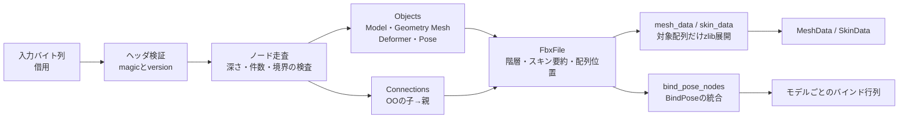

# FBX読み取り

## 担当責務

この文書は、Unityアバターに含まれるバイナリFBXのうち、VRM生成に必要な
メッシュ幾何・モデル階層・スキンの対応・バインドポーズ・材質スロットを読み取る層の設計を担当する。
Unity YAMLの読み取りとは入力形式も責務も異なるため、`unity` 層とは独立した
`fbx` モジュールとして置く。VRM生成・三角形化・座標系変換・重みの正規化は
この層の責務に含めない。

## 設計概要

読み取りは一度の走査と、メッシュ単位のオンデマンド展開に分ける。
入力バイト列は借用し、解析結果にはオブジェクト表・親子関係・配列の位置情報だけを残す。
頂点・法線・UVの配列は、呼び出し側が対象メッシュを要求した時点で展開する。
ファイル全体の幾何データを常駐させないためである。

解析時に配列の中身を常駐させず、絶対位置・要素数・圧縮方式だけを保持する。
面数の要約に必要な多角形索引だけは解析時に一時展開して数え、内容は保持しない。
`mesh_data` と `skin_data` は要求された対象の配列だけを境界検査付きで展開するため、
確保するメモリは対象の大きさに比例し、ファイル全体には比例しない。

## 読む範囲

- `Objects` の `Model` をすべて読み、ID・名前・種別・親子・所属メッシュを持つ。
- `Geometry` のうち `Mesh` を読み、頂点数・面数・属性レイヤの有無を要約する。
- メッシュ本体として `Vertices`・`PolygonVertexIndex`・先頭の `LayerElementNormal`・
  すべての `LayerElementUV`・先頭の `LayerElementMaterial` を読む。
- `LayerElement` の対応方式は `ByVertice`・`ByPolygonVertex`・`ByPolygon`・`AllSame` と
  `Direct`・`IndexToDirect` の組み合わせを受け付ける。材質は `AllSame` と `ByPolygon` だけを扱う。
- `Connections` は `OO` の子→親だけを読み、Modelの親子・Model→Geometryの所属・
  Skin→Geometry・Cluster→Skin・Model→Clusterの対応に使う。
- `Deformer` のうち `Skin` と `Cluster` を読み、スキンごとの結合モデルと、
  頂点索引・重みを持つクラスタを要約する。
- `Pose` のうち `BindPose` を読み、PoseNodeが指すモデルごとのバインド行列を統合する。
  複数のBindPoseに同じモデルが現れる場合は、行列が一致することを確かめて1つにまとめる。
- `Material` はIDと名前だけを読み、Modelへの接続順を材質スロットとして保持する。

`Shape`（ブレンドシェイプ）・クラスタの `Transform`/`TransformLink`・
BindPose以外のPose・材質の色やテクスチャ・シェーダはこの層では読まない。
材質の見た目はUnityの `.mat` を正とし、FBX側の材質は
「どの面がどのスロットか」を決める識別子としてだけ扱う。
ブレンドシェイプは別の作業単位で追加する。
`LayerElementColor`・接線・スムージングは読まない。

## 座標系・単位・変換

座標値と変換値はファイルに書かれた数値をそのまま返す。軸の向き
（`UpAxis` など）と `UnitScaleFactor` は値として返すだけで、変換はしない。
Unityのインポート時変換やVRMのY-upへの変換は生成側が担う。

Modelのローカル変換は `Lcl Translation`・`Lcl Rotation`・`Lcl Scaling` だけを読む。
回転はXYZ順の度数法のまま保持し、クォータニオンへの変換や合成はしない。
`PreRotation`・`RotationPivot`・`PostRotation`・`ScalingPivot`・`GeometricTranslation`
など、ローカルTRS以外の変換成分が現れた場合は、値を黙って落とすと誤った姿勢を
返すことになるため、そのファイルを明示的な非対応として失敗させる。
`InheritType` は値として保持し、合成規則の解釈は生成側に残す。

## 材質スロット

FBXの材質は、Modelに接続された順がスロット番号になる。`LayerElementMaterial` の
面ごとの値はこのスロット番号を指すため、読み取り層は材質のID・名前と接続順だけを返す。

色・テクスチャ・シェーダ設定は読まない。UnityではModelImporterの置換表によって
FBXの材質が `.mat` に差し替えられ、描画に使う値は `.mat` が正となる。
FBX側の材質値を別に解釈すると、どちらが正か決められない二重の状態になるためである。
材質名は、置換表の `first.name` とFBXの材質名を対応付けるために使う。

面の材質番号は、所有Modelのスロット数に対して範囲検査する。
スロットが1つも無い場合は0だけを受け付け、既定材質として扱えるようにする。

## スキンとバインドポーズ

クラスタの `Indexes` は変形対象Geometryの制御点番号であり、`Weights` と同じ長さを持つ。
重みは書かれた値をそのまま返し、正規化・負値の丸め・上限個数の切り捨てはしない。
実データには総和が1でない頂点や微小な負値が含まれるため、これらを補正すると
入力との対応が失われる。正規化と影響数の制限はVRM生成側の責務である。

クラスタは `Indexes`/`Weights` を持たない場合がある。結合モデルの一覧を保つため、
重みのないクラスタもスキンに含め、空の重みとして返す。

バインド行列は `PoseNode` の `Matrix` を16値の行優先（平行移動が12〜14番）で返す。
逆バインド行列の計算はしない。複数のBindPoseが同じモデルを含む場合は、
行列が一致することを検証して1つに統合する。一致しない場合は、どの姿勢を正とするか
読み取り層では決められないため不正として失敗する。

## 三角形化しない理由

`PolygonVertexIndex` は多角形の境界を負値で表す。この層は多角形のまま返し、
三角形化は行わない。fan三角形化は凹多角形で誤った面を作り、
耳切り法は読み取り層に収まらない判断を増やすためである。
実データには五角形も含まれるため、三角形化は面の品質を扱える生成側で行う。

## 失敗と上限

入力を信用せず、ヘッダ・オフセット・要素数・文字列長・圧縮後長をすべて境界検査する。
panicは使わず、失敗は種別付きのエラーで返す。

- バイナリ7.xのうち32bitレコードの版だけを受け付ける。ASCII FBX、暗号化された
  ファイル、未知のプロパティ型・配列encodingは非対応として失敗する。
- 名前はUTF-8として読み取れない場合に失敗する。損失置換で別の名前に変えない。
- ファイルサイズ・ノード数・ネスト深さ・文字列長・配列要素数（1件と合計）に上限を置く。
  上限は `FbxOptions` の `with_` で変更できる。
- オブジェクトIDの重複、親が複数あるModel、循環する親子、複数のModelに所属するGeometry、
  範囲外の頂点番号・属性番号は不正として失敗する。
- スキンが複数のGeometryに接続する場合、クラスタが複数のスキンや複数の結合モデルに
  接続する場合、1つのスキン内で結合モデルが重複する場合、クラスタ内で頂点索引が
  重複する場合は不正として失敗する。
- 面の材質番号が所有Modelのスロット数を超える場合、スロットが無いのに0以外を指す場合は
  不正として失敗する。
- クラスタの `Indexes` と `Weights` の長さ不一致、変形対象の頂点数を超える索引、
  バインド行列の要素数不一致、同じモデルに対する不一致なバインド行列は不正として失敗する。
- 座標と属性値の有限性を確認し、NaNや無限大は不正として失敗する。
- 重みの範囲（負値・1超）と総和は検査しない。実データに微小な負値と1でない総和があり、
  これらは破損ではなく入力の性質であるため、生成側が正規化する。

## 検証

合成したバイナリFBXで、ヘッダ・ノード境界・属性型・各対応方式・失敗条件を固定する。
実fixtureでは、BlenderのFBXインポート結果とメッシュごとの頂点数・面数・ループ数を
突き合わせ、独立した実装との一致を確認する。スキンは、スキンごとの結合モデル数・
重み付きクラスタ数・重み付き頂点数・重みの総和をBlenderの頂点グループと突き合わせる。
材質は、Modelごとのスロット名と、面の材質番号ごとの面数をBlenderの
マテリアルスロットと `material_index` に突き合わせる。
固定件数には依存させない。

## 外した選択肢

- 既存のFBXクレートは採用しない。`fbx_direct` は非推奨、`fbxcel` はC++バインディングで
  非推奨、その他の新規クレートは実績と保守性を確認できないためである。
- ASCII FBXは読まない。UnityのアバターはバイナリFBXで出力され、
  別形式の字句解析を追加する維持費が見合わない。
- FBX全体を汎用DOMとして公開しない。必要な情報はメッシュと階層に限られ、
  汎用ツリーを公開すると利用側の依存が形式の細部へ広がる。
- スキンとブレンドシェイプを同時に読まない。形状の合成は別の検証単位に分けたほうが、
  失敗の切り分けと検証が単純になる。クラスタのTransform/TransformLinkも読まず、
  バインド姿勢はBindPoseから取る。
- FBXの材質値を読まない。Unityの `.mat` が描画の正であり、FBX側の色やテクスチャを
  別に解釈すると、どちらを採用するかの判断が読み取り層へ漏れる。
- 座標系変換・単位変換・三角形化は行わない。VRM生成側の判断であり、
  読み取り層で行うと生値との対応が失われる。

## 保証しないこと

- 読み取り中の入力変更に対するスナップショット保証はしない。
- エラーの文言や `source` の具体型は契約にしない。
- FBXの全仕様を再現しない。未対応の要素は失敗または未読として扱い、
  未対応であることを黙って補正しない。
- 読み取った値の意味的な妥当性（面の向き・UVの範囲・材質番号の実在・
  重みの総和や範囲）は保証しない。参照範囲の検査までを行う。
- クラスタの `Transform`/`TransformLink` と、BindPose以外のPoseは返さない。
- FBXの材質の色・テクスチャ・シェーダ設定は返さない。材質の識別子とスロット順だけを返す。
- 巨大な入力に対する時間の上限は設けない。資源上限は量だけを抑える。
