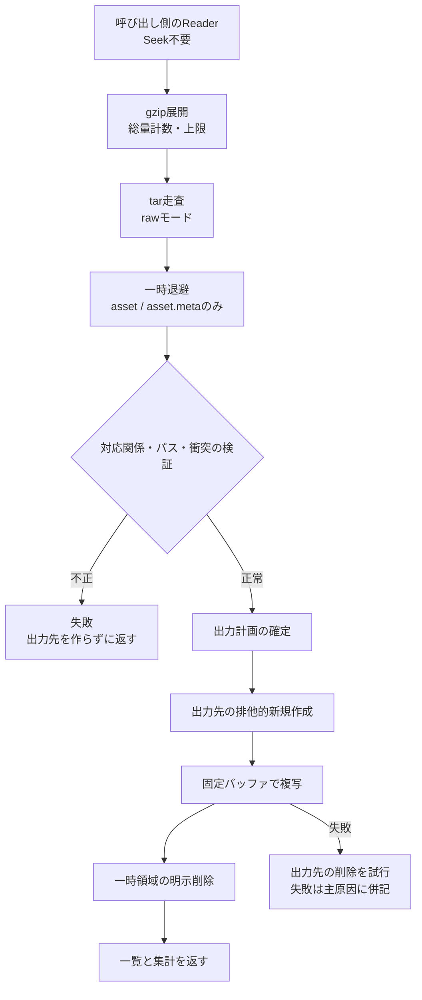
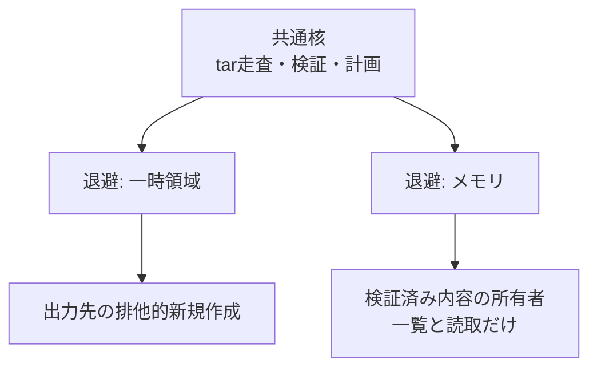

# UnityPackage展開

## 担当責務

この文書は、gzip圧縮tar形式のUnityPackageを読み、内容を検証してから
ユーザー指定先へ展開する設計を担当する。変換処理の前段として、
アーカイブ由来のバイト列を安全な出力計画へ変換することが役割になる。

## 設計概要

公開するのは二つの入口と、資源上限・結果・失敗の小さな型である。
`unpack_to` はユーザー指定先へ展開し、一覧と集計を返す。
`unpack_in_memory` は検証済み内容の所有者を返し、一覧と読取だけを提供する。
どちらもtar走査・検証・計画の共通核を使い、退避先だけが違う
（一時領域とメモリ）。アーカイブ全体を保持する `Package` 型や公開
イテレータは作らず、呼び出し側が求める展開結果の配置とその根拠だけを返す。
展開途中の巨大な中間表現は外へ出さない。

処理は読み取り・退避・検証・出力の順に一段ずつ進める。
nativeは全エントリの対応付けが終わるまで出力先を作らず、
壊れた入力が既存の配置を汚さないようにする。
メモリ退避には出力先が無いため、代わりに全件の検証が終わるまで
成功したパッケージとして公開しない。検証の順序と公開の条件は
退避先によらず同じである。
詳しくは [Web向けのメモリ展開](#web向けのメモリ展開) を参照。

tarの走査は `raw(true)` で拡張解決を無効化し、
各エントリの本来の種別で受け付ける。
通常のファイル形式では拡張が透過的に解決されてしまい、
拒否すべき型が見えなくなるためだ。

## Web向けのメモリ展開

対話的Webアプリの要求により、メモリ展開も扱う。
ブラウザ内で `.unitypackage` を受けて変換するには、
展開自体をターゲット非依存にする必要がある。
Web側の全体像は [`Webアプリ`](Webアプリ.md) に譲る。

tar走査・種別検査・上限・対応付け・パスと衝突の検証・計画は
ターゲット非依存の共通核へ切り出し、退避先だけを差し替える。
nativeは一時領域へ退避し、webはメモリへ退避する。
`workspace` はどちらの退避にも使わない。
退避の置き場が変わっても、検証の順序と公開の条件は変えない。

メモリ側の公開は検証済み内容の所有者に絞り、
一覧と読取だけを提供する。可変な写像や未検証の項目は公開しない。
nativeの排他的作成・後始末・残存報告はnative契約として残し、
緩めない。

## workspaceを使わない理由

展開の一時退避と最終出力はどちらもファイルシステム上に置くが、
責務としては別物である。退避は所有権が明確な一時領域の使い捨てであり、
出力は呼び出し側が指定した場所への配置である。
`workspace` は変換中の中間データの隔離と後始末を担う公開型であり、
最終出力先の決定や排他的作成までは責務に含めない。
そのため展開は `tempfile::TempDir` を出力先の親に直接作り、
`workspace` を経由しない。これは手順の迂回ではなく責務の分離である。

## パス安全の方針

層を分けて、どの層でも補正や正規化をしない。
不正はその層で拒否し、次の層へ進めない。

- tar構造の層では、GUID形式と固定のメンバー名だけを受け付ける。
- 出力パスの層では、`workspace` の検証を内部で再利用する。
- 先頭成分の層では、大文字小文字を問わず `Assets` 始まりだけを受け付ける。
- 計画の層では、出力先同士の重なりを大小文字の違いも含めて衝突とする。
- 作成の層では、出力先を排他的に新規作成し、計画内の重複作成を成功扱いにしない。

呼び出し側指定の親は解決して基準点に固定し、
アーカイブ由来パスで基準点の外へ出さない。

## 保証しないこと

- 出力ディレクトリ全体の不可分な公開は保証しない。
- `asset` を持たない正常フォルダと `asset` の欠けた壊れたファイルは、
  構造だけでは区別できない。`asset.meta` の意味解析や
  meta内GUIDとの照合も行わない。
- パーミッションや時刻の復元はしない。
- エラーの文言や `source` の具体型は契約にしない。
- 診断の表示形式は保証しない。外部由来の文字列を含む診断は
  可視エスケープして表示するが、その書式自体は契約にしない。
- 巨大な入力に対する時間の上限は設けない。資源上限は量だけを抑える。

## 外した選択肢

- nativeの展開結果を保持する `Package` 型は作らない。
  退避内容をメモリに載せたままとどめると使用量が内容サイズに比例するため、
  nativeは一時領域へ退避し、一覧と集計だけを返す。
  メモリ展開の所有者はWebの入力受付に要るものに絞り、汎用の保持器にしない。
  詳しくは [Web向けのメモリ展開](#web向けのメモリ展開) を参照。
- 公開イテレータは作らない。順序不定のtarをそのまま外へ出すより、
  検証済みの一覧を返すほうが呼び出し側の扱いが単純になる。
- 汎用アーカイブ抽象や汎用ファイルシステム抽象は作らない。
  要求はUnityPackageの展開だけであり、抽象の維持費が見合わない。
- `tar::Archive::unpack` は使わない。権限復元やシンボリックリンクの
  追従など、展開契約に含めない動作を持ち込むためである。
- Webのファイル出力展開は作らない。nativeの `unpack_to` 契約は不変とし、
  webは出力先を持たないメモリ内方式に絞る。
  実行時非対応のダミーは置かない。
- CLIに上書き・マージ・強制・一覧・進捗表示は付けない。
  契約は「不存在の出力先へ一度だけ展開する」に絞る。
