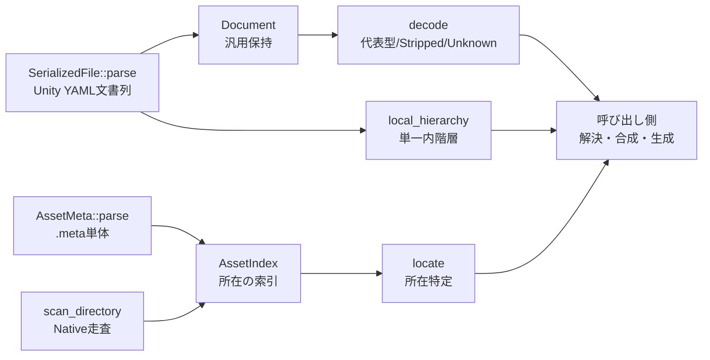

# Unityデータモデル

## 担当責務

この文書は、Unityの保存データ（展開済み配置の `.meta` と prefab・`.mat` などの
Unity YAML）を、参照関係を壊さず読み取る層の設計を担当する。
VRM生成に必要な前段として、索引付け・文書の汎用読み取り・代表型の型付き読み取り・
単一ファイル内の階層組み立てまでを受け持つ。

## 設計概要

読み取りは三つの入口に分ける。配置の索引（`AssetIndex`）、meta単体の読み取り
（`AssetMeta`）、文書列の読み取り（`SerializedFile` と `Document`）である。
型付き読み取りは文書単位の `decode` で行い、結果は代表型か `Stripped` か
`Unknown` のいずれかになる。索引は所在だけを答え、本体の読み込みや再帰的な
解決はしない。呼び出し側が本文を読む段階で参照を辿る。

## YAMLの扱い

YAMLの一般構文は `yaml_serde` に任せ、この層はUnity独自のファイル枠だけを扱う。
先頭directiveの検証と列0の `--- !u!` 行での文書分割までを行い、
本文は変更せず文書単位で渡す。独自のインデント解析やflow mappingパーサは持たない。
行全体の `trim()` では区切り判定せず、列0の完全なヘッダ形式だけを区切りとする。
block scalar内の `---` 風文字列との誤認を避けるためである。

64bitに収まらない整数スカラーは、桁を失わないよう10進文字列として保持する
読み替えを使う。Unity送出に現れる巨大な10進整数で文書全体の読み取りを
失敗させないためであり、構文解釈自体は変えない。
数値化で復元できないGUIDは黙って壊さず失敗にする。

## 索引と参照解決

索引の正は `.meta` であり、本体の一括読み込み・自動キャッシュ・再帰ロードはしない。
参照は `fileID` が `0` の場合にnullとして優先し、`type` は解決に使わない目安とする。
GUIDの省略は同一ファイル内を指し、索引にある参照元自身として返す。
索引にないGUIDは欠落と組み込み資産を区別せず外部として返し、未供給を失敗条件にしない。
重複（GUID・パス・大小文字のみ異なるパス）は後勝ちにせず拒否する。
大小文字の判定キーはUnicodeの小文字化で作り、過剰に衝突させる側（安全側）に倒す。

## 型付き読み取り

`Material` の代表型は `m_SavedProperties` の4一覧（`m_TexEnvs`・`m_Floats`・
`m_Ints`・`m_Colors`）を持つ。いずれの一覧も、項目を持たない場合は欄ごと
書かない材質がある（lilToonなど）ため、欠落とnullは空として読む。
欠落と空は同じ意味（項目ゼロ）であり、別物に読み替えない。
存在する欄の形状違い（シーケンスでない・項目の形状違い）は従来どおり失敗にする。

## 今回やらないことと理由

- `workspace` は使わない。変換中の中間データの隔離と後始末が責務であり、
  読み取り層の索引や文書保持とは別物であるため、汎用FS抽象やloaderも作らない。
- FBX解析はしない。メッシュの実体解決はVRM生成側の責務であり、
  読み取り層はModelImporter設定と置換表の保持までに留める。
- prefab合成はしない。`stripped` や `PrefabInstance` を含む場合の階層組み立ては
  明示的な非対応として失敗し、部分木を完全な階層として返さない。
- 画像デコードはしない。画像サイズ取得のためだけの依存追加もしない。
- スクリプト実行はしない。`MonoBehaviour` の独自欄は汎用データのまま残す。

## 保証しないこと

- 読み取り中の入力変更に対するスナップショット保証はしない。
- エラーの文言や `source` の具体型は契約にしない。
- 未知クラス・未知importer・未供給GUIDはそれだけではエラーにしない。
- 巨大な入力に対する時間の上限は設けない。資源上限は量だけを抑える。
- 数値として解決されたGUIDは文字列化して受理しない。引用符なしの全数字32桁や
  `1e` 形など、YAMLの数値と解釈され得る字面のGUIDは拒否する。
  一般的な英字を含む32桁hexは文字列として解決されるため、通常のUnity GUIDは対象外である。
  数値解決された字面では精度を失うより拒否を選ぶ。
- 階層の深さに既定の上限（100,000、rootを0とする辺の数）を設ける。
  組み立て自体は反復処理であり深さでstackを使わないため、上限は暴走への歯止めである。
  超過は `LimitExceeded` になる。
- `Document::raw` に現れるタグ付き値（例 `!vrctom:bignum`）は実装詳細であり、
  安定した公開表現として保証しない。タグ名や値の形に依存してはならない。

## 外した選択肢

- `serde_yaml` 系の代替への切り替えは行わない。`yaml_serde` のAPIで
  要求（重複キー拒否・位置情報・汎用値）を満たせるためである。
- 独自のYAML字句解析による巨大整数の事前引用は行わない。
  block scalar内の内容を壊す危険があり、serdeの読み替えで足りるためである。
- GUIDの数値化（精度・桁落ちを伴う復元）は行わない。復元不能は失敗にする。
- 写像への潰し込みによる順序・重複の喪失は行わない。
  マテリアルの一覧は順序付き列のまま保つ。
- 全Unityクラスの再現は行わない。代表型以外は `Unknown` として扱い、
  元データを残すことで将来の拡張点を塞がない。
