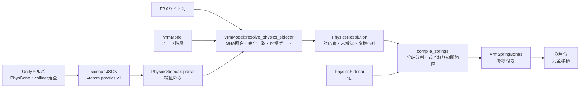
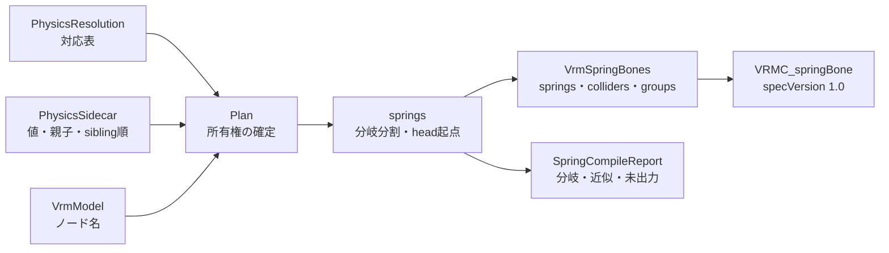

# VRMスプリング

## 担当責務

この文書は、Unityヘルパが出力する物理sidecar（JSON）を読み、
参照解決と座標検証、スプリングの最小出力を行う設計を担当する。
sidecarの目的・スキーマ・IDとパスの規則・完全一致の対応付け・
座標ゲート・上限と失敗条件・出力範囲と制限を持つ。
完全な参照実装一致（endpoint・平均tail）・
拘束の解釈・FX既定姿勢の評価は担当しない。
関節値は参照実装の式どおりに求め、Unity出力と突き合わせる。

中間表現は [`VRM中間モデル`](VRM中間モデル.md) が持ち、
GLBへの書き出しは [`VRM書き出し`](VRM書き出し.md) が行う。
この文書は参照解決と最小出力の判断をまとめる。

## 設計概要

sidecarはUnityにしか無い情報（PhysBoneの付属・連鎖・collider参照・
参照姿勢のローカルTRS）を運ぶ。Rust側はFBX由来の `VrmModel` と突き合わせ、
名前の推測をせずに厳密に対応付ける。推測で軸や単位を決めない。

## sidecarのスキーマ

`format` は `vrctom.physics`、`schemaVersion` は `1` である。
`generator` は出力元の名残、`capture` は取得時の条件、
`sourceModels` は参照元のFBX、`nodes`・`physBones`・`colliders` は
参照対象、`unsupportedFeatures` は未対応機能の名残である。

`Curve` の `keys` は時刻・値・傾き・重みの組を持つ。空の場合は
`value` を使う。`weightedMode` が0以外・未知のwrap値は明示的に失敗し、
近似しない。

列挙は文字列で受け、未知値は失敗する。

| 項目 | 値 |
|---|---|
| `integrationType` | `Simplified`・`Advanced` |
| `multiChildType` | `Ignore`・`First`・`Average` |
| `immobileType` | `AllMotion`・`World` |
| `limitType` | `None`・`Angle`・`Hinge`・`Polar` |
| `shapeType` | `Sphere`・`Capsule`・`Plane` |
| 制約 `type` | `Rotation`・`Position`・`Scale`・`Parent`・`Aim`・`LookAt` |

`constraints[]` は Unity ヘルパが出力する VRChat・Unity 由来の制約列である。
`{id, nodeId, targetNodeId, type, family, weight, enabled, active,
freezeToWorld, affectsRotation[3], aimAxis[3], sources[{nodeId, external, weight}]}` の
形式であり、ID は `vc:`・`uc:` 接頭辞の決定的な値である。
VRChat に bound された Unity 制約は二重に出さない。実 fixture では11件が出て、
回転3軸は回転、1軸はひねりとして8件を写し、複数参照（blend）2件と親付け1件を落とす。

`source` はFBX由来ノードだけが持つ。`path` はFBXルートからの名前列である。
シーン追加ノード（`Ground`・`Cardigan_Con` など）は `source: null` である。
`unsupportedFeatures` は `stretch`・`external-colliders`・`plane-colliders`
などの文字列を運ぶだけで、今回は検証しない。

## IDとパスの規則

IDは `n:`・`pb:`・`c:` の接頭辞を持ち、sidecar全体で一意である。
接頭辞違いの混同を避けるため、種類をまたいだ重複も拒否する。

ノードの結び付きは `parentId` で表す。循環した親子は失敗する。

対応付けの鍵は `source.path`（FBXルートからの名前列）であり、
`scenePath`（シーンルートからの名前列）は診断用である。
`VrmModel` 側はルートからの名前列を索引化し、`source.path` と
完全一致した場合だけ対応付ける。接尾辞一致・一意名の自動補完はしない。
診断用に候補を返すことはあるが、対応の決定には使わない。

## 対応解決

`VrmModel::resolve_physics_sidecar` は次の順で進める。

1. `capture.statePolicy` が `bind-pose` または `edit-mode` であることを確かめる。
   変換にはFBXのbind姿勢と一致する `bind-pose` を推奨する。
   それ以外は今回未対応として失敗する。
2. FBXバイト列のSHA-256を求め、`sourceModels` と照合する。
   一致がちょうど1件でない場合は失敗する。
3. 完全一致で対応付ける。0件・複数件・出所なしの参照は失敗する。
4. `source: null` のノードは、参照されていなければ未解決報告に残して続ける。
   平面colliderだけが参照するシーン専用ノードは、コンパイル時に補助ノードとして追加する。
   それ以外の参照は次単位の補助ノード生成が必要なため、明示的に失敗する。
   名前で近似しない。
5. PhysBone・colliderの参照IDを対応表で引き、存在と一意性を確かめる。
   平面colliderは解決時点では出力対象外として除外し、`PhysicsResolution` に報告する。
   コンパイル側ではsidecarから直接出力するため、出力物には含まれる。
6. 座標ゲートで単一の変換行列を確かめ、`PhysicsResolution` に保持する。

`PhysicsResolution` はsidecarノードIDからVrmノード索引への対応表・
未解決の追加ノード・PhysBoneとcolliderの参照・座標変換行列を持つ。
[`compile_springs`] が最小出力に使う。

## 座標ゲート

sidecarの参照ローカルTRSから参照世界行列を、
`VrmModel` の `root` とローカル行列から出力世界行列を組み立てる。
sidecarの `capture.coordinateSpace` はUnityの左手系
（`unity-avatar-root-local-meters`）であるため、参照世界をVRMの右手系へ
変換してから比較する。変換は位置のX反転とクォータニオンの
`(x, -y, -z, w)` であり、階層のローカルにも同じ変換を適用する。

対応する物理参照ノードで `model_world * inverse(converted_sidecar_world)` が
単一の行列に一致するか確かめる。許容差はsidecarがf32由来であることを考慮して
`1e-4` とし、軸や単位を推測しない。一致しない場合は理由付きで失敗する。

対象はPhysBoneのroot・ignoreとcolliderのrootとして参照されるノードだけである。
メッシュ所有ノードは頂点ベイクで切り離されるため対象外とする。
基準ノードはsidecar索引順に固定し、HashMapの反復順に依存させない。

## 上限と失敗条件

件数（ノード・PhysBone・collider・カーブキー総数・JSONバイト数）に上限を置き、
上限の変更は `with_` で始まるメソッドで行う。確保する前に検査する。

失敗条件は次のとおりである。

- JSONの構文破損・書式名や版の不一致・未知の列挙値やwrap。
- 欠落ID・重複ID・親子の不整合・循環。
- 非有限値・範囲外（負の半径・正でないルート拡大率・正規化されていない回転など）。
- 未知の重み付きカーブ。
- SHA-256の不一致・複数一致。
- 対応の0件・複数件・参照されるシーン追加ノード。
- 座標ゲートの不一致。
- `bind-pose`・`edit-mode` 以外の参照姿勢。

## 保証しないこと

- スプリングチェーンの完全なコンパイルはしない。出力するのは分岐分割した鎖と
  参照実装の式による関節値・角度制限・平面collider（補助ノード付き）であり、
  制限は [`VRMスプリング`](#出力範囲と制限) に残す。
  endpoint・平均tailの出力は次の作業単位である。
- シーン追加ノードの補助生成は、平面colliderの基準ノードに限る。
  それ以外の参照があれば保留として失敗する。
- 拘束・FX既定姿勢・animated・stretch系の評価はしない。
- 推測での軸決定・単位決定・名前近似はしない。

## 出力範囲と制限

`compile_springs` はPhysBoneごとに木を作り、分岐を分割してspring列を作る。
sidecarノードを `parentId` と `siblingIndex` 順に辿る深さ優先探索であり、
VrmModel（FBX）の子順は使わない。`ignore_nodes` の部分木を除き、
`ignoreOtherPhysBones` が真の場合だけ他のPhysBoneのrootの部分木を除く。
分岐のAimは `multiChildType` で決める。
所有権は解決順（sidecarのcapture順）に確定し、ノードは最初のPlanが所有する。
avatar rootは所有せず、jointにもしない。rootの子からspringを開始する。
springは所有しAimし、長さを持つ骨のうち、親が無い・親が所有外・
親が自分をAimしていない・親との区間が長さ0のいずれかであるものを
headとして始め、所有するAim先を辿る。端末の骨も関節に含み、親子連鎖を保つ。
長さの無い骨はheadにならず、前springの端末として終わり、
そのAim先が次のspringを始める。
jointにできない未解決ノードが混ざる鎖は落とし、飛ばして接続はしない。
endpoint生成・平均tail生成・ゼロ長分割はしない。
角度制限（`VRMC_springBone_limit`）はhead関節に出す。
centerは付ける。`HoldsImmobile` はcenterなしの鎖の引きの強さに織り込む。
近似と切り捨ては [`SpringCompileReport`] に残し、CLIのstderrにも主要な件数を出す。

分岐の扱いは次のとおりである。

- 子1件または `First` は最初の子をAimする。
- `Ignore` で子が複数の場合はAimなしとし、そのboneでspringを終了する。
  各子は新しいspringのheadになり得る。
- `Average` は今回は最初の子に畳み、近似として記録する。平均tail生成は次段階である。

パラメータは参照実装の式どおりに求める。末端は直前headの値を写す。

- 曲線は `value × curve(t)` で評価する（キーが無ければ `value`）。
  Hermite補間（傾き×区間幅）とwrap（0/1/2/4/8）を使い、重み付きは拒否する。
  頭側はchain depth位置 `T`、半径は1手先の `RadiusT` で評価する。
  endpointは作らないため、末端なしのまま `T = depth/(maxDepth-1)`、
  `RadiusT = depth/maxDepth` を使う。
- `stiffness`・`drag_force`・`gravity_power`・`hit_radius` は
  Advanced/Simplified・版1.0/1.1・falloff・制限・HoldsImmobileを織り込んだ
  参照実装の式で求める。骨長はUnity空間の世界行列×aim位置の長さであり、
  不明時は較正長を使う。重力方向は符号だけで決まる単位ベクトルである。
- 制限角は `EffectiveLimitAngle`（36方向の冪平均）で求め、
  `HeldRatio`・`LooseFloor` で引きを強める。倍精度で求めた数学的に正しい値を
  そのまま使い、単精度化は行わない。
  計算にはlimit入力（種別・最大角・制限回転・カーブ）を必ず使う。
- 角度制限は `JointLimit` 相当をhead関節に付け、`VRMC_springBone_limit` として出す。
  種別は Angle→Cone、Hinge→Hinge、Polar→Sphericalであり、
  角度は `min(maxAngleX, 180°)`（yawは `min(maxAngleZ, 90°)`）をラジアンで持つ。
  回転はUnity空間の `limit_frame` をVRM空間へ鏡像した単位四元数である。
  rest不明・制限なしの場合は付けず、末端（springの末尾）にも付けない。
  参照実装のTailはlimitを消すことに対応する。
  UniVRMの `LimitSpaceOffset`（軸合わせのオフセット）・`StraightDownMargin` による除外・
  `OmittedLimits` 報告は未対応であり、その他のlimit拡張も出さない。
- `HoldsImmobile`（centerなしの部分immobile）はhead位置のimmobile値を
  `held` として引きに織り込む。centerあり・未使用の場合は0である。
- Unity出力との突き合わせでは、drag・gravity・hitRadius・重力方向は完全一致する。
  sidecarに`limitRotationX/Y/ZCurve`が無い状態ではstiffness 111/148件（75%）、
  全体703/740件（95.0%）であった。Unityスナップショットのカーブ値をsidecarへ補うと
  **stiffness 139/148件（93.9%）、全体731/740件（98.8%）**まで改善する。
  この補完はUnityヘルパのカーブ出力（`limitRotationX/Y/ZCurve`）で行う。
- 残る9件（Cardigan_1.L/R、Cardigan_3.R、Spine_Ribbon_4）はいずれもPolar制限で、
  こちらが0.1〜0.8%だけ高い。単精度36方向ループ（`Mathf`・`Vector3`・`Quaternion`と
  同じ順序）で再計算しても同じ9件のままで改善しないため、f32版は破棄して
  倍精度一本に戻した。一致方向試行のacos特異性による丸めのくじ引きと見込む。
  許容差を広げて合わせることはしない。
  Cardigan_1.L/RのUnity値が8桁完全一致なのに自前は4桁目で相違する点や、
  Cardigan_3.L一致/R不一致のL/R非対称、JointLimitクォータニオンの一般経路確認、
  スナップショットとsidecarの位置差最大5.5e-7・全スカラー設定一致と合わせると、
  系統的な式誤りでは説明できない。詳細は試験の報告に残す。
- `center` は次の規則で付ける。付けなかったspringは理由別に記録する。
  - 各PhysBoneのimmobileは `value × curve(t)` で評価する（キーが無ければ `value`）。
    Tは木の深さ位置（端末が無い鎖は0）である。
  - `HoldsImmobile`（AllMotionかつ部分的なimmobile）の場合はcenterを付けない。
    代わりにhead位置のimmobile値を引きの強さに織り込む。
    該当PhysBoneを記録する。
  - Worldかつchain rootの値が0.5未満の場合はcenterを付けない。該当PhysBoneを記録する。
  - 候補はAllMotionではchain rootの親、Worldでは鎖の最上位祖先である。
    実アバタールート（Milfyのようにsidecarに含まれない）は辿れないため、
    sidecarの最上位（例：Armature）が候補になる。
  - springごとに候補から上へ辿り、
    先頭jointの祖先または自身であり、他のspringの先頭jointの部分木に
    入っていない最初のノードをcenterにする。未解決ノードは飛ばして親へ進む。
    見つからなければcenterなしとして記録する。
  - centerは実アバタールートにしない（sidecarに無いため辿りは届かない）。
- endpointは付けない。付けなかったspringを記録する。
- `multiChildType` が `Ignore` 以外でも最初の子に畳み、該当springを記録する。
- colliderはsphere/capsuleと平面（拡張付き）を出す。`Sphere` は高さを無視して必ず球にし、
  `Capsule` は回転した+Y軸の両端から `height/2 - radius` を詰め、
  縮退は球にする。平面は `VRMC_springBone_extended_collider` として出し、
  baseは `offset - normal*1000` 中心・半径1000の球、拡張の平面は同じ法線とずれを持つ。
  平面の基準ノードはシーン専用のため、sidecarの `referenceLocal` をVRM右手系へ換算した
  補助ノード（親なしのroot、名前はsidecar名）を末尾に追加する。既存索引は維持し、
  失敗時は追加しない。同じ基準ノードの平面は1件にまとめる。
  `insideBounds`・`bonesAsSpheres` は記録だけで、形状には織り込まない。
- 姿勢と出力ノードはroot基準である。`position`・`rotation` はroot-localの値であり、
  componentは追従対象の識別に使うが、値の座標換算には使わない。
  Unity左手系からVRM右手系への鏡像（X反転・四元数のY/Z反転）だけを適用する。
- グループはPhysBoneの参照集合ごとに作り、同じ集合は順序や重複によらず共有する。
  平面も参照集合に含める。参照されないcolliderは出さないが、
  未使用の平面はcolliderだけ出す（グループには入らない）。
- ノード制約は `VRMC_node_constraint` として出す。sidecar順に処理し、
  対象・参照先を対応表で解決する。回転3軸は回転、1軸はその軸のひねり、
  2軸・複数参照（blend）・親付け・外部参照・負の重み・ワールド固定・
  無効な対象と参照は出力せず、落としたIDを記録する。注視は3軸かつ主軸の
  場合だけ写し、注視は+Z軸として写す。非主軸・0軸の注視は出力しない。
  同じ対象の2件目以降は最初だけ残す。重みは全体重みに注視の場合だけ
  参照重みを掛け、0〜1に丸める。FX既定値の上書き・1e-6未満の参照重みの
  抑止・spring関節やアバタールートの除外・循環の検出は未対応であり、
  実fixtureのデータでは発動しない。親付けのリペアレントも対象外である。
- 空配列は書式違反（`minItems: 1`）のため、空のルート配列と空の
  spring内 `colliderGroups` は省略する。springが空の場合も拡張自体を付けない。

## 外した選択肢

- 接尾辞一致での自動対応はしない。左右同名の取り違えを型や検査で防げないため、
  完全一致に絞る。
- 未知のwrapや重み付きカーブの近似はしない。解釈のずれが物理全体に広がるため、
  明示的な失敗にする。
- 対応表の鍵に `scenePath` は使わない。シーンルート名はUnity側の都合で変わるため、
  FBX由来の `source.path` を正とする。
