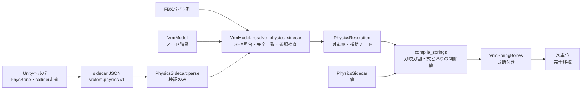
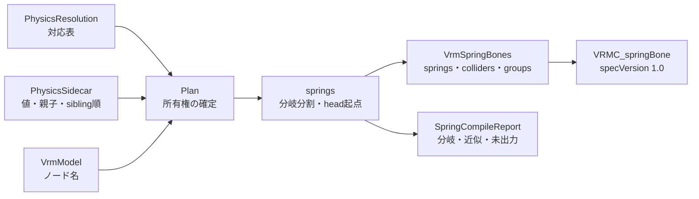

# VRMスプリング

## 担当責務

この文書は、Unityヘルパが出力する物理sidecar（JSON）を読み、
参照解決と参照検査、スプリングの最小出力を行う設計を担当する。
sidecarの目的・スキーマ・IDとパスの規則・完全一致の対応付け・
参照検査・上限と失敗条件・出力範囲と制限を持つ。
完全な参照実装一致（endpoint・平均tail）・
拘束の解釈・FX既定姿勢の評価は担当しない。
関節値は参照実装の式どおりに求め、Unity出力と突き合わせる。

中間表現は [`VRM中間モデル`](VRM中間モデル.md) が持ち、
GLBへの書き出しは [`VRM書き出し`](VRM書き出し.md) が行う。
この文書は参照解決と最小出力の判断をまとめる。

## 設計概要

sidecarはUnityにしか無い情報（PhysBoneの付属・連鎖・collider参照・
参照姿勢のローカルTRS）を運ぶ。Rust側はFBX由来の `VrmModel` と突き合わせ、
名前の推測をせずに厳密に対応付ける。推測で軸や単位を決めない。

## sidecarのスキーマ

`format` は `vrctom.physics`、`schemaVersion` は `1` である。
`generator` は出力元の名残、`capture` は取得時の条件、
`sourceModels` は参照元のFBX、`nodes`・`physBones`・`colliders` は
参照対象、`unsupportedFeatures` は未対応機能の名残である。

`Curve` の `keys` は時刻・値・傾き・重みの組を持つ。空の場合は
`value` を使う。`weightedMode` が0以外・未知のwrap値は明示的に失敗し、
近似しない。

列挙は文字列で受け、未知値は失敗する。

| 項目 | 値 |
|---|---|
| `integrationType` | `Simplified`・`Advanced` |
| `multiChildType` | `Ignore`・`First`・`Average` |
| `immobileType` | `AllMotion`・`World` |
| `limitType` | `None`・`Angle`・`Hinge`・`Polar` |
| `shapeType` | `Sphere`・`Capsule`・`Plane` |
| 制約 `type` | `Rotation`・`Position`・`Scale`・`Parent`・`Aim`・`LookAt` |

`constraints[]` は Unity ヘルパが出力する VRChat・Unity 由来の制約列である。
`{id, nodeId, targetNodeId, type, family, weight, enabled, active,
freezeToWorld, affectsRotation[3], aimAxis[3], sources[{nodeId, external, weight}]}` の
形式であり、ID は `vc:`・`uc:` 接頭辞の決定的な値である。
VRChat に bound された Unity 制約は二重に出さない。実 fixture では11件が出て、
回転3軸は回転、1軸はひねりとして8件を写し、複数参照（blend）2件と親付け1件を落とす。

`source` はFBX由来ノードだけが持つ。`path` はFBXルートからの名前列である。
シーン追加ノード（`Ground`・`Cardigan_Con` など）は `source: null` である。
`unsupportedFeatures` は `stretch`・`external-colliders`・`plane-colliders`
などの文字列を運ぶだけで、今回は検証しない。

`humanoid` は humanoid の T-pose 記録であり、無い旧形式の sidecar は
後方互換で扱う（Rust 側は何もしない）。`{isHuman, bones[{bone, nodeId, tPose}]}` の
形式であり、`bone` は Unity の `HumanBodyBones` 名、`nodeId` はノードと同じ
`n:N` のID体系である。`tPose` は `{position[3], rotation[4], scale[3]}` であり、
参照実装の capture と同じく `avatar.humanDescription.skeleton` を Transform 名で
引いた humanoid の T-pose（capture 時の姿勢ではない）を持つ。
出所は skeleton のローカルTRSであり、回転の差分δ
（`inverse(reference_local) * tPose`）だけを
[`apply_humanoid_t_pose`](VRM書き出し.md) で各骨に右から掛ける
（位置・拡大率は適用しない）。参照実装の置換と同じ姿勢変化になるが、
こちらは `Armature` の -90度X を根元に焼き込まないため、置換ではなく
差分適用でフレーム差を吸収する。
`skeleton` に無い骨は `tPose` を省き（JSON では `null`）、Rust 側はその骨を
上書きせず飛ばして記録する。Rust 側は骨名とノード参照の存在、T-pose の
位置・拡大率の有限値、回転の有限値と非ゼロを検査し、正規化と重複ノードの
検出は適用時に行う。適用時は参照姿勢の回転も有限値・非ゼロか確かめる。

## IDとパスの規則

IDは `n:`・`pb:`・`c:` の接頭辞を持ち、sidecar全体で一意である。
接頭辞違いの混同を避けるため、種類をまたいだ重複も拒否する。

ノードの結び付きは `parentId` で表す。循環した親子は失敗する。

対応付けの鍵は `source.path`（FBXルートからの名前列）であり、
`scenePath`（シーンルートからの名前列）は診断用である。
`VrmModel` 側はルートからの名前列を索引化し、`source.path` と
完全一致した場合だけ対応付ける。接尾辞一致・一意名の自動補完はしない。
診断用に候補を返すことはあるが、対応の決定には使わない。

## 対応解決

`VrmModel::resolve_physics_sidecar` は次の順で進める。
`VrmModel` を可変で受け取り、補助ノードの追加で更新する。

1. `capture.statePolicy` が `bind-pose` または `edit-mode` であることを確かめる。
   変換にはFBXのbind姿勢と一致する `bind-pose` を推奨する。
   それ以外は今回未対応として失敗する。
2. FBXバイト列のSHA-256を求め、`sourceModels` と照合する。
   一致がちょうど1件でない場合は失敗する。
3. 完全一致で対応付ける。0件・複数件の対応は失敗する。
   `source.path` が別モデル向きの場合は照合対象外であり、後段で検出する。
4. sidecarにあって `VrmModel` に無いノードは、Transformのみの補助ノードとして
   `VrmModel` の末尾に追加し、対応表に含める（sidecar順）。
   Prefabで追加されたオブジェクト（シーン追加ノード）がスプリング・コライダー・
   制約から参照される場合に必要になる。親子・名前・ローカル変換
   （`referenceLocal` のVRM右手系換算）・兄弟順はsidecarの値を用いる。
   追加ノードはmeshを持たず、skin・humanoidの写像は変えない。
   追加した件数と名前は `PhysicsResolution::auxiliary_nodes` に残し、
   CLIの標準エラーにも出す（例：`物理: 補助ノード5件を追加`）。
   平面colliderだけに参照されるノードは、平面経路が基準ノードを直接合成するため
   対象外にする（重複を避ける）。名前で近似しない。
   決定性はsidecar順で保つ。重複IDは検証済みのため起きず、
   循環は検証で拒否済み、親不在はここで失敗する。
5. PhysBone・colliderの参照IDを対応表で引き、存在と一意性を確かめる。
   平面colliderは解決時点では出力対象外として除外し、`PhysicsResolution` に報告する。
   コンパイル側ではsidecarから直接出力するため、出力物には含まれる。
6. 参照ローカルの一致で対応表を検証する。詳細は [`参照検査`](#参照検査) を見る。

`PhysicsResolution` はsidecarノードIDからVrmノード索引への対応表・
追加した補助ノード・PhysBoneとcolliderの参照を持つ。
[`compile_springs`] が最小出力に使う。

対応解決の後、スプリングの生成より前に [`apply_humanoid_t_pose`](VRM書き出し.md)
で humanoid の rest 姿勢（参照姿勢からの差分δ）を各骨のローカル回転に右から掛ける。
無い骨はノードの姿勢のまま残す。参照実装もリグ構築直後に T-pose を当ててから
物理を解決するため、同じ順序にする。

## 参照検査

sidecarの参照ローカルTRSから参照世界行列を、
`VrmModel` の `root` とローカル行列から出力世界行列を組み立てる。
sidecarの `capture.coordinateSpace` はUnityの左手系
（`unity-avatar-root-local-meters`）であるため、参照世界をVRMの右手系へ
変換してから比較する。変換は位置のX反転とクォータニオンの
`(x, -y, -z, w)` であり、階層のローカルにも同じ変換を適用する。

物理が実際に参照するノードごと（PhysBoneのcomponent・root・ignoreと
colliderのcomponent・root）に世界行列を比べる。
線形部（3x3）はモデルルートの一様な単位換算で割って正規化し、
平行移動はメートルのまま比べる。w行は両方 `[0, 0, 0, 1]` のため除く。
許容差は `5e-3` とし、平行移動（メートル）と線形部（無次元）を同じ尺度で評価する。
sidecarはf32由来であり、bind姿勢の丸めと行列積の丸めを許す。
実測ではManukaの脚鎖で最大 `1.5e-3` の偏差が出る。鎖の上流のわずかな
回転差がレバーアームで増幅されたものであり、見た目では区別できない。
ChiffonはFBXがセンチメートル単位であり、旧来の単一変換行列では破綻したため、
モデルルート scale による正規化が必要になった。
誤ったFBXとの照合はセンチメートル単位以上のずれになるため、この値でも検出できる。

対象から外すのは次のものである。補助ノードは親の鎖の比率を継承するため、
骨鎖の世界とは一般に一致せず、一貫性は参照ローカルの換算そのもので保つ。
メッシュ所有ノードは頂点ベイクで切り離されるため対象外とする。
全身の関節を対象にすると指や表情用ボーンの編集時ポーズ差まで拾うため、
物理参照ノードに絞る。基準ノードはsidecar索引順に固定し、
HashMapの反復順に依存させない。対象が0件の場合は失敗する。

## 上限と失敗条件

件数（ノード・PhysBone・collider・カーブキー総数・JSONバイト数）に上限を置き、
上限の変更は `with_` で始まるメソッドで行う。確保する前に検査する。

失敗条件は次のとおりである。

- JSONの構文破損・書式名や版の不一致・未知の列挙値やwrap。
- 欠落ID・重複ID・親子の不整合・循環。
- 非有限値・範囲外（負の半径・正でないルート拡大率・正規化されていない回転など）。
- 未知の重み付きカーブ。
- SHA-256の不一致・複数一致。
- 対応の0件・複数件・補助ノードの親不在・参照ローカルの不一致。
- `bind-pose`・`edit-mode` 以外の参照姿勢。

## 保証しないこと

- スプリングチェーンの完全なコンパイルはしない。出力するのは分岐分割した鎖と
  参照実装の式による関節値・角度制限・平面collider（補助ノード付き）であり、
  制限は [`VRMスプリング`](#出力範囲と制限) に残す。
  endpoint・平均tailの出力は次の作業単位である。
- シーン追加ノードの補助生成は、物理（スプリング・コライダー・制約・humanoid・視線）が
  参照する範囲で行う。平面colliderだけに参照されるノードは平面経路が直接合成するため除く。
  参照されない追加ノードは出さない。
- 拘束・FX既定姿勢・animated・stretch系の評価はしない。
- 推測での軸決定・単位決定・名前近似はしない。

## 出力範囲と制限

`compile_springs` はPhysBoneごとに木を作り、分岐を分割してspring列を作る。
sidecarノードを `parentId` と `siblingIndex` 順に辿る深さ優先探索であり、
VrmModel（FBX）の子順は使わない。`ignore_nodes` の部分木を除き、
`ignoreOtherPhysBones` が真の場合だけ他のPhysBoneのrootの部分木を除く。
分岐のAimは `multiChildType` で決める。
所有権は解決順（sidecarのcapture順）に確定し、ノードは最初のPlanが所有する。
avatar rootは所有せず、jointにもしない。rootの子からspringを開始する。
springは所有しAimし、長さを持つ骨のうち、親が無い・親が所有外・
親が自分をAimしていない・親との区間が長さ0のいずれかであるものを
headとして始め、所有するAim先を辿る。端末の骨も関節に含み、親子連鎖を保つ。
長さの無い骨はheadにならず、前springの端末として終わり、
そのAim先が次のspringを始める。
jointにできない未解決ノードが混ざる鎖は落とし、飛ばして接続はしない。
endpoint生成・平均tail生成・ゼロ長分割はしない。
角度制限（`VRMC_springBone_limit`）はhead関節に出す。
centerは付ける。`HoldsImmobile` はcenterなしの鎖の引きの強さに織り込む。
近似と切り捨ては [`SpringCompileReport`] に残し、CLIのstderrにも主要な件数を出す。

分岐の扱いは次のとおりである。

- 子1件または `First` は最初の子をAimする。
- `Ignore` で子が複数の場合はAimなしとし、そのboneでspringを終了する。
  各子は新しいspringのheadになり得る。
- `Average` は今回は最初の子に畳み、近似として記録する。平均tail生成は次段階である。

パラメータは参照実装の式どおりに求める。末端は直前headの値を写す。

- 曲線は `value × curve(t)` で評価する（キーが無ければ `value`）。
  Hermite補間（傾き×区間幅）とwrap（0/1/2/4/8）を使い、重み付きは拒否する。
  頭側はchain depth位置 `T`、半径は1手先の `RadiusT` で評価する。
  endpointは作らないため、末端なしのまま `T = depth/(maxDepth-1)`、
  `RadiusT = depth/maxDepth` を使う。
- `stiffness`・`drag_force`・`gravity_power`・`hit_radius` は
  Advanced/Simplified・版1.0/1.1・falloff・制限・HoldsImmobileを織り込んだ
  参照実装の式で求める。骨長はUnity空間の世界行列×aim位置の長さであり、
  不明時は較正長を使う。重力方向は符号だけで決まる単位ベクトルである。
- 制限角は `EffectiveLimitAngle`（36方向の冪平均）で求め、
  `HeldRatio`・`LooseFloor` で引きを強める。倍精度で求めた数学的に正しい値を
  そのまま使い、単精度化は行わない。
  計算にはlimit入力（種別・最大角・制限回転・カーブ）を必ず使う。
- 角度制限は `JointLimit` 相当をhead関節に付け、`VRMC_springBone_limit` として出す。
  種別は Angle→Cone、Hinge→Hinge、Polar→Sphericalであり、
  角度は `min(maxAngleX, 180°)`（yawは `min(maxAngleZ, 90°)`）をラジアンで持つ。
  回転はUnity空間の `limit_frame` をVRM空間へ鏡像した単位四元数である。
  rest不明・制限なしの場合は付けず、末端（springの末尾）にも付けない。
  参照実装のTailはlimitを消すことに対応する。
  UniVRMの `LimitSpaceOffset`（軸合わせのオフセット）・`StraightDownMargin` による除外・
  `OmittedLimits` 報告は未対応であり、その他のlimit拡張も出さない。
- `HoldsImmobile`（centerなしの部分immobile）はhead位置のimmobile値を
  `held` として引きに織り込む。centerあり・未使用の場合は0である。
- Unity出力との突き合わせでは、drag・gravity・hitRadius・重力方向は完全一致する。
  sidecarに`limitRotationX/Y/ZCurve`が無い状態ではstiffness 111/148件（75%）、
  全体703/740件（95.0%）であった。Unityスナップショットのカーブ値をsidecarへ補うと
  **stiffness 139/148件（93.9%）、全体731/740件（98.8%）**まで改善する。
  この補完はUnityヘルパのカーブ出力（`limitRotationX/Y/ZCurve`）で行う。
- 残る9件（Cardigan_1.L/R、Cardigan_3.R、Spine_Ribbon_4）はいずれもPolar制限で、
  こちらが0.1〜0.8%だけ高い。単精度36方向ループ（`Mathf`・`Vector3`・`Quaternion`と
  同じ順序）で再計算しても同じ9件のままで改善しないため、f32版は破棄して
  倍精度一本に戻した。一致方向試行のacos特異性による丸めのくじ引きと見込む。
  値そのものを合わせにいくことはせず、**相対0.8%以内・9件以内**を許容として受け入れる。
  試験はこの2条件を固定しており、件数が増えるか相対差が0.8%を超えれば失敗する。
  厳密に一致させたくなった場合は、Unity側の一致方向試行の中間値をダンプして
  式を確定させる作業が別途必要になる（今回は行わない）。
  Cardigan_1.L/RのUnity値が8桁完全一致なのに自前は4桁目で相違する点や、
  Cardigan_3.L一致/R不一致のL/R非対称、JointLimitクォータニオンの一般経路確認、
  スナップショットとsidecarの位置差最大5.5e-7・全スカラー設定一致と合わせると、
  系統的な式誤りでは説明できない。詳細は試験の報告に残す。
- `center` は次の規則で付ける。付けなかったspringは理由別に記録する。
  - 各PhysBoneのimmobileは `value × curve(t)` で評価する（キーが無ければ `value`）。
    Tは木の深さ位置（端末が無い鎖は0）である。
  - `HoldsImmobile`（AllMotionかつ部分的なimmobile）の場合はcenterを付けない。
    代わりにhead位置のimmobile値を引きの強さに織り込む。
    該当PhysBoneを記録する。
  - Worldかつchain rootの値が0.5未満の場合はcenterを付けない。該当PhysBoneを記録する。
  - 候補はAllMotionではchain rootの親、Worldでは鎖の最上位祖先である。
    実アバタールート（Milfyのようにsidecarに含まれない）は辿れないため、
    sidecarの最上位（例：Armature）が候補になる。
  - springごとに候補から上へ辿り、
    先頭jointの祖先または自身であり、他のspringの先頭jointの部分木に
    入っていない最初のノードをcenterにする。未解決ノードは飛ばして親へ進む。
    見つからなければcenterなしとして記録する。
  - centerは実アバタールートにしない（sidecarに無いため辿りは届かない）。
- endpointは付けない。付けなかったspringを記録する。
- `multiChildType` が `Ignore` 以外でも最初の子に畳み、該当springを記録する。
- colliderはsphere/capsuleと平面（拡張付き）を出す。`Sphere` は高さを無視して必ず球にし、
  `Capsule` は回転した+Y軸の両端から `height/2 - radius` を詰め、
  縮退は球にする。平面は `VRMC_springBone_extended_collider` として出し、
  baseは `offset - normal*1000` 中心・半径1000の球、拡張の平面は同じ法線とずれを持つ。
  平面の基準ノードはシーン専用のため、sidecarの `referenceLocal` をVRM右手系へ換算した
  補助ノード（親なしのroot、名前はsidecar名）を末尾に追加する。既存索引は維持し、
  失敗時は追加しない。同じ基準ノードの平面は1件にまとめる。
  `insideBounds`・`bonesAsSpheres` は記録だけで、形状には織り込まない。
- 姿勢と出力ノードはroot基準である。`position`・`rotation` はroot-localの値であり、
  componentは追従対象の識別に使うが、値の座標換算には使わない。
  Unity左手系からVRM右手系への鏡像（X反転・四元数のY/Z反転）だけを適用する。
- グループはPhysBoneの参照集合ごとに作り、同じ集合は順序や重複によらず共有する。
  平面も参照集合に含める。参照されないcolliderは出さないが、
  未使用の平面はcolliderだけ出す（グループには入らない）。
- ノード制約は `VRMC_node_constraint` として出す。sidecar順に処理し、
  対象・参照先を対応表で解決する。回転3軸は回転、1軸はその軸のひねり、
  2軸・複数参照（blend）・親付け・外部参照・負の重み・ワールド固定・
  無効な対象と参照は出力せず、落としたIDを記録する。注視は3軸かつ主軸の
  場合だけ写し、注視は+Z軸として写す。非主軸・0軸の注視は出力しない。
  同じ対象の2件目以降は最初だけ残す。重みは全体重みに注視の場合だけ
  参照重みを掛け、0〜1に丸める。FX既定値の上書き・1e-6未満の参照重みの
  抑止・spring関節やアバタールートの除外・循環の検出は未対応であり、
  実fixtureのデータでは発動しない。親付けのリペアレントも対象外である。
- 空配列は書式違反（`minItems: 1`）のため、空のルート配列と空の
  spring内 `colliderGroups` は省略する。springが空の場合も拡張自体を付けない。

## 外した選択肢

- 接尾辞一致での自動対応はしない。左右同名の取り違えを型や検査で防げないため、
  完全一致に絞る。
- 未知のwrapや重み付きカーブの近似はしない。解釈のずれが物理全体に広がるため、
  明示的な失敗にする。
- 対応表の鍵に `scenePath` は使わない。シーンルート名はUnity側の都合で変わるため、
  FBX由来の `source.path` を正とする。

## Prefabからの導出（Unity不要）

Unityを回さずに `--prefab` から同じsidecarをRustだけで導出する。
入口は `vrm::physics_prefab::derive_physics_sidecar` であり、
FBXバイト列・Assets配置（`.meta` 読み取り用）・Prefab文書から組み立てる。
出力は既存sidecarと同一スキーマ（`format: vrctom.physics`, `schemaVersion: 1`）であり、
`generator` と `capture` の採取メタ以外はフィールド単位で一致させる。

情報源と対応付けは次のとおりである。

- ノード：アバタールート配下のTransformをDFSで `n:N` 化する。
  親子・名前・兄弟順（`siblingIndex`）・シーンパス（`scenePath`）・出所（`source`）・
  参照出所（`referenceSource`）・参照ローカル（`referenceLocal`）を持つ。
  FBX由来ノードはPrefab→FBXと遡った最外の対応から `modelId`・`path`・`assetGuid`・
  `localId` を求める。Prefab直付けやシーン追加は `source: null` である。
  取り込みfileIDは `unity::file_id` の規則
  （`Type:Transform->//RootNode/root/{path}/Transform0` のXXH64）で求め、
  PrefabのGameObject/Transform文書とFBXモデル内ノードを対応付ける。
- humanoid：`.fbx.meta` の `humanDescription.human`（`boneName`→`humanName`）と
  `humanDescription.skeleton`（`{name, position, rotation, scale}`）から作る。
  sidecarの `humanoid.bones[].tPose` はskeletonをTransform名で引いたものである。
  `.meta` の `humanName` は空白を含む（`Left Thumb Proximal`）ため、
  空白除去で正規化して `HumanBodyBones` 名（`LeftThumbProximal`）と突き合わせる。
- 型判定：MonoBehaviourのscript参照（`guid`＋`fileID`）をMD4で計算して突き合わせる。
  `MD4("s\0\0\0" + namespace + className)` の先頭4バイトをLE int32として読み、
  guidがVRChatのDLLかも確かめる。MD4は自前実装であり、既知ベクタ
  `MD4("") = 31d6cfe0d16ae931b73c59d7e0c089c0` で裏付ける。
  実測6組（PhysBone・Collider・RotationConstraint・AvatarDescriptor・HeadChop・
  ContactReceiver）で検証する。未知のDLL型は黙って落とさず失敗する。
- 参照姿勢：`statePolicy` は `bind-pose` 相当であり、ノードのローカル変換は
  Bodyのbind行列（ボーン数最大→`Body` 優先→頂点数→階層順）から復元する。
  `bindWorld = meshWorld * bindpose.inverse` と同じ選び方であり、
  当方はFBXのbind行列（BindPose）から同じ計算をする。
  FBXの右手系からUnityの左手系への写像として、位置Xと回転Y/Zの符号を反転させる。
  Prefab数値はUnityのfloat32へ量子化する（`0.7` は `0.699999988...` になる）。
  親が同じSMRのボーンなら親のbind世界、そうでなければ親のscene現在行列を使い、
  `local = parentWorld.inverse * boneWorld` を分解する。鏡像はX軸に寄せ、
  TRSに戻らない場合は `bind-decomposed-approx` として申告する。
- PhysBone：有効なものだけ（`enabled && activeInHierarchy`）を収録する。
  全フィールド（pull/spring/stiffness/gravity/gravityFalloff/immobile/radius/
  allowCollision/limits/ignoreNodeIds/endpointPosition/multiChildType等）を
  Prefabから読み、`AnimationCurve` 形式（値＋キー＋wrap）も再現する。
  Prefabの `2`（Loop）は `8`（ClampForever）に読み替える。重み付きは拒否する。
  制約の `Sources.source{i}` は番号順に読み、末尾のnullを落とす。
  中間のnullは空IDで残す。`GlobalWeight` 等もfloat32へ量子化する。
- Collider・Constraint・lookAt・unsupportedFeaturesも同様にPrefabから読む。
  lookAtはdescriptorの生値を写し、目はノードID体系で空文字許容とする。
  決定性はノードDFS順→取得順（文書順）である。
- 非graftのPrefab（Manuka・Chiffon・Ciel）は一般木で組み立てる。
  father/childrenの配線・`m_RootOrder` の順序・TRS・`m_IsActive`・`m_Name` の
  上書きを適用し、構造不明の改変があれば失敗する。Milfyのgraft経路は触らない。
- Unity純正の `RotationConstraint`（classID `1818360609`）は `uc:` 制約として読む。
  旧SDK由来で欠落しがちな `ignoreOtherPhysBones`・`version` は既定値で補う。
- 同一ノードの複数成分の順序はfileID数値順ではなく文書順にする。
  Ciel・Chiffonの制約・骨順の一致に必要である。
- Cielは直接記述経路であり、ローカルのGameObject・Transform文書から木を作る。
  FBX対応は `m_Mesh` のfileIDと名前経路で照合し、複数FBXを読み込む。
  対応が取れないTransformは `source: null` のTransformのみ節点として出し、
  一覧を報告する。物理が参照する未対応節点は失敗とする。

失敗条件は次のとおりであり、いずれも黙って落とさず明示的に失敗する。

- 型判定不能（未知のDLL型）。
- 参照解決不能（対象・参照先・ignore・collider・制約の解決不能）。
- 2019.3より前のFBX取り込み方式（`.meta` の `fileIdsGeneration != 2`）。
- 無関係な成分（Contact等）は無視してよいが、無視した型名をレポートに残す。
- 構造不明のPrefab改変・未知の制約種別。

実測での一致状況は次のとおりである。

- Milfy：ノードは **287/287** で一致（副階層のgraftを含む）。
  `parentId`・`siblingIndex`・`scenePath`・`source` は全件一致し、
  `referenceLocal` の差は回転 最大0.000385度（`Ahoge.001`）、
  位置 最大5.2e-7 m（0.5µm）に収まる。0.001度を超えるノードは0件。
  PhysBone 39・Collider 12・Constraint 11・humanoid 53・lookAt は
  **JSONとして完全一致**する。
  出力VRMは件数（spring 45 / joint 148 / collider 12 / center 43 /
  constraint 8 / humanoid 53 / limit 71）が一致し、差分は516件すべて
  浮動小数の末尾（stiffness 最大2.2e-5、hitRadius 最大3.7e-8）である。
  バイト列は一致しない（49,565,696 対 49,565,728 バイト）が、
  構造・骨の姿勢・材質・表情に差はない。
- Manuka：ノード **268/268** で対応・順序・出所が一致する。
  ただし `referenceSource` は既知の11件だけ違う（Unity側のみ10件の脚鎖と、
  導出側のみ1件の `n:36`）。回転差は最大0.044度（`Manuka_pants_ribbon_R` 系2件）、
  位置差は最大2.1e-4 mに収まる。脚鎖10件はbind分解可否の違いである。
  PhysBone 31・Collider 16・Constraint 4・humanoid 51・lookAt は
  4ulp許容で一致する（`serde_json` の10進丸め由来の1〜2ulpを吸収する）。
  `unsupportedFeatures` は導出のみ `trs-decomposition:n:36` の1件、
  採取のみ10件（脚鎖）であり、由来が逆の差分は無い。
  出力VRMは spring 49 / joint 165 / collider 16 / constraint 4 / T-pose 51、
  補助ノード5件（`NadeNade_Head`・`Chest_C1`・`Chest_C2`・`Tail_C`・`Apron_ribbon_C`）である。
- Chiffon：ノード **231/231** で対応・順序・出所が一致する。
  `referenceLocal` の差は回転 最大1.3e-5度、位置 最大4.55e-7 mに収まる。
  PhysBone 19・Collider 7・Constraint 0・humanoid 53・lookAt・
  `unsupportedFeatures` 39件は4ulp許容で一致する。
  出力VRMは spring 37 / joint 124 / collider 7 / constraint 0 / T-pose 53、
  補助ノード29件である。FBXはセンチメートル単位であり、
  モデルルート scale による正規化が無い参照検査では破綻する。
- Ciel：ノード **288/288** で親子・名前・兄弟順・シーンパスが一致する。
  出所はUnity側が空のため一致件数で確かめ、未対応の9件だけ一致する
  （`Ciel_stick`・`FloorCollider`・`Stick Contact`・`Trail`・
  `Trail Particle`・`VRoid服`・`インナー`・`服`・`髪`）。
  残り279件は導出側だけが埋める（Unity側は空であり、仕様上の差である）。
  `referenceSource` は既知の22件だけ違う（ツインテール・スカート鎖）。
  回転差は最大0.06度、位置差は最大5.0e-4 mに収まる。
  PhysBone 45・Collider 5・Constraint 0・humanoid・lookAt は4ulp許容で一致する。
  `sourceModels` は正解が空であり、導出側はメッシュGUIDから2件
  （`ciel_1.0`・`ciel_stick`）を埋める（仕様上の差である）。
  出力VRMは spring 55 / joint 161 / collider 5 / constraint 0 / T-pose 51、
  補助ノード29件、未対応9件（上記と同じ）である。

既知の許容差分として残すのは次のものであり、修正しない。

- `bind-decomposed-approx` 境界の不一致（Manuka 11件に `n:36` を含む、Ciel 22件）。
  鎖の上流のわずかな回転差がレバーアームで増幅されたものであり、
  見た目では区別できない。
- Manukaのパンツリボン系の約0.04度のbind微小差異。
  `PoseNode == TransformLink` が同一であることを確かめており、
  由来はUnity側のf32パイプラインである。
- JSONの10進表記に由来する最大4ulpの差異。
  `serde_json` が `0.029999999329447746` を1ulp低く、
  `-0.23119299113750459` を1ulp高く読む既知の丸めであり、
  正しく丸める処理系（Python・Rustの `str::parse`）では両表記とも同じ値になる。
  試験では4ulpまで許し、float32量子化の差（数千ulp相当）は通さない。

以上から、導出経路はUnity採取のsidecarと**実用上等価**である。
バイト一致にはならない（浮動小数の末尾）ため、sidecar と導出のどちらを使ったかを
レポートに出す。CLI は `--prefab` 指定時に**既定で導出経路**を使う。
`--physics <path>` を指定したときだけsidecarを使い、`--no-physics` で物理を省ける。

### 許容差の基準

sidecar経路（Unity採取）と導出経路は、計算の精度と順序が違うため完全一致しない。
「見た目に差が出ない」ことを次の基準で判定する。構造の一致は基準ではなく前提である。

| 項目 | 許容 | 根拠 |
|---|---|---|
| ノード数・親子・名前・`source`・参照ID | **完全一致** | 構造が違えば物理の対象が変わる |
| ボーンのローカル位置 | 1 mm 以下 | 身長1.5mに対し0.07%。どの解像度でもサブピクセル |
| ボーンのローカル回転 | 0.1 度以下 | 10cm先の小物で0.17mm。髪・リボンの初期姿勢として検出できない |
| stiffness などの係数 | 相対 1% 以下 | 揺れの周期・減衰の体感差は数%未満では判別できない |
| 角度制限（cone等） | 0.5 度以下 | 可動域の端の差。到達しない限り挙動は同じ |

実測（Milfy・シフォン・マヌカ）では、いずれもこの基準に収まっている
（マヌカが最大で位置0.212mm・回転0.044度・stiffness 0.045%）。

### 他アバターでの確認

購入アバターで、Unity採取のsidecarと導出sidecarを突き合わせた結果である。

| アバター | sidecar | 導出 | ノード | ローカル姿勢差 | VRMの件数 | VRMの差分 |
|---|---|---|---|---|---|---|
| シフォン | 231ノード / PhysBone 19 / collider 7 | 同じ | 231/231 | 0.00001度・4.6e-7 m | 37 / 124 / 7 | 358件すべて数値（最大1.1e-5）、構造差なし |
| マヌカ | 268 / 31 / 16 | 同じ | 268/268 | 0.044度・2.1e-4 m | 49 / 165 / 16 | 603件すべて数値（最大1.6e-3）、構造差なし |
| シエル | 採取できるが `sourceModels` が空 | 導出のみ | — | — | 55 / 161 / 5 | 比較対象なし |
| ミルクRe | 採取できるが `sourceModels` が空 | 導出のみ | — | — | 17 / 58 / 3 | 比較対象なし |
| カリン | 採取できるが `sourceModels` が空 | 未対応（下記） | — | — | — | — |

- マヌカの差が大きめなのは、Prefab が主FBXの骨のローカル姿勢
  （`m_LocalRotation` 等）を上書きしているためで、上書きの適用順・float32量子化に
  由来する0.2mm級の差である。件数・構造・参照関係は一致する。
- **シエルのsidecarは `sourceModels` が空**になる。Prefab にレンダラが直接書かれ、
  FBX のインスタンスを持たないため、UnityヘルパがノードをFBXへ帰属できない。
  当方の導出経路は `m_Mesh` の fileID から対応を取れるので導出だけで変換できる。
  この制限は `tools/unity/README.md` にも記載する。
- シフォンでは導出時に補助ノード29件（Prefabで追加されたオブジェクト）を
  出力へ加えている。sidecar経路でも同じ補助ノードが生成され、件数が一致する。
- ミルクReは、Prefabで追加した当たり判定用オブジェクト（`PBCollider_UpperArm_R` 等）を
  PhysBoneが参照する。以前は「FBX対応が取れない」として失敗していたが、
  補助ノードとして出力するようにした（`source: null`）。
- **カリンは未対応**。FBX内に同名モデル（`Hair_tail_L.005_end` 等）があり、
  `Type:Mesh->{名前}0` のIDが重複する。Unityは同名に連番を付けるが、
  当方は連番の対応順を実測で確認できていないため、先勝ちにせず失敗させている。

