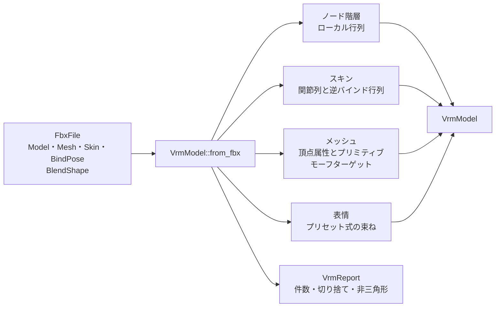

# VRM中間モデル

## 担当責務

この文書は、FBX読み取り層の結果から、VRM 1.0（glTF 2.0準拠）へ書き出す前の
中間表現を作る設計を担当する。ノード階層・スキン・メッシュ属性・材質スロット・
表情（モーフターゲットとプリセット式）を持ち、
VRMファイルの書き出し、ヒューマノイドの対応付け、材質の見た目の解釈、
スプリングボーンは担当しない。表情の判断の詳細は [`VRM表情`](VRM表情.md) にまとめる。

VRM 1.0を対象にする。VRM 0.xはUnity由来の左手系で、glTFを土台にする
現在の仕様と座標規則が異なるため、読み取り済みの右手系データをそのまま使える
1.0を選ぶ。

## 設計概要

モデルは入力バイト列を保持しない。読み取り済みの値から独立した所有データを作る。
配列は対象メッシュ単位で展開し、ファイル全体を保持しない方針を引き継ぐ。

## 座標系と単位

VRM 1.0はglTFに従い、右手系・Y-up・+Zが正面・メートルである。
FBXの標準軸（Y-up・+Z正面・Xが右手）はこれと一致するため、軸の入れ替えをせず、
単位換算だけをシーンルートの行列として適用する。

FBXの変換行列は行優先の配列で、行ベクトルに対して右から掛ける。
これは列優先で列ベクトルに左から掛けるglTFの行列と同じ配列になるため、
16値の配列を転置せずにそのまま中間表現とglTFへ渡す。
平行移動はどちらも12〜14番に現れる。

単位換算は `UnitScaleFactor / 100` をルートの拡大率として使う。
標準軸以外のFBXは、正面や上下の解釈を誤らないよう非対応として失敗する。

## ノードとスキン

ノードはFBXの全Modelに対応させる。ローカル行列はバインド姿勢の世界行列から
`親の逆行列 × 自分の世界行列` で求める。バインド行列が無いModelがある場合は、
姿勢を復元できないため失敗する。`InheritType` の解釈は読み取り層の方針どおり
生成側に残し、ここではバインド姿勢の世界行列だけを使う。

メッシュを持つModelの頂点は、そのModelのバインド世界行列を掛けてシーン空間へ移す。
メッシュノードのローカル行列は単位行列にし、頂点への二重適用を避ける。
そのためメッシュを持つModelは、元の親を持たないルートとして出力する。

スキンの関節列は、読み取り層のクラスタ順をそのまま使う。スキンごとに関節順が
異なるため、全スキンで共有する単一の関節列は作らない。
逆バインド行列は関節のバインド世界行列の逆行列である。
シーンルートの単位換算は関節より上に置くため、逆バインド行列には含めない。

## メッシュ

多角形はfan三角形化し、三角形の並びは元の多角形の頂点順を保つ。
凹多角形の判定はせず、四角形・五角形は凸である前提で扱う。
Unityのインポート時の三角形化を再現するのではなく、元データから決定的に作るためである。

頂点は、位置・法線・UVセットの組が同じcornerを1つにまとめる。
材質スロットごとにプリミティブを分け、頂点配列はメッシュで共有する。
頂点属性は位置・法線・全UVセット・関節・重みである。
UVはファイルの値をそのまま返し、画像の上下反転は書き出し側で扱う。

重みは制御点ごとに最大4件を残し、残りの和が1になるよう正規化する。
4件を超える影響は落とし、落とした頂点数をレポートに残す。
重みの無い頂点は関節0に重み1を与え、件数をレポートに残す。
これは変形を捏造しないための最終手段であり、通常の入力では発生しない。

材質はFBXのスロット（IDと名前）だけを持ち、見た目は扱わない。
実際の色・テクスチャ・シェーダはUnityの `.mat` を正とし、別の作業単位で解釈する。

## 表情

表情の要求は `VrmOptions::with_expressions` で渡すプロファイル（`VrmExpressionProfile`）で表す。
付けない場合は従来どおり表情を作らない。材質の要求とは分け、ソースがFBXの
ブレンドシェイプ由来であるためである。

対象メッシュは、要求された全ターゲット名を含むメッシュがちょうど1つである場合だけ採用する。
0件・複数件・同名ターゲットの重複は失敗する。
選択したチャンネルは単一フレーム条件（形状1件・有限ゼロの初期値・空または全要素が有限100の
重み率）を満たす場合だけ使う。配列長は制約しない。選択していないチャンネルは検査しない。

差分はFBX形状の制御点番号から出力頂点への対応表で配り、UVや法線の継ぎ目で複製された
頂点すべてに同じ差分を載せる。変換は線形部分だけを使い、平行移動は掛けない。
法線の差分は扱わない。詳細な条件とGLB側の表し方は [`VRM表情`](VRM表情.md) に譲る。

`VrmMesh.targets` は名前と出力頂点ごとの位置差分を持ち、順序は選択順である。
`VrmModel.expressions` はプロファイル順のプリセット式を持ち、
束ねは中間メッシュ索引・ターゲット索引・重み（1.0）を指す。
上書き指定はすべて `none`、`isBinary` は偽である。

上限は確保前に検査する。`max_morph_targets`（既定64）は1メッシュのターゲット数、
`max_morph_bytes`（既定512MiB）はモーフ全体のバイト数であり、
`with_max_morph_targets`・`with_max_morph_bytes` で変更できる。

## 失敗と上限

- 標準軸以外のFBX、単位換算係数が0以下または非有限の場合は非対応として失敗する。
- バインド姿勢が無いModel、スキンの関節にバインド行列が無い場合は失敗する。
- 1つのメッシュに複数のスキンが対応する場合は、どちらを使うか決められないため失敗する。
- メッシュを持つModelに子Modelがある場合は失敗する。頂点をシーン空間へ移す前提が崩れるためである。
- 多角形のcorner数が3未満、材質番号がスロット範囲外、関節番号が範囲外の場合は失敗する。
- 座標・法線・UV・重み・モーフ差分の非有限値は失敗とする。
- 表情対象のメッシュが無い・複数ある・同名ターゲットが重複する・所有モデルが無い場合、
  単一フレーム条件を満たさないチャンネルがある場合は失敗する。
  詳細は [`VRM表情`](VRM表情.md) に譲る。
- メッシュ・頂点・三角形の件数に上限を置き、上限は設定で変更できる。
  モーフのターゲット数と総バイト数にも上限を置き、差分を確保する前に検査する。

## 保証しないこと

- 凹多角形の正しい三角形化は保証しない。fan三角形化の前提を外れる入力では面が重なる。
- 4件を超えるスキン影響は保持しない。
- UVの画像上の向き、材質の見た目、ヒューマノイドの対応付けは返さない。
- スプリングボーン・揺れ物・アニメーションは扱わない。
- VRMファイルとしての妥当性は、この層では保証しない。書き出し層が検証する。

## 外した選択肢

- 頂点ごとに軸変換を掛ける方案は採らない。ルート行列1つにまとめるほうが、
  逆バインド行列とスキン行列の整合を保ちやすい。
- 全スキンで関節列を共有しない。実データでスキンごとのクラスタ順が異なるためである。
- 8件のスキン影響（JOINTS_1）は出力しない。VRM閲覧側の対応が限られるため、
  4件に絞って互換性を優先する。
- 耳切り法による三角形化は行わない。読み取り層の責務を増やさず、
  まず決定的な変換で経路を通す。必要になった時点で置き換える。
- FBXの材質値を解釈しない。Unityの `.mat` が正であり、二重解釈を避ける。
