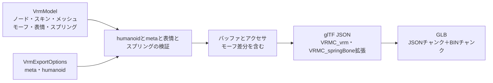

# VRM書き出し

## 担当責務

この文書は、VRM中間モデルからVRM 1.0のGLBバイト列を作る設計を担当する。
glTFのノード・メッシュ・スキン・材質・モーフターゲットと、
`VRMC_vrm` 拡張のmeta・humanoid・expressions・lookAt、`VRMC_springBone` 拡張の
springs・colliderGroups・colliders、`VRMC_springBone_limit` 拡張の
関節ごとの角度制限を書き出す。
材質の内容（Unityの `.mat` からの写像）は [`VRM材質`](VRM材質.md) が担当し、
表情の選択と差分の作り方は [`VRM表情`](VRM表情.md) が担当し、
スプリングの中身は [`VRMスプリング`](VRMスプリング.md) が持つ。
ファイルシステムへの保存、ライセンス内容の妥当性判断は担当しない。

## 設計概要

GLBは12バイトのヘッダ、JSONチャンク、BINチャンクで構成する。
JSONは空白、BINは0で4バイト境界まで埋める。
バッファは1本だけ持ち、アクセサは4バイト境界に詰める。

## 座標とノード

中間モデルの座標をそのまま書き出す。シーンのルートノード（親を持たないノード）の
行列に中間モデルの `root`（単位換算）を掛ける。スキンメッシュのノードは
親を持たないルートに置き、親の変換がスキンに影響しないようにする。

ノードは `matrix` で書き、TRSへの分解はしない。単位行列のノードは `matrix` を
省略する。中間モデルのローカル行列はglTFの列優先と同じ配列であるため、
f32へ変換するだけでよい。メッシュノードは頂点をベイク済みでローカル行列が単位行列である。

humanoid の rest 姿勢は sidecar の T-pose を優先し、無い骨はノードの姿勢を使う。
`--physics` 指定時は解決直後に [`apply_humanoid_t_pose`](../../crates/vrctom/src/vrm/physics.rs)
で参照姿勢からの差分δ（`inverse(reference_local) * tPose`）だけを
各骨のローカル回転に右から掛け（位置・拡大率は触らない）、
視線の測定とスプリングの生成より前に適用する。参照実装の置換と同じ姿勢変化に
なるが、こちらは `Armature` の -90度X を根元に焼き込まないため、
置換ではなく差分適用でフレーム差を吸収する（Hips が動かず world 姿勢を保つ）。
T-pose が無い旧形式の sidecar では何もしない。適用の検証（ID解決・有限値・
非ゼロ回転・重複検出）は [`PhysicsSidecar::parse`](../../crates/vrctom/src/vrm/physics.rs)
と適用時に行い、参照姿勢の回転も確かめ、失敗時はモデルを部分更新しない。

## humanoid

VRM 1.0の必須骨は hips・spine・head・左右の upperArm/lowerArm/hand、
左右の upperLeg/lowerLeg/foot の15個である。任意の chest・neck・肩・目・足先に加え、
指30骨（親指は metacarpal・proximal・distal、
index・middle・ring・little は proximal・intermediate・distal、左右）も
名前から対応付ける。指は必須でない。`jaw` は書式に含まれるが対応手段が無い。

対応付けはノード名の正規化で行い、同じ骨名が複数ノードに一致した場合は
曖昧として失敗する。必須骨が無い場合も失敗する。呼び出し側は
`HumanoidBones` を明示的に渡すこともでき、その場合は名前の推測を使わない。

正規化は小文字化のうえ空白・`_`・`.`・`-` を除去する。
側は先頭の `left`/`right`、または語幹が既知の場合の末尾 `l`/`r`
（`Thumb Proximal.L` の `l` など）で判定する。
指の語幹は `thumbmetacarpal`・`thumbproximal`・`thumbintermediate`・
`thumbdistal`・`indexproximal`・`indexintermediate`・`indexdistal`・
`middleproximal`・`middleintermediate`・`middledistal`・
`ringproximal`・`ringintermediate`・`ringdistal`・
`littleproximal`・`littleintermediate`・`littledistal` であり、
番号別名 `thumb1/2/3`・`index1/2/3`・`middle1/2/3`・`ring1/2/3`・
`little1/2/3` を対応付ける。`pinky` 系（`pinkyproximal`・`pinky1` など）は
小指（little）として扱う。側の無い指名（`thumbproximal` 単体など）には
対応付けない。

親指は3本鎖であり、最初の骨は中手骨に当たる。
そのため Unity の `Thumb Proximal`（`thumbproximal`・`thumb1` を含む）は
VRM の `thumbMetacarpal` に、`Thumb Intermediate`（`thumbintermediate`・
`thumb2` を含む）は `thumbProximal` に、`Thumb Distal`（`thumbdistal`・
`thumb3` を含む）は `thumbDistal` に対応付ける。
VRM 1.0に `thumbIntermediate` は存在しない。
明示的な `thumbmetacarpal` 名を持つモデルで `thumbproximal` 名も併存する場合は、
どちらも同じ `ThumbMetacarpal` に一致するため重複として失敗する。
この制限を避ける手段は無い（3本の親指では最初の骨が中手骨になるため）。

指の親子規則は、親指の `Metacarpal` と他の指の `Proximal` の親は同側の `Hand`、
親指の `Proximal` の親は同側の `Metacarpal`、
親指の `Distal` の親は同側の `Proximal`、
他の指の `Intermediate` の親は同側の `Proximal`、
`Distal` の親は同側の `Intermediate` である。
同側への置き換えは既存の `allowed_parents_for`
の仕組みで行い、親が想定外（例: `Thumb Distal` の親が `Hand`）の場合は
既存どおり失敗する。重複検出も指に効く。

書き出す前に次を検証する。

- 必須骨がすべて存在し、同じノードが複数の骨に割り当てられていない。
- 各骨の最も近いhumanoid祖先が、仕様の親子関係と許される省略に一致する。
- humanoid骨のローカル行列の拡大率が正で、鏡像でない。
- 書き出すhumanoidの骨キーがVRM 1.0の骨名55件のいずれかである。
  未知のキーは書式違反として失敗する。
  55件の一覧と書式の対応は単体試験で数と代表名（`thumbMetacarpal` あり・
  `thumbIntermediate` なし・`jaw` あり）で固定する。

## meta

`VRMC_vrm.meta` には必須の name・authors・licenseUrl を書く。
licenseUrlの既定値はVRM 1.0の `https://vrm.dev/licenses/1.0/` である。
任意のversion・copyrightInformation・contactInformation・references・
thirdPartyLicensesは指定された場合だけ書く。
nameが空、authorsが空、licenseUrlが空の場合は失敗する。

権限9項目はUnityと同じキー集合で常に書く。既定値はUnityと同じである。
上書きはCLI（`--avatar-permission`・`--commercial-usage`・
`--credit-notation`・`--modification`・`--allow-*` の5件）か
`VrmMeta` の欄への代入で行い、`--meta-version` 相当は今回の範囲外である。

- `avatarPermission`: `onlyAuthor`（既定）・`onlySeparatelyLicensedPerson`・`everyone`
- `commercialUsage`: `personalNonProfit`（既定）・`personalProfit`・`corporation`
- `creditNotation`: `required`（既定）・`unnecessary`
- `modification`: `prohibited`（既定）・`allowModification`・`allowModificationRedistribution`
- `allowRedistribution`・`allowExcessivelyViolentUsage`・
  `allowExcessivelySexualUsage`・`allowPoliticalOrReligiousUsage`・
  `allowAntisocialOrHateUsage` はいずれも既定で偽

書き出す前に文字列がVRM 1.0の既知集合かを実際に確かめる。
型で担保するが、将来の列挙追加時の書式漏れを実行時に捉えるためである。
CLIの値はkebab-case（`allow-modification` など）で受け取り、JSONへは
camelCase（`allowModification`）で書く。

## 材質

`VrmExportOptions` に `VrmMaterials` が渡された場合、FBXの材質スロット名で
材質を引き、glTFの材質と `VRMC_materials_mtoon` 拡張を書く。画像は1本のバッファへ
`bufferView` として詰め、GUID単位で1件にまとめる。拡張は `extensionsUsed` に
`VRMC_materials_mtoon` を加える。

`VrmMaterials` が無い、またはスロットに対応する材質が無い場合は、
従来どおりスロット名だけを持つ灰色のPBR材質（金属度0・粗さ1・両面なし・不透明）を
書く。スロットを持たないメッシュは材質を割り当てない。

UVはFBXとUnityの左下原点からglTFの左上原点へ合わせるため、全UVセットのVを
`1 - v` にして書く。画像は反転しない。

## モーフターゲットと表情

`VrmMesh.targets` がある場合、各プリミティブの `targets` に位置差分のアクセサを載せる。
全プリミティブが同じ順序で同じアクセサを参照する。法線の差分は書かない。
ターゲットは中間モデル側で互換形状に絞ったものであり、Milfy実測では57件になる。
絞り込みの規則は [`VRM表情`](VRM表情.md) に譲る。
メッシュの `weights` にはターゲット数と同じ長さのゼロ列を書き、初期値をここに任せる。
`node.weights` は書かない。ターゲット名はメッシュの `extras.targetNames` に書く。
`gltf` の `extras` 機能を使う。

`VrmModel.expressions.preset` が空でない場合、`VRMC_vrm.expressions.preset` に式を書く。
式ごとに `morphTargetBinds`（中間メッシュ索引をノード索引へ写したもの・ターゲット索引・重み）・
`isBinary`・`overrideBlink`・`overrideLookAt`・`overrideMouth` を持つ。
現在の生成では `isBinary` は偽、上書きはすべて `none` である。

書き出す前に次を検証する。詳細な条件は [`VRM表情`](VRM表情.md) に譲る。

- 束ねの重みは0〜1の有限値である。
- 式名はVRM 1.0のプリセット18種のいずれかであり、重複も空もない。
- 束ねのメッシュ索引・ターゲット索引は範囲内であり、ターゲットの長さは出力頂点数と一致する。

## 視線（lookAt）

`VrmModel.look_at` が `Some` の場合だけ `VRMC_vrm.lookAt` を書く。
`None` の場合は従来どおり省略する。`--physics` 無しでは `None` のままになる。

- `Bone` は目の骨で視線を動かす。`offsetFromHeadBone` に頭基準の注視原点、
  `rangeMapHorizontalInner`・`rangeMapHorizontalOuter`・`rangeMapVerticalDown`・
  `rangeMapVerticalUp` に4方向の範囲写像、`type` に `bone` を書く。
  - `offsetFromHeadBone` はVRM空間の `inverse(head世界) * 眼の中点`（同次変換）であり、
    頭のローカルで注視の原点を表す。Milfy実測では `[0, 0.044, 0.024]`（m）程度である。
  - 範囲写像は `inputMaxValue`（入力最大角・度）と `outputScale`（出力角・度）を持つ。
    測定値は入力と出力が同値（入力は1度で止める）であり、VRChatのEye Lookが
    視線角そのままに目を振り止める動きに対応する。
    未測定の既定値は入力90度・出力10度である。
- `Expression` は目が無い場合に使い、頭上6cmを原点に入力90度・重み1.0で見る。
  `type` は `expression` である。表情の有無とは関係なく書く。
- 測定の規則・既定値・除外条件は [`VRM表情`](VRM表情.md) に譲る。

書き出す前に次を検証する。

- `type` は `bone`・`expression` のいずれかである。
- 骨型の目の索引は範囲内で、左右は異なる。
- `offsetFromHeadBone` は3つの有限値である。
- 範囲の値は0以上上限（90度）以下の有限値であり、`inputMaxValue` は正である。

## スプリング

`VrmModel.spring_bones` が空でない場合、`VRMC_springBone` 拡張に
`springs`・`colliderGroups`・`colliders` を `specVersion: "1.0"` とともに書く。
空の配列は書式違反（`minItems: 1`）のため省略し、すべて空の場合は
拡張を付けず、`extensionsUsed` にも加えない。
関節の角度制限がある場合は、各jointに
`extensions: {"VRMC_springBone_limit": {"specVersion": "1.0-draft", "limit": {...}}}` を付け、
`extensionsUsed` に `VRMC_springBone_limit` を加える。
`spherical` は `{pitch, yaw, rotation}`、`cone`・`hinge` は `{angle, rotation}` を持つ。
末端・制限なし・rest不明の関節には付けず、1件もない場合は使用宣言にも加えない。
平面colliderがある場合は、各colliderに
`extensions: {"VRMC_springBone_extended_collider": {"specVersion": "1.0", "shape": {"plane": {"normal": [...], "offset": [...]}}}}` を付け、
`extensionsUsed` に `VRMC_springBone_extended_collider` を加える。
平面の基準ノードは親なしの補助ノードとして末尾に追加する。
中身の作り方は [`VRMスプリング`](VRMスプリング.md) に譲る。

書き出す前に次を検証する。

- springの関節は1件以上あり、親子でつながり、springをまたいで重ならない。
- ノード索引・collider索引・グループ索引は範囲内である。
- `hitRadius`・`stiffness`・`gravityPower` は0以上の有限値、
  `dragForce` は0〜1の有限値である。
- `gravityDir` は正規化して書く。ゼロや非有限は失敗する。
- 角度制限の角度は有限値で、円錐・蝶番は0〜π、球面のpitchは0〜π・yawは0〜π/2の範囲であり、
  回転は単位四元数である。範囲外・非有限は失敗する。
- colliderの半径は0以上の有限値、形状点は3つの有限値である。
  平面colliderの法線は単位ベクトル、ずれは有限値であることを確かめる。
  法線が単位でない・非有限の場合は失敗する。
- 空の `colliderGroups` は書かない。書式の `minItems: 1` に従う。

## ノード制約

`VrmModel.node_constraints` が空でない場合、各対象ノードに
`extensions: {"VRMC_node_constraint": {"specVersion": "1.0", "constraint": {...}}}` を付け、
`extensionsUsed` に `VRMC_node_constraint` を加える。
`rotation` は `{source, weight}`、`roll` は `{source, weight, rollAxis: "X"|"Y"|"Z"}`、
`aim` は `{source, weight, aimAxis: "PositiveX"|...|"NegativeZ"}` を持つ。
注視軸はXだけ鏡像する（`PositiveX` と `NegativeX` を入れ替える）。
空の場合は拡張を付けず、`extensionsUsed` にも加えない。
中身の作り方は [`VRMスプリング`](VRMスプリング.md) に譲る。

書き出す前に次を検証する。

- 対象と参照先のノード索引は範囲内であり、互いに異なる。
- 重みは0〜1の有限値である。

## アクセサ

- 位置はVEC3/F32で、min/maxを付ける。
- 法線はVEC3/F32。
- UVはVEC2/F32で、セット数だけ `TEXCOORD_n` を出す。
- 関節はVEC4/U16、重みはVEC4/F32。
- 索引はSCALAR/U32。
- 逆バインド行列はMAT4/F32で、中間モデルの列優先配列をそのまま書く。
  逆バインド行列は頂点属性ではないため、そのbufferViewにはtargetを付けない。

## 失敗と上限

- humanoidの欠落・重複・親子不一致・非正の拡大率・未知の骨名は失敗する。
- metaの必須項目が空の場合は失敗する。
- ノード・メッシュ・スキン・材質・アクセサの索引が範囲外の場合は失敗する。
- 出力バイト数の上限を設け、超過は失敗する。
- 中間モデルの不変条件違反（頂点数と属性長の不一致など）は失敗する。

## 保証しないこと

- 生成したVRMが第三者製のvalidatorをすべて通ることは保証しない。
  仕様の必須項目と参照整合を満たす範囲に留める。
- 材質の見た目を完全に再現することは保証しない。材質の解釈は [`VRM材質`](VRM材質.md)
  の近似に従う。
- スプリングの完全な再現は保証しない。分岐分割した鎖と第一近似の値・角度制限だけを出し、
  その他のlimit拡張は [`VRMスプリング`](VRMスプリング.md) に残す。
- ライセンス内容の妥当性や、利用条件の適法性は判断しない。
- 凹多角形の三角形化品質は中間モデルの前提を引き継ぐ。

## 外した選択肢

- VRM 0.xは書き出さない。Unity由来の左手系で、中間モデルと座標規則が異なる。
- `gltf` クレートのimport機能は使わない。書き出しに不要な画像デコーダを
  依存に加えないため、JSON型とシリアライズだけを使い、GLBの容器は自前で組む。
- 複数バッファや外部 `.bin` は作らない。VRMは単一GLBで配布されるためである。
- MToon以外の材質拡張（lilToon拡張・KHR_materials_unlitなど）は書かない。
  材質の見た目はMToon 1.0とglTFのPBRで表す。
- humanoidを完全自動にしない。推測を既定にしつつ、明示指定で上書きできるようにする。
