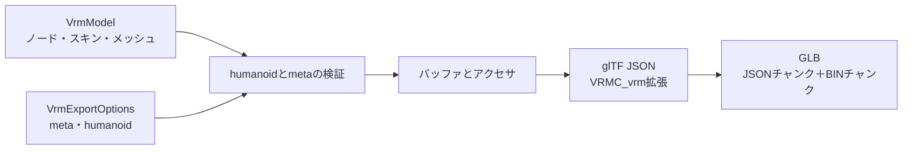

# VRM書き出し

## 担当責務

この文書は、VRM中間モデルからVRM 1.0のGLBバイト列を作る設計を担当する。
glTFのノード・メッシュ・スキン・材質と、`VRMC_vrm` 拡張のmeta・humanoidを書き出す。
ファイルシステムへの保存、テクスチャ画像、MToon、表情、スプリングボーン、
ライセンス内容の妥当性判断は担当しない。

## 設計概要

GLBは12バイトのヘッダ、JSONチャンク、BINチャンクで構成する。
JSONは空白、BINは0で4バイト境界まで埋める。
バッファは1本だけ持ち、アクセサは4バイト境界に詰める。

## 座標とノード

中間モデルの座標をそのまま書き出す。シーンのルートノード（親を持たないノード）の
行列に中間モデルの `root`（単位換算）を掛ける。スキンメッシュのノードは
親を持たないルートに置き、親の変換がスキンに影響しないようにする。

ノードは `matrix` で書き、TRSへの分解はしない。単位行列のノードは `matrix` を
省略する。中間モデルのローカル行列はglTFの列優先と同じ配列であるため、
f32へ変換するだけでよい。メッシュノードは頂点をベイク済みでローカル行列が単位行列である。

## humanoid

VRM 1.0の必須骨は hips・spine・head・左右の upperArm/lowerArm/hand、
左右の upperLeg/lowerLeg/foot の15個である。任意の chest・neck・肩・目・足先も
名前から対応付ける。指は対応付けない。

対応付けはノード名の正規化で行い、同じ骨名が複数ノードに一致した場合は
曖昧として失敗する。必須骨が無い場合も失敗する。呼び出し側は
`HumanoidBones` を明示的に渡すこともでき、その場合は名前の推測を使わない。

書き出す前に次を検証する。

- 必須骨がすべて存在し、同じノードが複数の骨に割り当てられていない。
- 各骨の最も近いhumanoid祖先が、仕様の親子関係と許される省略に一致する。
- humanoid骨のローカル行列の拡大率が正で、鏡像でない。

## meta

`VRMC_vrm.meta` には必須の name・authors・licenseUrl を書く。
licenseUrlの既定値はVRM 1.0の `https://vrm.dev/licenses/1.0/` である。
任意のversion・copyrightInformation・contactInformation・references・
thirdPartyLicensesは指定された場合だけ書く。
nameが空、authorsが空、licenseUrlが空の場合は失敗する。

## 材質

材質は名前だけを持つ単純なPBR材質として書き、色は中間調の灰色、
金属度0、粗さ1、両面なし、不透明にする。テクスチャは付けない。
実際の見た目はUnityの `.mat` を解釈する別の作業単位で置き換える。
材質スロットを持たないメッシュは材質を割り当てない。

## アクセサ

- 位置はVEC3/F32で、min/maxを付ける。
- 法線はVEC3/F32。
- UVはVEC2/F32で、セット数だけ `TEXCOORD_n` を出す。
- 関節はVEC4/U16、重みはVEC4/F32。
- 索引はSCALAR/U32。
- 逆バインド行列はMAT4/F32で、中間モデルの列優先配列をそのまま書く。
  逆バインド行列は頂点属性ではないため、そのbufferViewにはtargetを付けない。

## 失敗と上限

- humanoidの欠落・重複・親子不一致・非正の拡大率は失敗する。
- metaの必須項目が空の場合は失敗する。
- ノード・メッシュ・スキン・材質・アクセサの索引が範囲外の場合は失敗する。
- 出力バイト数の上限を設け、超過は失敗する。
- 中間モデルの不変条件違反（頂点数と属性長の不一致など）は失敗する。

## 保証しないこと

- 生成したVRMが第三者製のvalidatorをすべて通ることは保証しない。
  仕様の必須項目と参照整合を満たす範囲に留める。
- 材質の見た目、テクスチャ、MToon、表情、スプリングボーン、揺れ物は出力しない。
- ライセンス内容の妥当性や、利用条件の適法性は判断しない。
- 凹多角形の三角形化品質は中間モデルの前提を引き継ぐ。

## 外した選択肢

- VRM 0.xは書き出さない。Unity由来の左手系で、中間モデルと座標規則が異なる。
- `gltf` クレートのimport機能は使わない。書き出しに不要な画像デコーダを
  依存に加えないため、JSON型とシリアライズだけを使い、GLBの容器は自前で組む。
- 複数バッファや外部 `.bin` は作らない。VRMは単一GLBで配布されるためである。
- MToonを最初から書かない。材質の解釈にはUnity `.mat` とテクスチャが必要で、
  先にGLBとして読み込める経路を通す。
- humanoidを完全自動にしない。推測を既定にしつつ、明示指定で上書きできるようにする。
