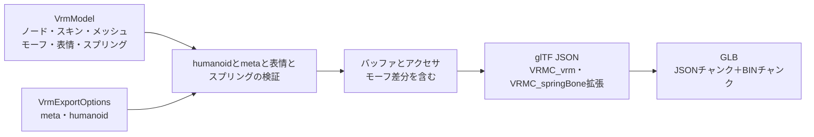

# VRM書き出し

## 担当責務

この文書は、VRM中間モデルからVRM 1.0のGLBバイト列を作る設計を担当する。
glTFのノード・メッシュ・スキン・材質・モーフターゲットと、
`VRMC_vrm` 拡張のmeta・humanoid・expressions、`VRMC_springBone` 拡張の
springs・colliderGroups・colliders、`VRMC_springBone_limit` 拡張の
関節ごとの角度制限を書き出す。
材質の内容（Unityの `.mat` からの写像）は [`VRM材質`](VRM材質.md) が担当し、
表情の選択と差分の作り方は [`VRM表情`](VRM表情.md) が担当し、
スプリングの中身は [`VRMスプリング`](VRMスプリング.md) が持つ。
ファイルシステムへの保存、ライセンス内容の妥当性判断は担当しない。

## 設計概要

GLBは12バイトのヘッダ、JSONチャンク、BINチャンクで構成する。
JSONは空白、BINは0で4バイト境界まで埋める。
バッファは1本だけ持ち、アクセサは4バイト境界に詰める。

## 座標とノード

中間モデルの座標をそのまま書き出す。シーンのルートノード（親を持たないノード）の
行列に中間モデルの `root`（単位換算）を掛ける。スキンメッシュのノードは
親を持たないルートに置き、親の変換がスキンに影響しないようにする。

ノードは `matrix` で書き、TRSへの分解はしない。単位行列のノードは `matrix` を
省略する。中間モデルのローカル行列はglTFの列優先と同じ配列であるため、
f32へ変換するだけでよい。メッシュノードは頂点をベイク済みでローカル行列が単位行列である。

## humanoid

VRM 1.0の必須骨は hips・spine・head・左右の upperArm/lowerArm/hand、
左右の upperLeg/lowerLeg/foot の15個である。任意の chest・neck・肩・目・足先も
名前から対応付ける。指は対応付けない。

対応付けはノード名の正規化で行い、同じ骨名が複数ノードに一致した場合は
曖昧として失敗する。必須骨が無い場合も失敗する。呼び出し側は
`HumanoidBones` を明示的に渡すこともでき、その場合は名前の推測を使わない。

書き出す前に次を検証する。

- 必須骨がすべて存在し、同じノードが複数の骨に割り当てられていない。
- 各骨の最も近いhumanoid祖先が、仕様の親子関係と許される省略に一致する。
- humanoid骨のローカル行列の拡大率が正で、鏡像でない。

## meta

`VRMC_vrm.meta` には必須の name・authors・licenseUrl を書く。
licenseUrlの既定値はVRM 1.0の `https://vrm.dev/licenses/1.0/` である。
任意のversion・copyrightInformation・contactInformation・references・
thirdPartyLicensesは指定された場合だけ書く。
nameが空、authorsが空、licenseUrlが空の場合は失敗する。

## 材質

`VrmExportOptions` に `VrmMaterials` が渡された場合、FBXの材質スロット名で
材質を引き、glTFの材質と `VRMC_materials_mtoon` 拡張を書く。画像は1本のバッファへ
`bufferView` として詰め、GUID単位で1件にまとめる。拡張は `extensionsUsed` に
`VRMC_materials_mtoon` を加える。

`VrmMaterials` が無い、またはスロットに対応する材質が無い場合は、
従来どおりスロット名だけを持つ灰色のPBR材質（金属度0・粗さ1・両面なし・不透明）を
書く。スロットを持たないメッシュは材質を割り当てない。

UVはFBXとUnityの左下原点からglTFの左上原点へ合わせるため、全UVセットのVを
`1 - v` にして書く。画像は反転しない。

## モーフターゲットと表情

`VrmMesh.targets` がある場合、各プリミティブの `targets` に位置差分のアクセサを載せる。
全プリミティブが同じ順序で同じアクセサを参照する。法線の差分は書かない。
メッシュの `weights` にはターゲット数と同じ長さのゼロ列を書き、初期値をここに任せる。
`node.weights` は書かない。ターゲット名はメッシュの `extras.targetNames` に書く。
`gltf` の `extras` 機能を使う。

`VrmModel.expressions.preset` が空でない場合、`VRMC_vrm.expressions.preset` に式を書く。
式ごとに `morphTargetBinds`（中間メッシュ索引をノード索引へ写したもの・ターゲット索引・重み）・
`isBinary`・`overrideBlink`・`overrideLookAt`・`overrideMouth` を持つ。
現在の生成では `isBinary` は偽、上書きはすべて `none` である。

書き出す前に次を検証する。詳細な条件は [`VRM表情`](VRM表情.md) に譲る。

- 束ねの重みは0〜1の有限値である。
- 式名はVRM 1.0のプリセット18種のいずれかであり、重複も空もない。
- 束ねのメッシュ索引・ターゲット索引は範囲内であり、ターゲットの長さは出力頂点数と一致する。

## スプリング

`VrmModel.spring_bones` が空でない場合、`VRMC_springBone` 拡張に
`springs`・`colliderGroups`・`colliders` を `specVersion: "1.0"` とともに書く。
空の配列は書式違反（`minItems: 1`）のため省略し、すべて空の場合は
拡張を付けず、`extensionsUsed` にも加えない。
関節の角度制限がある場合は、各jointに
`extensions: {"VRMC_springBone_limit": {"specVersion": "1.0-draft", "limit": {...}}}` を付け、
`extensionsUsed` に `VRMC_springBone_limit` を加える。
`spherical` は `{pitch, yaw, rotation}`、`cone`・`hinge` は `{angle, rotation}` を持つ。
末端・制限なし・rest不明の関節には付けず、1件もない場合は使用宣言にも加えない。
平面colliderがある場合は、各colliderに
`extensions: {"VRMC_springBone_extended_collider": {"specVersion": "1.0", "shape": {"plane": {"normal": [...], "offset": [...]}}}}` を付け、
`extensionsUsed` に `VRMC_springBone_extended_collider` を加える。
平面の基準ノードは親なしの補助ノードとして末尾に追加する。
中身の作り方は [`VRMスプリング`](VRMスプリング.md) に譲る。

書き出す前に次を検証する。

- springの関節は1件以上あり、親子でつながり、springをまたいで重ならない。
- ノード索引・collider索引・グループ索引は範囲内である。
- `hitRadius`・`stiffness`・`gravityPower` は0以上の有限値、
  `dragForce` は0〜1の有限値である。
- `gravityDir` は正規化して書く。ゼロや非有限は失敗する。
- 角度制限の角度は有限値で、円錐・蝶番は0〜π、球面のpitchは0〜π・yawは0〜π/2の範囲であり、
  回転は単位四元数である。範囲外・非有限は失敗する。
- colliderの半径は0以上の有限値、形状点は3つの有限値である。
  平面colliderの法線は単位ベクトル、ずれは有限値であることを確かめる。
  法線が単位でない・非有限の場合は失敗する。
- 空の `colliderGroups` は書かない。書式の `minItems: 1` に従う。

## アクセサ

- 位置はVEC3/F32で、min/maxを付ける。
- 法線はVEC3/F32。
- UVはVEC2/F32で、セット数だけ `TEXCOORD_n` を出す。
- 関節はVEC4/U16、重みはVEC4/F32。
- 索引はSCALAR/U32。
- 逆バインド行列はMAT4/F32で、中間モデルの列優先配列をそのまま書く。
  逆バインド行列は頂点属性ではないため、そのbufferViewにはtargetを付けない。

## 失敗と上限

- humanoidの欠落・重複・親子不一致・非正の拡大率は失敗する。
- metaの必須項目が空の場合は失敗する。
- ノード・メッシュ・スキン・材質・アクセサの索引が範囲外の場合は失敗する。
- 出力バイト数の上限を設け、超過は失敗する。
- 中間モデルの不変条件違反（頂点数と属性長の不一致など）は失敗する。

## 保証しないこと

- 生成したVRMが第三者製のvalidatorをすべて通ることは保証しない。
  仕様の必須項目と参照整合を満たす範囲に留める。
- 材質の見た目を完全に再現することは保証しない。材質の解釈は [`VRM材質`](VRM材質.md)
  の近似に従う。
- スプリングの完全な再現は保証しない。分岐分割した鎖と第一近似の値・角度制限だけを出し、
  その他のlimit拡張は [`VRMスプリング`](VRMスプリング.md) に残す。
- ライセンス内容の妥当性や、利用条件の適法性は判断しない。
- 凹多角形の三角形化品質は中間モデルの前提を引き継ぐ。

## 外した選択肢

- VRM 0.xは書き出さない。Unity由来の左手系で、中間モデルと座標規則が異なる。
- `gltf` クレートのimport機能は使わない。書き出しに不要な画像デコーダを
  依存に加えないため、JSON型とシリアライズだけを使い、GLBの容器は自前で組む。
- 複数バッファや外部 `.bin` は作らない。VRMは単一GLBで配布されるためである。
- MToon以外の材質拡張（lilToon拡張・KHR_materials_unlitなど）は書かない。
  材質の見た目はMToon 1.0とglTFのPBRで表す。
- humanoidを完全自動にしない。推測を既定にしつつ、明示指定で上書きできるようにする。
