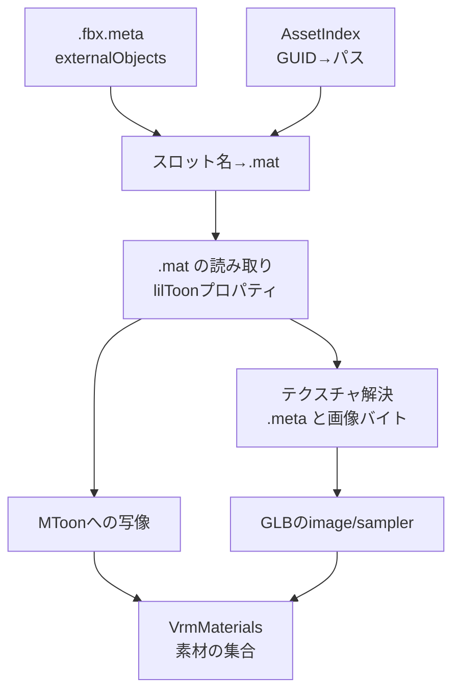

# VRM材質

## 担当責務

この文書は、Unityのマテリアル（`.mat`）とテクスチャからVRM 1.0の材質を作る設計を担当する。
FBXの材質スロット名を `.fbx.meta` の置換表で `.mat` に対応付け、
色・透明度・テクスチャを読み、glTFの材質と `VRMC_materials_mtoon` 拡張を組み立てる。

画像のデコード・再エンコード、テクスチャのベイク、lilToon以外のシェーダの解釈、
表情・スプリングボーンは担当しない。

## 設計概要

読み取りはNativeのみ（`#[cfg(not(target_arch = "wasm32"))]`）で、`Assets` 配下だけを
`scan_directory` で索引化してから行う。`ProjectSettings` や `Library` など
metaを持たない配置を巻き込まないためである。型と写像規則はターゲット非依存にする。
呼び出し側は得られた `VrmMaterials` を [`VrmExportOptions`] に渡す。

## 材質の同定

FBXの材質スロット名は `.fbx.meta` の `externalObjects` が持つ
`UnityEngine:Material` の置換表で `.mat` のGUIDに解決する。
名前だけの一致では解決しない。置換表に無いスロットは、書き出し時に
既定の灰色材質へ落ちる。

`.mat` はUnity YAMLとして読み、`Material` の代表型を使う。
`m_Shader` のGUIDは、索引に `.shader` があればその先頭行のシェーダ名で、
無ければ既知のlilToonのGUID表で系列を判定する。

| 系列 | 透明度 | 例 |
|---|---|---|
| lilToon / lilToonOutline | 不透明 | `lilToon`, `Hidden/lilToonOutline` |
| lilToonCutout / lilToonCutoutOutline | カットアウト | `Hidden/lilToonCutout` |
| lilToonTransparent / lilToonTransparentOutline | 半透明 | `Hidden/lilToonTransparent` |

Lite版（`Hidden/lilToonLite*`）も同じ系列として扱う。
シェーダ名で判定する場合も、名前に `lilToon` を含むものだけを対象にする。
GUIDが未知で `_lilToonVersion` を持つ場合は、`_DstBlend` が0なら不透明、
それ以外は半透明と推定し、カットアウトは判定できないものとして警告する。
lilToonのプロパティを持たないシェーダは未対応とし、灰色材質へ落として警告する。

## 色空間

`.mat` の色はsRGB符号化された値である。glTFの色因子は線形であるため、
RGBだけをsRGBから線形へ変換する。アルファは変換しない。
色成分は0〜1に丸める。`_EmissionColor` で1を超える成分を丸めた場合は警告する。

## glTF材質への写像

| 出力 | 入力 | 規則 |
|---|---|---|
| `baseColorFactor` | `_Color` | RGBを線形化し、Aはそのまま |
| `baseColorTexture` | `_MainTex` | 割り当てがある場合だけ |
| `alphaMode` | シェーダ系列 | 不透明・カットアウト・半透明 |
| `alphaCutoff` | `_Cutoff` | カットアウトのときだけ0〜1へ丸める |
| `doubleSided` | `_Cull` | 2（裏面カリング）以外は両面 |
| `emissiveFactor` | `_EmissionColor` | `_UseEmission` が真のときだけ |
| `emissiveTexture` | `_EmissionMap` | 同上。割り当てがある場合だけ |

## MToonへの写像

`VRMC_materials_mtoon` は1.0を書く。中間調の陰影はlilToonの半Lambert境界から作る。

- 影を使わない（`_UseShadow` が0）場合、`shadeColorFactor` は基準色と同じにし、
  `shadeMultiplyTexture` は基準色テクスチャにする。`shadingToonyFactor` は0.9、
  `shadingShiftFactor` は0にする。
- 影を使う場合、`shadeColorFactor` の色は `_ShadowColor` を線形化し
  `_ShadowStrength` を掛けた `1 - (1 - color) * strength` にする。
- 影を使い、`_ShadowColorTex` がある場合は、それを `shadeMultiplyTexture` にして
  `shadeColorFactor` は上の色のままにする。lilToonは基準色とアルファで混ぜるため、
  乗算として近似する（警告する）。
- 影を使い、`_ShadowColorTex` がない場合は、`shadeMultiplyTexture` を基準色
  テクスチャにし、`shadeColorFactor` を上の色と基準色の積にする。MToonの影側は
  `shadeColorFactor × shadeMultiplyTexture` なので、lilToonの影色×基準色に合わせる。
- 基準色テクスチャがない場合、`shadeMultiplyTexture` は省き、`shadeColorFactor`
  だけを書く。
- 境界 `b = _ShadowBorder`、ぼかし `w = _ShadowBlur` から
  `lo = clamp(b - w/2)`, `hi = clamp(b + w/2)` を作り、
  `shadingToonyFactor = 1 - max(hi - lo, 0.001)`、
  `shadingShiftFactor = 1 - (lo + hi)` とする。
- `_UseMatCap` が真なら `_MatCapTex` を `matcapTexture`、`_MatCapColor` のRGBを
  `matcapFactor` にする。lilToonのアルファ（混ぜ具合）は表せない。
- `_UseOutline` が真なら `outlineWidthMode` を `worldCoordinates` にし、
  `outlineWidthFactor = max(_OutlineWidth, 0)`、
  `outlineColorFactor = _OutlineColor`、`outlineWidthMultiplyTexture = _OutlineWidthMask`
  を書く。lilToonの幅はオブジェクト空間の値であり、ルートの単位換算は掛けない。
  実データのルート換算が1のときはメートルとして一致する近似である。
- `transparentWithZWrite` は半透明かつ `_ZWrite` が真のときだけ真にする。
- `renderQueueOffsetNumber` は0に固定する。シェーダ既定の描画順が分からず、
  材質ごとの差分を決められないためである。
- `giEqualizationFactor` は0.9にする。

## テクスチャ

画像はGUIDごとに1回だけ読み、GLBの単一バッファに `bufferView` として詰める。
MIMEはPNGとJPEGだけを扱い、拡張子ではなく先頭バイトで判定する。
それ以外の形式（TGA・PSDなど）や索引に無いテクスチャは、材質を止めずに
そのスロットを省いて警告する。

PNGは、画素データに影響しない付加チャンク（`gAMA`・`iCCP`・`cHRM`・`pHYs`・
テキスト類など）を落としてから埋め込む。glTFは画像の色空間を用途で決めるため、
Unityが埋め込むsRGBプロファイルや解像度情報を持ち込むと、
ビューアによって解釈が分かれる。必須チャンク（`IHDR`・`PLTE`・`tRNS`・`IDAT`・
`IEND`）だけを元のバイト列のまま残し、再エンコードはしない。
チャンク構造が読めないPNGは壊さずそのまま埋め込み、警告する。

サンプラは `.meta` の `textureSettings` と `mipmaps` から作る。

| Unity | glTF |
|---|---|
| `wrapU/V` 0/1/2 | `REPEAT`/`CLAMP_TO_EDGE`/`MIRRORED_REPEAT` |
| `filterMode` 0点・1双線形・2三線形 | `NEAREST`・`LINEAR` とmipmapの組合せ |
| `enableMipMap` 0 | mipmapなしの `MIN_FILTER` |

同じGUIDの画像は1件にまとめ、サンプラも同じなら同一の `texture` を共有する。

## UVの向き

FBXとUnityのUVは左下原点、glTFは左上原点である。中間モデルはUVをそのまま持ち、
書き出し時に全UVセットのVを `1 - v` にして書く。テクスチャ画像自体は上下反転しない。
この結果、BlenderのglTFインポータが戻すUVはFBXのUVと一致する。

材質の `_MainTex` などのスケール・オフセット（`_ST`）は反映しない。
既定の1と0以外が設定されている場合は、その旨を警告する。
MToonは材質ごとに1つのUV変換しか持てず、UVの反転と組み合わせた変換の
正しさをこの単位では検証できないためである。

## 失敗と上限

- 索引の走査・`.mat` の解決・画像の読み込みで入出力に失敗した場合は失敗する。
- 1枚の画像、合計の画像、材質数の上限を設け、超過は失敗する。
  画像は上限を超える分を読む前に打ち切る。1枚の上限は元のバイト列、
  合計の上限は埋め込み用に付加チャンクを落とした後のバイト列で数える。
  `.mat` と `.shader` にも固定の読み取り上限を設け、`.mat` の超過は失敗、
  `.shader` の超過は名前判定を諦める。
- 材質やテクスチャが索引に無い場合、未対応シェーダ・未対応画像形式の場合は、
  警告を残して灰色材質かテクスチャ無しへ落とし、書き出しは続ける。
- 色や幅などに非有限値・範囲外の値がある材質は、灰色材質へ落として警告する。
  `VrmMaterials` を直接渡して不正値だった場合は、書き出しを失敗させる。
- 自動検出した配置での索引化・読み取りの失敗は、CLIが警告を出して材質なしで
  続行する。`--assets` を明示した場合の失敗は終了コード1にする。

## 保証しないこと

- lilToonの見た目を完全に再現しない。バックライト・リム・2ndカラー・
  バンプマップ・アルファマスク・グラデーション・UVスクロール・アウトラインの
  UVモード・頂点色は写像しない。検出できるバックライト・リム・バンプマップ・
  アルファマスク・グラデーション・2ndカラー・UVスクロールは使用時に警告する。
- 影色テクスチャのアルファ合成、マットキャップの混ぜ具合、アウトライン幅の
  オブジェクト空間依存は近似である。
- テクスチャの再エンコードや縮小はしない。元の解像度と形式のまま埋め込む。
- 材質の描画順（`renderQueueOffsetNumber`）は常に0である。
- 異なるシェーダ（Poiyomi・URP・Standardなど）の見た目は再現しない。

## 外した選択肢

- 画像デコードを持たない。PNG/JPEGをそのまま埋め込めば再エンコードなしで済み、
  wasmでも画像コーデック依存を増やさずに済む。
- テクスチャのベイクはしない。色レイヤやマスクを合成するにはデコードと合成が要り、
  まず直接写像できる範囲で見た目を通す。
- FBXの材質値は使わない。Unityの `.mat` が正であり、二重解釈を避ける。
- MToon 0.xは書かない。VRM 1.0の `VRMC_materials_mtoon` 1.0だけを対象にする。
