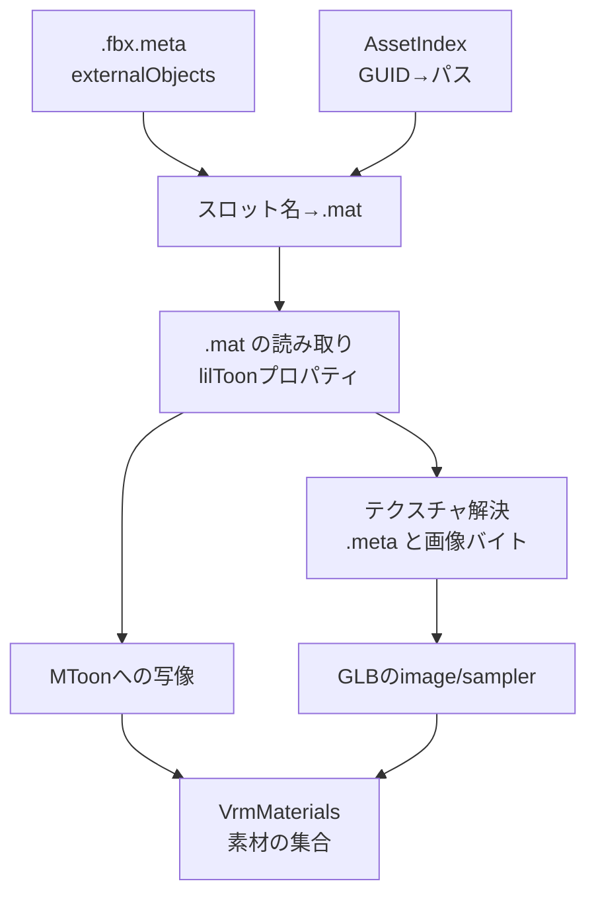
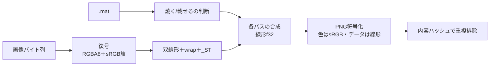

# VRM材質

## 担当責務

この文書は、Unityのマテリアル（`.mat`）とテクスチャからVRM 1.0の材質を作る設計を担当する。
FBXの材質スロット名を `.fbx.meta` の置換表で `.mat` に対応付け、
色・透明度・テクスチャを読み、glTFの材質と `VRMC_materials_mtoon` 拡張を組み立てる。

画像のデコード・再エンコード、テクスチャのベイク、lilToon以外のシェーダの解釈、
スプリングボーンは担当しない。表情は [`VRM表情`](VRM表情.md) が担当する。

## 設計概要



読み取りはNativeのみ（`#[cfg(not(target_arch = "wasm32"))]`）で、`Assets` 配下だけを
`scan_directory` で索引化してから行う。`ProjectSettings` や `Library` など
metaを持たない配置を巻き込まないためである。型と写像規則はターゲット非依存にする。
呼び出し側は得られた `VrmMaterials` を [`VrmExportOptions`] に渡す。

## 材質の同定

FBXの材質スロット名は `.fbx.meta` の `externalObjects` が持つ
`UnityEngine:Material` の置換表で `.mat` のGUIDに解決する。
名前だけの一致では解決しない。置換表に無いスロットは、書き出し時に
既定の灰色材質へ落ちる。

購入アバターの割当はPrefabにあるため、置換表だけでは足りない。
`--renderers` を指定した場合は、レンダラsidecar
（`tools/unity/README.md` の「RendererSidecarExporter」の節）の
「レンダラ→材質」の割当を使い、FBXの置換表は使わない。
詳しくは [`レンダラsidecarによる割当`](#レンダラsidecarによる割当--renderers) を参照。

`.mat` はUnity YAMLとして読み、`Material` の代表型を使う。
`m_Shader` のGUIDは、索引に `.shader` があればその先頭行のシェーダ名で、
無ければ既知のlilToonのGUID表で系列と能力を判定する。

| 系列 | 透明度 | 例 |
|---|---|---|
| lilToon / lilToonOutline | 不透明 | `lilToon`, `Hidden/lilToonOutline` |
| lilToonCutout / lilToonCutoutOutline | カットアウト | `Hidden/lilToonCutout` |
| lilToonTransparent / lilToonTransparentOutline | 半透明 | `Hidden/lilToonTransparent` |

Lite版（`Hidden/lilToonLite*`）も同じ系列として扱う。
シェーダ名で判定する場合も、名前に `lilToon` を含むものだけを対象にする。
GUIDが未知で `_lilToonVersion` を持つ場合は、`_DstBlend` が0なら不透明、
それ以外は半透明と推定し、カットアウトは判定できないものとして警告する。
lilToonのプロパティを持たないシェーダは未対応とし、灰色材質へ落として警告する。

シェーダ名からは系列に加えて能力（アウトライン描画路の有無・
Multi系・Lite系）も読む。アウトライン描画路は名前に `Outline` を含み
`OutlineOnly` を含まない場合に持ち、GUID表ではlilToon 2.3.4の
`.shader.meta` で裏付けした6件（`lilToonOutline`・`lilToonCutoutOutline`・
`lilToonTransparentOutline` とそのLite版）で判定する。
Multi系（`Multi` を含む）は `_TransparentMode`
（0不透明・1カットアウト・2半透明）で系列が決まり、
それ以外（屈折・宝石・ファー）は未対応として灰色材質へ落とす。
`m_CustomRenderQueue` が-1（未設定）の場合は系列の既定
（不透明2000・カットアウト2450・半透明3000）を実効描画順とする。

## レンダラsidecarによる割当（`--renderers`）

Prefabの材質割当と有効状態を再現する入力であり、無指定時は従来の
FBX置換表経路のままにする（Prefabの割当・有効状態は未反映である旨を
レポートに1行残す）。`.mat` の読み取りはNative限定であり、
wasmでは未対応として明示エラーにする（材質経路と同じ扱い）。

```mermaid
flowchart TB
    sidecar[レンダラsidecar<br/>format・版の検査] --> sha[FBXのSHA-256照合<br/>models[] のいずれか]
    sha --> match[Model名で対応付け<br/>mesh.name → 所有モデル名]
    match --> pool[材質プール<br/>guidとfileIDで同一性判定]
    pool --> mat2[".mat の読み取り<br/>既存の写像・ベイク・解像度合わせ"]
    match --> cut[除外<br/>有効レンダラに無いメッシュは出さない]
```

- 照合キーはModel名である。sidecarの `mesh.name` はUnityのメッシュ
  サブアセット名＝FBXのModel名であり、当方の出力メッシュ名
  （ジオメトリ名）とは一致しない。`model.nodePath` はPrefab直置きの
  レンダラでは `null` のため使わない。
- 有効なレンダラは `supported && enabled && activeInHierarchy` だけである。
- 入力FBXのSHA-256は `models[].sha256` のいずれかと一致すること。
  一致しなければ別アバター用のsidecarを取り違えた事故として失敗し、
  どのモデルに一致したかはレポートに出す。
- 有効レンダラの `mesh.name` は中間モデルのModel名で一意に解決できること。
  見つからない・重複する場合は先勝ちにせず失敗し、対象名と候補数を出す。
- レンダラの材質配列長とメッシュの材質スロット数は一致すること。
  `materials[i]` が `null` の場合は失敗し、灰色材質で続行しない。
- sidecarにあるが当方のFBXに無い有効レンダラは失敗とし、
  当方のFBXにあるが有効レンダラに無いメッシュは出力しない。
  除外は件数と名前をレポートに出す。ノードやスキンの関節は消さず、
  表情の参照先が除外された場合は黙って消さず失敗する。
- 材質プールは `(guid, fileID)` で同一性を判定し、重複を1つにまとめる。
  材質スロットの並びはレンダラ順→サブメッシュ順の初出順で決定的にし、
  列挙順に依存しない。材質名は `.mat` の `m_Name` を使い、
  焼くか載せるかの判断も既存の処理を通す。新しいシェーダ変換器は作らない。
- 内部では「材質プール＋（メッシュ、ローカルスロット）→材質」の割当表に
  正規化し、メッシュ側は既存の `primitive.material` の引き方を保つ
  （`VrmMaterialEntry.slot` の意味は変えない）。

## 色空間

`.mat` の色はsRGB符号化された値である。glTFの色因子は線形であるため、
RGBだけをsRGBから線形へ変換する。アルファは変換しない。
色成分は0〜1に丸める。`_EmissionColor` で1を超える成分を丸めた場合は警告する。

## glTF材質への写像

| 出力 | 入力 | 規則 |
|---|---|---|
| `baseColorFactor` | `_Color` | RGBを線形化し、Aはそのまま |
| `baseColorTexture` | `_MainTex` | 割り当てがある場合だけ |
| `alphaMode` | シェーダ系列 | 不透明・カットアウト・半透明 |
| `alphaCutoff` | `_Cutoff` | カットアウトのときだけ0〜1へ丸める |
| `doubleSided` | `_Cull` | 2（裏面カリング）以外は両面 |
| `emissiveFactor` | `_EmissionColor` | `_UseEmission` が真のときだけ |
| `emissiveTexture` | `_EmissionMap` | 同上。割り当てがある場合だけ |

## MToonへの写像

`VRMC_materials_mtoon` は1.0を書く。中間調の陰影はlilToonの半Lambert境界から作る。

- 影を使わない（`_UseShadow` が0）場合、`shadeColorFactor` は基準色と同じにし、
  `shadeMultiplyTexture` は基準色テクスチャにする。`shadingToonyFactor` は0.9、
  `shadingShiftFactor` は0にする。
- 影を使う場合、`shadeColorFactor` の色は `_ShadowColor` を線形化し
  `_ShadowStrength` を掛けた `1 - (1 - color) * strength` にする。
- 影を使い、強さマスク・主強度・（影色テクスチャ＋2層目以降）の
  いずれかがある場合は、`ShadeMultiply` の焼き（`ShadeComposite`）を行い
  `shadeColorFactor` を白にする。無い場合は下の係数へ載せる。
- 影を使い、`_ShadowColorTex` があり焼かない場合は、それを
  `shadeMultiplyTexture` にして `shadeColorFactor` は上の色のままにする。
  lilToonは基準色とアルファで混ぜるため、乗算として近似する（警告する）。
- 影を使い、`_ShadowColorTex` がなく焼かない場合は、`shadeMultiplyTexture`
  を基準色テクスチャ（焼いたものを含む）にし、`shadeColorFactor`
  を上の色と基準色の積にする。MToonの影側は
  `shadeColorFactor × shadeMultiplyTexture` なので、
  lilToonの影色×基準色に合わせる。
- 2層目以降（`_Shadow2ndColor`・`_Shadow3rdColor`、アルファが引き込み量）は
  参照実装の `ShadeLayers` と同じ重みで混ぜ、焼く場合の定数
  （`_ShadowWeight`・`_ShadowExtra`）にも使う。
  色テクスチャは色で代用する。
- 焼く場合のアルベドは焼いた基準色があればそれを使い、係数は白にする
  （参照実装の `AlbedoInput`・`AlbedoColor` と対応）。
  `_ShadowMainStrength`（主強度）も焼きに含める。
- 基準色テクスチャがない場合、`shadeMultiplyTexture` は省き、`shadeColorFactor`
  だけを書く。
- 境界 `b = _ShadowBorder`、ぼかし `w = _ShadowBlur` から
  `lo = clamp(b - w/2)`, `hi = clamp(b + w/2)` を作り、
  `shadingToonyFactor = 1 - max(hi - lo, 0.001)`、
  `shadingShiftFactor = 1 - (lo + hi)` とする。
- `_UseMatCap` が真で `_MatCapTex` の割り当てがある場合だけ
  `matcapTexture` を書き、`matcapFactor` は
  `_MatCapColor.rgb × (_MatCapBlend × saturate(_MatCapColor.a))`
  （参照実装の `MatcapWeight`）にする。無効時は `[0, 0, 0]` とする。
  どのMatCapを枠に入れるかは参照実装の `SlotMatcapPrefix` と対応するが、
  枠から外れたMatCap2ndは発光へ平均色として折り込む
  （`EmissionComposite` の `_HasFold` と対応）。
  折り込めない場合（枠が空く・乗算・発光超過・リムと両立しない）は
  理由を警告して省く。
  lilToonのアルファ（混ぜ具合）は重みにだけ反映し、乗算系の減光は近似である。
- アウトラインはOutline系の変種では `_UseOutline` に関係なく描画し、
  Multi系のときだけ `_UseOutline` を見る（参照実装の `ReadOutline`）。
  有効な場合は `outlineWidthMode` を `worldCoordinates` にし、
  `outlineWidthFactor = _OutlineWidth × 0.01`（m）、
  `outlineColorFactor = _OutlineColor`（線形化、未設定時は線形の既定値）、
  `outlineLightingMixFactor = _OutlineEnableLighting`（既定1）を書く。
  `outlineWidthMultiplyTexture` は幅マスクをMToonが読むGへ
  `ChannelRepack` で載せ替えて載せる。
  `_OutlineTex` は平色で近似し、警告する。
  lilToonの幅はオブジェクト空間の値であり、ルートの単位換算は掛けない。
  実データのルート換算が1のときはメートルとして一致する近似である。
- `_UseBumpMap` が真の場合だけ `_BumpMap` を `normalTexture` にし、
  `normalTexture.scale = _BumpScale` を書く。
  2nd法線マップがある場合は `NormalComposite` で合成して載せ、
  出力後の scale は1にする。2ndが読めない場合は1stの直載せへ落とす。
- `KHR_materials_unlit` をMToon材質の全件に付け、`extensionsUsed` へ加える。
  参照実装のUniVRM書き出しと対応する。
- `transparentWithZWrite` は半透明かつ `_ZWrite` が真のときだけ真にする。
- `renderQueueOffsetNumber` は実効描画順の相対順から決める。
  不透明・カットアウトは0、半透明かつZ書き込みありは描画順の昇順に0から、
  半透明かつZ書き込みなしは描画順の降順に0から下げる。
  範囲はMToon仕様（Z書き込みありは0〜9、なしは-9〜0）に収める。
  参照実装の `RenderQueueOffsets::Assign` と対応する。
- リムが無効な場合は `parametricRimColorFactor [0, 0, 0]`・
  `parametricRimFresnelPowerFactor 5`・`parametricRimLiftFactor 0`・
  `rimLightingMixFactor 1` を書く。有効な場合は色（通常lilToonは
  `RimColor.a` を重みに掛け、Lite系は掛けない）・`RimFresnelPower`（既定3.5）・
  `RimEnableLighting`（既定1）を入れ、リム倍率テクスチャは単一の素朴な
  MatCapマスクだけを直載せする。焼きが必要な場合・リム有効時は警告して省き、
  境界・ぼかしの合わせ込み
  （参照実装の `RimFit`）と色テクスチャ・マスクは次の段として警告する。
- UVアニメは `_MainTex_ScrollRotate` の横・縦・回転を読み、
  縦はglTFのV向き（Unityと逆）に直し、回転はラジアン毎秒のまま書く。
  MToonは全テクスチャを動かすため、動作時は近似として警告する。
- `giEqualizationFactor` は0.9にする。

## テクスチャ

画像はGUIDごとに1回だけ読み、GLBの単一バッファに `bufferView` として詰める。
MIMEはPNGとJPEGだけを扱い、拡張子ではなく先頭バイトで判定する。
それ以外の形式（TGA・PSDなど）や索引に無いテクスチャは、材質を止めずに
そのスロットを省いて警告する。

PNGは、画素データに影響しない付加チャンク（`gAMA`・`iCCP`・`cHRM`・`pHYs`・
テキスト類など）を落としてから埋め込む。glTFは画像の色空間を用途で決めるため、
Unityが埋め込むsRGBプロファイルや解像度情報を持ち込むと、
ビューアによって解釈が分かれる。必須チャンク（`IHDR`・`PLTE`・`tRNS`・`IDAT`・
`IEND`）だけを元のバイト列のまま残す。取り込み上限で縮小した場合は
再エンコードするため、付加チャンクは付かない。
チャンク構造が読めないPNGは壊さずそのまま埋め込み、警告する。

## 取り込みの解像度

Unityの取り込み（`TextureImporter`）と同じく、`.meta` の
`maxTextureSize` と `nPOTScale`（実キー、`npotScale` 表記も受け付ける）を読み、
取り込み後の寸法に縮小してから焼き・出力する。
焼きの出力寸法も、縮小後の入力に従う。

- 上限は `platformSettings` の `DefaultTexturePlatform` を既定に使い、
  無ければグローバル値を使う。上限が0・未設定なら制限なしとし、
  上限より小さい場合は拡大しない。
  プラットフォーム上書き（`Standalone` など）は使わない。
  書き出し側の上限（参照実装の `CappedTextureSerializer`）とは別であり、
  そちらは再現しない。
- 長辺が上限を超える場合だけ縦横比を保って縮める。
  参照実装の書き出し側の半分ずつ（両辺を `/2`）ではなく、
  Unityの取り込みと同じく縦横比を保つ。
- `nPOTScale` はUnityのenum（0=None・1=ToNearest・2=ToLarger・3=ToSmaller）と
  対応し、上限の後に各辺へ適用する。不明な値は等倍（`None`）として扱い、
  警告する。等距離の `ToNearest` は大きい方を選ぶ。
- 縮小フィルタは面積平均（box）を基本にする。色テクスチャ
  （基準色・発光・MatCap・影色）は符号化済み（sRGB）のまま平均し、
  データ（マスク・法線）は線形空間で平均する。
  Unityの取り込みはsRGB標識の画像を符号化済み空間で、
  リニア標識（法線など）を線形空間で縮小するため、この切り分けで近づける。
  sRGB標識のマスクは色と同じ扱いになるが、標識に従う点は取り込みと同じである。
  書き出し側の半分ずつの平均（参照実装の `TextureHalving`、線形で平均）とは
  異なる。焼きの用途区分（色とデータ）が違う同じGUIDは別の版として持ち、
  同じ区分は1回だけ復号する。
- 直載せ（焼かないスロット）にも同じ縮小を適用する。
  縮小後はRGBAのPNGとして埋め込むため、縮小したJPEGはPNGになる。
  復号できない画像は元のまま残し、警告は増やさない。
- 決定性は保つ。同じ内容の焼き出力は同じ `index` を共有し、
  縮小の反復順と符号化は決定的である。

サンプラは `.meta` の `textureSettings` と `mipmaps` から作る。

| Unity | glTF |
|---|---|
| `wrapU/V` 0/1/2 | `REPEAT`/`CLAMP_TO_EDGE`/`MIRRORED_REPEAT` |
| `filterMode` 0点・1双線形・2三線形 | `NEAREST`・`LINEAR` とmipmapの組合せ |
| `enableMipMap` 0 | mipmapなしの `MIN_FILTER` |

同じGUIDの画像は1件にまとめ、サンプラも同じなら同一の `texture` を共有する。

## テクスチャのベイク

参照実装（`SoulFlameBake.shader` の各パス・`BakeJobBuilder` の組み方・
`BakeExecutor.Bind` の渡し方）に沿い、基準色・陰影・発光の合成と
チャンネル詰め替え・法線合成をCPUで行う（`vrm::bake`、Native限定）。
焼いた場合は係数を白（1.0）にし、参照実装と同じく焼き画像を載せる。
焼かない場合は従来どおり係数へ載せる。



### 入力と色空間

- PNGは8bit RGBA/RGB・グレースケール（1/2/4/8bit）・16bit・
  パレットを受け、JPEGはグレースケールとRGBを受ける。
  どちらも純Rustで復号し、wasmでは使わない（native限定依存）。
  16bitは `(v * 255 + 32895) >> 16` で丸める。
  CMYKなどは読み替えず、警告して直載せへ落とす。
- 画素はRGBA8（復号前）のまま持ち、標本化時にsRGB復号する。
  復号の有無は `.meta` の `TextureImporter.mipmaps.sRGBTexture`
  に従い、無ければ真（Unityの既定）に倒す。
  sRGB⇔リニアの式はIEC 61966-2-1の区分式であり、
  UnityのsRGBレンダーターゲットと同じである。
- 色出力（基準色・陰影・発光）はsRGB符号化し、データ出力
  （チャンネル詰め替え・法線）は線形のまま書く。
  アルファは符号化しない。参照実装と同じく0〜1へ丸める。
  焼きPNGに時刻などの非決定要素は含めない。

### 標本化とサイズ

- `tex2Dlod` と同じくテクセル中心（`uv * size - 0.5`）で標本化し、
  入力ごとの繰り返し・フィルタ・`_ST`（`uv * scale + offset`）を適用する。
  双線形はsRGB復号後の線形値で混ぜる。
  繰り返しは番号を回し、端止め・鏡像は端で止める。
- MatCap平均色は参照実装と同じく内接円の平均であり、
  生値の双線形の後に復号してアルファを掛ける。
- 出力寸法は縮小後の入力の最大サイズを基本とし、
  繰り返しの多い入力は参照実装の `ResampledSize`
 （上限4096・繰り返し上限8）で嵩増しする。
  発光の寸法は参照実装の `SizeFrom` と同じく始点・強さ・混合マスクだけを数え、
  折り込むMatCap本体と主強度がない場合のアルベドは数えない。
  Unity取込時の圧縮は再現しない。
  取込で縮んだ入力は焼きも小さくなる。
- 焼き出力は内容ハッシュ（SHA-256）で重複排除し、
  名前は `bake:{スロット}:{用途}` で決定的である。
  画像合計の上限には焼き出力も数える。

### 焼く判断

| スロット | 焼く条件 | 焼かない場合 |
|---|---|---|
| 基準色 | アルファマスク（方式1〜4＋割当）があり、色調補正・2nd/3rdが無効で `_ST` が単位 | 直載せ |
| 陰影 | 強さマスク・主強度・（影色テクスチャ＋2層目以降）のいずれかがあり `_ST` が単位 | 影色テクスチャは乗算として近似、無ければ影色×基準色を係数へ |
| 発光 | MatCap2ndの折り込みがある、または主強度・混合マスクがあり `_ST` が単位 | 直載せ |
| アウトライン幅 | 幅マスクの割り当てがある（R→Gへ載せ替え、常に焼く） | 省く |
| 法線 | 2nd法線マップの割り当てがある | 1stの直載せ |
| リム倍率 | 焼かず、単一の素朴なMatCapマスクだけ直載せする | 省く（リム有効時は警告） |

- 2層目以降の陰影色は参照実装の `ShadeLayers` と同じ重み
  （1024標本の最小二乗）で混ぜ、境界・ぼかしから
  `shadingToonyFactor`・`shadingShiftFactor` を作る。
- 発光へのMatCap2nd折り込みは、枠が空いていない・加算系・
  発光1以下・リムと両立する場合だけ行い、
  平均色×重みをマスク越しに加算する。
  折り込めない場合は理由を警告して省く。
- 色調補正・カラーレイヤー・デカール・MatCap合成・
  リム乗算合成は焼かず、必要な材質では警告する（黙って落とさない）。
  焼けない組み合わせ（非単位 `_ST`・読めない入力）は
  警告して直載せへ落とし、書き出しは続ける。
- `_OutlineTex` は平色で近似し、警告する。
  SDF・Flatマスクは通常陰影として扱い、警告する。

## UVの向き

FBXとUnityのUVは左下原点、glTFは左上原点である。中間モデルはUVをそのまま持ち、
書き出し時に全UVセットのVを `1 - v` にして書く。テクスチャ画像自体は上下反転しない。
この結果、BlenderのglTFインポータが戻すUVはFBXのUVと一致する。

材質の `_MainTex` などのスケール・オフセット（`_ST`）は反映しない。
既定の1と0以外が設定されている場合は、その旨を警告する。
MToonは材質ごとに1つのUV変換しか持てず、UVの反転と組み合わせた変換の
正しさをこの単位では検証できないためである。

## 失敗と上限

- 索引の走査・`.mat` の解決・画像の読み込みで入出力に失敗した場合は失敗する。
- 1枚の画像、合計の画像、材質数の上限を設け、超過は失敗する。
  画像は上限を超える分を読む前に打ち切る。1枚の上限は元のバイト列、
  合計の上限は埋め込み用に付加チャンクを落とした後のバイト列で数える。
  `.mat` と `.shader` にも固定の読み取り上限を設け、`.mat` の超過は失敗、
  `.shader` の超過は名前判定を諦める。
- 材質やテクスチャが索引に無い場合、未対応シェーダ・未対応画像形式の場合は、
  警告を残して灰色材質かテクスチャ無しへ落とし、書き出しは続ける。
- 材質文書の型付き読み取りに失敗した場合は、失敗理由を警告に残して
  灰色材質へ落とし、書き出しは続ける。「材質文書がない」は文書自体が無い場合だけに使い、
  読み取り失敗と混同しない。
- 数値プロパティに非有限値（NaN・無限大）がある材質は、灰色材質へ落として警告する。
- 写像後の値が非有限、または公開APIから範囲外の値が渡された場合は、
  書き出しを失敗させる。有限の範囲外の色・強度は丸める。
- 自動検出した配置での索引化・読み取りの失敗は、CLIが警告を出して材質なしで
  続行する。`--assets` を明示した場合の失敗は終了コード1にする。

## 保証しないこと

- lilToonの見た目を完全に再現しない。バックライト・2ndカラー・
  色調補正・カラーレイヤー・デカール・グラデーション・UVスクロールの適用範囲・
  アウトラインのUVモード・頂点色は写像しない。
  検出できるバックライト・色調補正・グラデーション・2ndカラー・
  UVスクロールは使用時に警告する。
  単独のアルファマスクは基準色へ焼き込むが、色調補正・2nd/3rdとの
  組み合わせは焼かずに直載せして警告する。
- 影色テクスチャのアルファ合成、アウトライン幅の
  オブジェクト空間依存は近似である。
- テクスチャの再エンコードや縮小をしない。取り込み上限内の元の解像度と形式のまま埋め込む。
  縮小が必要な場合と焼き出力だけはPNGへ符号化する。
- 異なるシェーダ（Poiyomi・URP・Standardなど）の見た目は再現しない。
- Unity取込時の圧縮は再現しない。解像度は取り込み上限とNPOTで再現する。
  透明部のRGBなど、取込で変わる画素は参照実装と差が出る。
  差分の見方は検証報告に残す。

## 未対応（次の段）

- 色調補正・カラーレイヤー・デカールを含む基準色の合成はしない。
  ある場合は焼かずに直載せし、警告する。
- MatCap合成・リム乗算合成の焼きはしない。単一の素朴なMatCapマスクの
  直載せだけ行い、焼きが必要な場合は警告して省く。
- MatCapの減光（Normal・Multiply混合の `Covers`）はしない。警告して省く。
- UVアニメの実値の扱いは枠の値だけを書き、他テクスチャへの波及は近似とする。

## 外した選択肢

- 画像デコードを持たない。PNG/JPEGをそのまま埋め込めば再エンコードなしで済み、
- wasmでも画像コーデック依存を増やさずに済む。
  → 焼きのため `png`・`zune-jpeg` をnative限定依存として持つ。
  wasmでは使わず、依存ツリーにも混ざらない。
- テクスチャのベイクはしない。色レイヤやマスクを合成するにはデコードと合成が要り、
  まず直接写像できる範囲で見た目を通す。
  → 主要パス（基準色・陰影・発光・チャンネル詰め替え・法線）は焼く。
- FBXの材質値は使わない。Unityの `.mat` が正であり、二重解釈を避ける。
- MToon 0.xは書かない。VRM 1.0の `VRMC_materials_mtoon` 1.0だけを対象にする。
