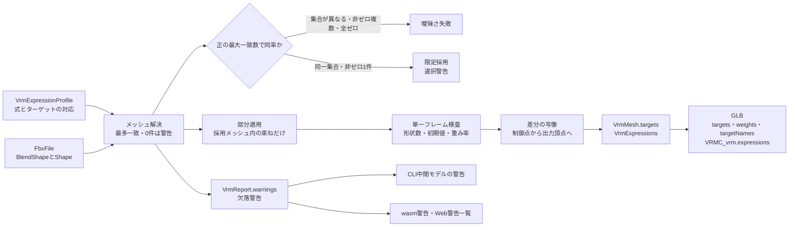

# VRM表情

## 担当責務

この文書は、FBXのブレンドシェイプからVRM 1.0の表情（`VRMC_vrm.expressions`）を作り、
物理sidecarの視線記録からVRM 1.0の視線（`VRMC_vrm.lookAt`）の測定値を求める設計を担当する。
入力プロファイルの解決、対象メッシュの決定、単一フレーム条件の検査、差分の写像、
視線の入力と測定規則、GLB出力と検証の範囲を持つ。
材質・スプリングボーン・まぶたと視線の連動・カスタム式は担当しない。

読み取りは [`FBX読み取り`](FBX読み取り.md) が担い、中間表現は [`VRM中間モデル`](VRM中間モデル.md) が持ち、
GLBへの書き出しは [`VRM書き出し`](VRM書き出し.md) が行う。この文書はそのつなぎの判断をまとめる。

## 設計概要

表情の要求が無い場合は従来どおり表情を作らず、出力も変えない。
`VrmOptions::with_expressions` でプロファイルを渡した場合だけ表情を作る。

## 入力プロファイル

`VrmExpressionProfile` は式名とターゲット名の対応列（`bindings`）である。
`bindings` の順序がターゲットと式の順序になる。重複するターゲットは1つにまとめる。

VRCプロファイル（`VrmExpressionProfile::vrchat`）はSoulFlame出力のチャンネル名を固定で結ぶ。

| 式 | ターゲット |
|---|---|
| `aa` | `vrc.v_aa` |
| `ih` | `vrc.v_ih` |
| `ou` | `vrc.v_ou` |
| `ee` | `vrc.v_e` |
| `oh` | `vrc.v_oh` |
| `blink` | `vrc.blink` |
| `lookUp` | `vrc.looking_up` |
| `lookDown` | `vrc.looking_down` |

CLIでは `vrctom export ... --expressions vrc` でこの8種類の対応から見つかったものを生成する。`--prefab` なしで `--expressions` 未指定の場合は表情を作らない。`--prefab` 指定時はdescriptor由来の既定生成になる（`--no-expressions` で止める）。
8種類は束ねの指定であり、見つかる分だけを適用して欠落は警告に残す。
出力するターゲットは後述の絞り込みで残った互換形状すべてになる（Milfy実測では57件）。
カスタムプロファイルも同じ部分適用の規則であり、VRC専用の分岐は無い。

## descriptorからの既定生成

`--prefab` 指定時はPrefab内の `VRCAvatarDescriptor` から既定の対応を作る。
識別は `lipSync` 欄に加え、`VisemeBlendShapes`・`VisemeSkinnedMesh`・
`customEyeLookSettings` のいずれかを伴う `MonoBehaviour` 文書であり、
別スクリプトの同名欄を誤認しない。参照実装（SoulFlame VRM Exporter 0.6.9）が
descriptorから既定生成する表情と同じにする。対象は口とまぶたの束ねの生成までであり、
ベースライン焼き込み・複数メッシュ束ね・法線デルタ・
カスタム式・override・ARKitは対象外である。

- 対応表：SDKのviseme順は `sil, PP, FF, TH, DD, kk, CH, SS, nn, RR, aa, E, ih, oh, ou` であり、
  VRM式への対応は `aa=10, ih=12, ou=14, ee=11("E"), oh=13`（SDK索引）である。
  式の順序は `aa, ih, ou, ee, oh, blink, lookUp, lookDown` になる。
- 口の分岐：LipSync=3（VisemeBlendShape）はviseme名から `aa/ih/ou/ee/oh` の5件、
  LipSync=2（JawFlapBlendShape）は `MouthOpenBlendShapeName` から `aa` の1件を作る。
  不足分（短い列・空名・メッシュに無い名）はその式だけ警告して落とし、残りを作る。
  LipSync=1（JawFlapBone）・4（VisemeParameterOnly）・0（Default）は候補を作らず理由を警告する。
- まぶたの分岐：`eyelidType=2`（Blendshapes）かつ `enableEyeLook` が有効の場合だけ `blink`（索引0）を作る。
  `lookUp`・`lookDown`（索引1・2）はさらにhumanoidとして左右Eyeが解決できる場合だけ作る。
  目条件はdescriptorの `leftEye`・`rightEye` ではなく、`.fbx.meta` の対応表と共有するhumanoid解決で判定する。
  `eyelidType` が0（None）・1（Bones）の場合やeyeLook無効時は作らず警告する。
- `eyelidsBlendshapes` は16進バイト列（リトルエンディアンi32×3）を文書の生本文から読む。
  読むのは `customEyeLookSettings` ブロックの直接の子だけであり、
  コメント・block scalarの内容・別mapping・ネスト先の同名キーは拾わない。
  引用符付きキー（`"customEyeLookSettings"` など）もキーとして扱う。
  YAMLの数値解決では先頭ゼロが落ち桁が変わるため、生本文を優先し、
  無い・空・曖昧・フロー形式の場合だけ `Value::Sequence`・`String`・bignumの順に読む
  （フロー形式では先頭ゼロを保証しない）。
  `-1` は未設定としてその式だけ落とし、範囲外・空名も同じく落として警告する。
- renderer解決：FBXの `models()` から取り込みID表（メッシュID・描画設定ID）を作り、
  Prefab内のstripped文書と直接記述の `SkinnedMeshRenderer` を張る。
  出所を検証し、stripped文書はclassID 137（SkinnedMeshRenderer）であり、
  対応元GUIDが入力FBXと一致し、所属の `m_PrefabInstance` が外部GUIDを持たない
  ローカル参照で入力FBXへの文書と一致する場合だけ使う。直接記述はメッシュ参照の
  GUIDが入力FBXと一致する場合だけ使う。同じfileIDが異なるメッシュに解決する曖昧さは
  部分成功にせず失敗する。使用する側の参照にGUIDがある（外部参照）・参照先が
  Prefabに無い（dangling）・文書はあるが入力FBXのrendererに解決できない場合も
  警告続行にせず失敗する。null・欠落だけ警告してその側の式なしで続ける。
  FBXのチャンネル順をUnity側のブレンドシェイプ索引と同一視する前提であり、
  `eyelidsBlendshapes` の索引はこの順序で名前を引く。
  visemeとeyelidの両方に実在候補があり別メッシュの場合は今回の範囲外として
  失敗する（部分成功にしない）。実在候補が無い側の別メッシュは失敗にしない。
  片方だけならそのメッシュを使う。
- 重みはすべて100（VRM束ねは1.0）、overrideはnone、`isBinary` は偽である。
- descriptorが無い場合は理由を警告して式なしで続行する。
  参照の形状不良・曖昧参照・外部参照・dangling・上限超過は失敗にする。
- 適用先メッシュの決定はヒントとして `VrmOptions::with_expression_mesh` で渡し、
  最大一致による選択をせず、単一フレーム検査など既存の解決規則は変えない。
  束ねに入れるのはメッシュに実在する名前だけであり、欠落警告は解決時に出す。

## メッシュ解決

要求ターゲット名を要求順・重複排除で `wanted` とし、各メッシュの一致数
（`wanted` に含まれる異なる名前の数。同名チャンネルが複数あっても加点しない。
完全一致だけを見て、別名・大小文字・NFKC補正は要求名に加えない）を数える。

| 条件 | 結果 |
|---|---|
| 表情指定なし／要求が空 | 表情なし、警告なし |
| 最大一致数が0 | 表情なし、要求ターゲットごとに欠落警告 |
| 最大一致数が正で該当メッシュが1件 | 採用し部分適用 |
| 最大一致数が正で該当メッシュが複数 | 同率限定規則で解消を試み、できなければ失敗する（`AmbiguousExpressionTarget`） |

- 最大一致数が正で複数ある場合は同率限定規則で解消を試みる。
  各候補の「要求名との積集合」（一致ターゲット名の集合）が異なる場合は、
  ジオメトリ名・`ObjectId`・一致数・一致した要求名を安定順（FBXのメッシュ順）で
  診断に挙げて失敗する。名前の重複排除で隠さない。
- 集合が同じ場合だけ、一致ターゲットの位置差分を調べる。
  参照名の重複・単一フレーム条件・初期値・重み率の検査を先に行い、
  `shape_data` を読む。不正・非対応・デコード失敗は「空」扱いにせず
  既存の対応エラーを返す。所有モデル名・頂点数・FBX順・`ObjectId` を
  採用根拠にせず、次点メッシュへの移行もしない。
- 非ゼロ差分を持つ候補がちょうど1件で、他候補の一致ターゲットがすべてゼロの
  場合だけ、その1件を採用する。非ゼロ候補が複数、または全候補ゼロの場合は
  失敗のままにする。非ゼロ判定は検証済みの有限な元差分で成分が `0.0` と
  異なるかであり、`-0.0` はゼロ、許容誤差は使わない。
  非有限の差分は既存どおり構造破損として失敗する。
- 判定用の形状データは使い終わったら解放し、採用候補は通常の全保持
  チャンネル検査へ進める。`max_morph_targets`・`max_morph_bytes` の検査は緩めない。
- 同じターゲット名が採用メッシュ内に重複する場合は失敗する。
- 対象メッシュに所有モデルが無い場合は失敗する。後段の変換で束ねが宙に浮くためである。
- 最多候補が不正だからといって次点へ移ることはしない。
  「存在しない」だけを緩和し、「存在するが解釈できない」は広げない。

メッシュ名の扱いに注意する。`VrmMesh.name` はジオメトリ名であり、所有モデル名とは限らない。
実データではジオメトリ名が `Plane.001`、所有モデル名が `Body` である。
`Body` をメッシュ名として期待しない。
またUnityのターゲット索引をコピーしない。ターゲット索引は解決順で付け直す。
束ねの索引は名前で解決し直す。重複名は失敗、欠落は警告である。

## 同率採用の警告

同率限定規則で採用した場合は、欠落警告の前に選択警告を1件出す。
文面は採用メッシュと他候補の識別情報（ジオメトリ名・`ObjectId`）と
他候補の一致ターゲットがすべて位置差分ゼロである旨を含む。
警告順は選択警告の後に欠落警告（要求順）を置く。

## 欠落時の扱い

採用後は採用メッシュに存在するターゲットの束ねだけを元の順序で残す。
欠落判定は採用メッシュ内であり、他メッシュにあるだけなら未適用として警告する。
欠落警告は重複排除した要求ターゲットごとに1件、要求順に出す。
警告文は名前と未適用であること、採用メッシュの識別情報（ジオメトリ名・`ObjectId`）を含む。
一致数0件でも同じ規則で全要求を警告し、追加の集約警告は重ねない。
`VrmReport.warnings` に載せ、`ResolvedPlan` 内だけに入れない。
一致数0件の `None` でも警告を返す。

`expression_count` は適用できた束ねの数（生成式数）と一致させる。
`build_expressions` の未解決束ねの検出は `InvalidStructure` のまま残し、
部分適用は解決段階で完結させる。

## 警告経路

- `VrmModel::from_fbx` の利用者すべてに `VrmReport.warnings` で届く。
  `BuiltModel.report`・`convert_fbx` の戻り値で伝わる。
- CLIは通常経路と特殊経路の両方で、モデル生成成功直後に見出し
  `中間モデルの警告:` で表示する。各警告は可視エスケープする。
  表示順はバインド代替の報告 → モデル生成の警告 → 既存のhumanoid・物理等の診断 →
  材質警告 → 成功要約である。書き出しより前に出し、後段で失敗しても残す。
  共通の表示関数を両経路から呼ぶ。
- wasmは既存の `Report.warnings` に統合し、JSONスキーマは変えない。
  順序は既存の材質警告・灰色出力警告 → モデル生成警告 → humanoid対応付け警告である。
- Webは既存の警告一覧へ表示するだけであり、新たな通知経路は作らない。
  `web/src/worker.ts` のオプションJSON形は不変である。
- `MissingExpressionTarget` の公開エラー種別は削除しない。新しい警告型・strictモード・
  コールバックは作らない。

## 互換形状の絞り込み

対象メッシュの選定後、そのメッシュのチャンネルをFBX順に絞る。残すのは次のいずれかに
当てはまる場合だけであり、参照実装（SoulFlame VRM Exporter）の `PruneBlendShapes` と同値である。

1. 表情の束ねがそのチャンネル名を参照している。
2. 名前が `vrc.` で始まる（大文字小文字を無視する）。
3. 名前がMMD標準フェイシャルモーフ名に一致する（NFKC正規化後に比較する。
   半角カタカナ（`ｳｨﾝｸ２右`→`ウィンク２右`・`ｷﾘｯ`→`キリッ`）や全角数字の表記揺れも一致する）。

体形スライダのようなその他の名前は落ちる。

実装しない範囲として文書に残す。

- ARKit名は残さない。参照実装は顔追跡を書くプリセットのときだけ残すが、
  ここでは顔追跡を書かないため対象外である。
- descriptor経路では束ねが参照するdescriptor名（viseme名・まぶた形状名）は残る。
  絞り込みの保持条件に束ね参照が含まれるためである。
  束ねないviseme名は `vrc.`・MMD規則で残るか落ちる。
  参照実装はdescriptor名をすべて残すが、今回は束ね参照以外は未対応である。

Milfy実測ではFBXの667チャンネルが57件に絞られる。

## 単一フレーム条件

残したチャンネルは次の単一フレーム条件を満たす場合だけ使う。

- 接続する形状が1件である。複数形状は失敗する。
- `DeformPercent` が有限かつゼロである。非ゼロ・非有限・欠落は失敗する。
  判定には微小な誤差の許容（`1e-6`）を使う。
- `FullWeights` が無い場合は検査しない。ある場合は全要素が有限かつ100である。
  1件でも外れる場合は失敗する。配列長は制約しない。

落ちたチャンネルは検査しない。他アバターの未使用チャンネルを壊さないためである。

## 差分の写像

FBXの形状は `Vertices` の差分と `Indexes` の制御点番号を持つ。
差分は出力頂点から制御点への対応表で全出力頂点へ配る。
UVや法線の継ぎ目で複製された頂点すべてに同じ差分が載る。

差分の変換はバインド行列の線形部分だけを掛け、平行移動は掛けない。
対象は位置の差分（POSITION）だけであり、法線の差分（NORMAL）は対象外である。

差分は出力前にf32へ寄せ、非有限は破損として失敗する。
ターゲットの長さは出力頂点数と同じにし、影響の無い頂点はゼロにする。

## 中間表現

- `VrmMesh.targets: Vec<VrmMorphTarget>` は名前と出力頂点ごとの位置差分を持つ。
  順序はFBXのチャンネル順であり、表情の要求が無い場合は空である。
- `VrmModel.expressions: VrmExpressions` はプリセット式の列（`preset`）を持つ。
- 束ね（`VrmMorphTargetBind`）は中間メッシュ索引・メッシュ内ターゲット索引・重みを持つ。
- 上書き指定（`VrmExpressionOverride`）は `None`・`Block`・`Blend` を持ち、
  JSONでは `none`・`block`・`blend` と書く。現在の生成ではすべて `none` である。

上限は `VrmOptions` が持つ。

| 上限 | 既定 | 扱い |
|---|---|---|
| `max_morph_targets` | 64 | 1メッシュのターゲット数。要求数と変換結果の両方で検査する |
| `max_morph_bytes` | 512MiB | モーフ全体のバイト数（件数×出力頂点の上限であるcorner数×12）。差分確保前に検査し、変換後に実数で再検査する |

重みの上限変更は `with_max_morph_targets`・`with_max_morph_bytes` で行う。

## GLB出力

- 各プリミティブの `targets` に位置差分のアクセサ（POSITION）を載せる。
  全プリミティブが同じ順序で同じアクセサを参照する。NORMALは書かない。
- メッシュの `weights` にターゲット数と同じ長さのゼロ列を書く。
  初期値はここに任せ、`node.weights` は書かない。
- メッシュの `extras.targetNames` にターゲット名を書く。
  `gltf` の `extras` 機能を使う。
- `VRMC_vrm.expressions.preset` に式を書く。式ごとに `morphTargetBinds`
  （ノード索引・ターゲット索引・重み）・`isBinary`・`overrideBlink`・
  `overrideLookAt`・`overrideMouth` を持つ。現在の生成では `isBinary` は偽、
  上書きはすべて `none` である。

## 検証・失敗条件

部分適用で残った束ねについて、書き出し前に次を検証する。

- 束ねの重みは0〜1の有限値である。
- 式名はVRM 1.0のプリセット18種（`happy`・`angry`・`sad`・`relaxed`・`surprised`・
  `aa`・`ih`・`ou`・`ee`・`oh`・`blink`・`blinkLeft`・`blinkRight`・
  `lookUp`・`lookDown`・`lookLeft`・`lookRight`・`neutral`）のいずれかである。
  カスタム式は書かない。
- 束ねのメッシュ索引・ターゲット索引は範囲内である。
- ターゲットの名前は空でなく、長さは出力頂点数と一致する。
- ターゲットの位置差分は有限である。

上限の超過・構造破損は失敗として返し、panicは使わない。
モーフの上限は差分を確保する前に検査する。
失敗を残す範囲は、同率複数（集合相違・非ゼロ複数・全ゼロ）・束ね参照名の重複・
単一フレーム条件違反・所有モデルなし・上限超過・非有限差分・構造不整合である。
表情の欠落は失敗にしない。

実データ受入条件として、Wol（`Boy_Wolf_ver2.0.fbx` を `--expressions vrc`）は
終了コード0・プリセット式5件（`aa`・`ih`・`ou`・`ee`・`oh`）・
欠落警告3件（`vrc.blink`・`vrc.looking_up`・`vrc.looking_down` の順）・
GLBの式名とレポート件数の一致を満たす。
Milfy（`Milfy.fbx` を `--expressions vrc`）は終了コード0・8式・57ターゲット・
欠落警告0・GLBの式名とレポート件数の一致を満たす。
Wolの既定経路（`--expressions` なし）も引き続き成功する。
Milfy実測では8式・57ターゲット・`Body` ノード・ターゲット名一致で出力し、
Khronos Validatorで0エラー・VRM Schemaで有効である。
Unity出力との差分の突き合わせは、スパースアクセサを展開して座標回転を揃えると一致する
（平均 `~2e-8` m、最大 `~1e-5` m、不一致0）。詳細は検証レポートに譲る。

## 視線（lookAt）の入力と測定

視線の入力は物理sidecarの `lookAt`（任意）である。旧形式のsidecarには無く、
その場合は視線を扱わず `VRMC_vrm.lookAt` も書かない。

- `eyeLook` はdescriptorの `enableEyeLook` の生値である。
- `leftEyeNodeId`・`rightEyeNodeId` はdescriptorの左右の目の骨のsidecarノードID
  （`n:N`）である。未設定は空文字である。
- `eyesLookingStraight`・`Up`・`Down`・`Left`・`Right` は5姿勢の左右の回転
  （`[x, y, z, w]`、生値・正規化しない）である。`linked` が真の場合は左の値を両目に使う。

測定は参照実装（SoulFlame VRM Exporter）の式に従い、Unity空間（左手系）で行う。
中間モデルのワールド回転はVRM空間なので、既存の鏡像規則（四元数の `(x,-y,-z,w)`）で
Unity空間へ戻してから適用する。鏡像は群同型のため、往復で厳密に戻る。

- 目の親のワールド回転・5姿勢のローカル回転から、姿勢の差分を眼の親の枠で
  前方（+Z）に適用し、ヨー（+X向きが正）とピッチ（上が正）を求める。
- 上下はその方向の姿勢から、内外は左右の姿勢のうち実際にその目を振った向きの
  大きい方から取る。左目は `-X` 側が外向きである。
- 左右の平均を1方向ずつ束ねる。無効な方向（非数・0.5度を超える逆向き・90度超え）は
  その方向だけ既定の10度に戻し、それ以外は0度で止める。

骨型になるのはhumanoidの頭と左右の目がすべてある場合だけであり、
それ以外は表情型になる。骨型の範囲は次をすべて満たす場合だけ測定値を使い、
それ以外は既定（入力90度・出力10度）に戻す。

- Eye Lookが有効である。
- sidecarの目の解決先がhumanoidの左右の目と一致する。
- 5姿勢がすべて有効（有限・非ゼロ長）である。

一致しない・無効・範囲外の方向は測定せず既定に戻す。失敗時にモデルを部分更新しない。

未対応（SoulFlame独自）：まぶたの `lookUp`・`lookDown` と垂直視線の連動は扱わない。
参照実装はSoulFlameアプリ専用のextrasでまぶたを動かすが、ここでは出力しない。
瞬き式の上書きはすべて `none` のまま置く。

## 保証しないこと

- カスタム式は作らない。プリセット18種以外の式名は書き出し時に失敗する。
- 材質・テクスチャへの束ねは作らない。
- ARKit名は残さない。顔追跡を書かないためである。descriptor経路で束ねが参照する
  descriptor名は残るが、束ねないdescriptor名をすべて残すことはしない。
- 視線との連動（`overrideLookAt`）やまぶたの視線追従は扱わない。
  上書き指定は `none` のまま置く。
- 法線モーフ（NORMAL）は出力しない。
- スプリングボーン・揺れ物・アニメーションは扱わない。参照解決は [`VRMスプリング`](VRMスプリング.md) の担当であり、コンパイルと書き出しは将来の作業単位である。

## 外した選択肢

- Unityのターゲット索引をそのまま写さない。FBXの接続順とUnityの表示順は別の番号であり、
  写すと誤った対応を作る。名前で解決し、索引は付け直す。
- メッシュ名で対象を決めない。名前は実データで変わるため、最多一致のメッシュ集合で決める。
  正の最大一致数で複数ある場合は同率限定規則（一致名集合の比較と非ゼロ差分）で1件に絞り、
  絞れなければ失敗する。
- 複数フレームの合成はしない。重み曲線の解釈が増え、失敗の切り分けが難しくなる。
  まず単一フレームの経路を通し、必要になった時点で別の作業単位で扱う。
- `FullWeights` の配列長で可否を決めない。長さは実装により変わるため、
  要素がすべて100かどうかだけで判断する。
- 表情の初期値を `node.weights` に書かない。glTFの初期値はメッシュ側の `weights` で表すのが
  仕様どおりであり、ノード側に重ねると二重の初期値になる。
