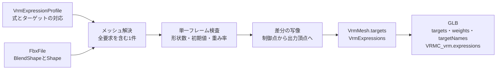

# VRM表情

## 担当責務

この文書は、FBXのブレンドシェイプからVRM 1.0の表情（`VRMC_vrm.expressions`）を作り、
物理sidecarの視線記録からVRM 1.0の視線（`VRMC_vrm.lookAt`）の測定値を求める設計を担当する。
入力プロファイルの解決、対象メッシュの決定、単一フレーム条件の検査、差分の写像、
視線の入力と測定規則、GLB出力と検証の範囲を持つ。
材質・スプリングボーン・まぶたと視線の連動・カスタム式は担当しない。

読み取りは [`FBX読み取り`](FBX読み取り.md) が担い、中間表現は [`VRM中間モデル`](VRM中間モデル.md) が持ち、
GLBへの書き出しは [`VRM書き出し`](VRM書き出し.md) が行う。この文書はそのつなぎの判断をまとめる。

## 設計概要

表情の要求が無い場合は従来どおり表情を作らず、出力も変えない。
`VrmOptions::with_expressions` でプロファイルを渡した場合だけ表情を作る。

## 入力プロファイル

`VrmExpressionProfile` は式名とターゲット名の対応列（`bindings`）である。
`bindings` の順序がターゲットと式の順序になる。重複するターゲットは1つにまとめる。

VRCプロファイル（`VrmExpressionProfile::vrchat`）はSoulFlame出力のチャンネル名を固定で結ぶ。

| 式 | ターゲット |
|---|---|
| `aa` | `vrc.v_aa` |
| `ih` | `vrc.v_ih` |
| `ou` | `vrc.v_ou` |
| `ee` | `vrc.v_e` |
| `oh` | `vrc.v_oh` |
| `blink` | `vrc.blink` |
| `lookUp` | `vrc.looking_up` |
| `lookDown` | `vrc.looking_down` |

CLIでは `vrctom export ... --expressions vrc` でこの8件を使う。未指定は表情を作らない。

## メッシュ解決

要求された全ターゲット名を含むメッシュがちょうど1つである場合だけ採用する。

- 候補が無い場合は、見つからない名前を挙げて失敗する。
  要求が複数のメッシュに散る場合も「1つのメッシュに全要求が含まれない」として失敗する。
- 候補が複数ある場合は、ジオメトリ名を挙げて失敗する。
- 同じターゲット名が1つのメッシュ内に重複する場合は失敗する。
- 対象メッシュに所有モデルが無い場合は失敗する。後段の変換で束ねが宙に浮くためである。

メッシュ名の扱いに注意する。`VrmMesh.name` はジオメトリ名であり、所有モデル名とは限らない。
実データではジオメトリ名が `Plane.001`、所有モデル名が `Body` である。
`Body` をメッシュ名として期待しない。
またUnityのターゲット索引をコピーしない。ターゲット索引は解決順で付け直す。

## 単一フレーム条件

選択したチャンネルは次の単一フレーム条件を満たす場合だけ使う。

- 接続する形状が1件である。複数形状は失敗する。
- `DeformPercent` が有限かつゼロである。非ゼロ・非有限・欠落は失敗する。
  判定には微小な誤差の許容（`1e-6`）を使う。
- `FullWeights` が無い場合は検査しない。ある場合は全要素が有限かつ100である。
  1件でも外れる場合は失敗する。配列長は制約しない。

選択していないチャンネルは検査しない。他アバターの未使用チャンネルを壊さないためである。

## 差分の写像

FBXの形状は `Vertices` の差分と `Indexes` の制御点番号を持つ。
差分は出力頂点から制御点への対応表で全出力頂点へ配る。
UVや法線の継ぎ目で複製された頂点すべてに同じ差分が載る。

差分の変換はバインド行列の線形部分だけを掛け、平行移動は掛けない。
対象は位置の差分（POSITION）だけであり、法線の差分（NORMAL）は対象外である。

差分は出力前にf32へ寄せ、非有限は破損として失敗する。
ターゲットの長さは出力頂点数と同じにし、影響の無い頂点はゼロにする。

## 中間表現

- `VrmMesh.targets: Vec<VrmMorphTarget>` は名前と出力頂点ごとの位置差分を持つ。
  順序は選択順であり、表情の要求が無い場合は空である。
- `VrmModel.expressions: VrmExpressions` はプリセット式の列（`preset`）を持つ。
- 束ね（`VrmMorphTargetBind`）は中間メッシュ索引・メッシュ内ターゲット索引・重みを持つ。
- 上書き指定（`VrmExpressionOverride`）は `None`・`Block`・`Blend` を持ち、
  JSONでは `none`・`block`・`blend` と書く。現在の生成ではすべて `none` である。

上限は `VrmOptions` が持つ。

| 上限 | 既定 | 扱い |
|---|---|---|
| `max_morph_targets` | 64 | 1メッシュのターゲット数。要求数と変換結果の両方で検査する |
| `max_morph_bytes` | 512MiB | モーフ全体のバイト数（件数×出力頂点の上限であるcorner数×12）。差分確保前に検査し、変換後に実数で再検査する |

重みの上限変更は `with_max_morph_targets`・`with_max_morph_bytes` で行う。

## GLB出力

- 各プリミティブの `targets` に位置差分のアクセサ（POSITION）を載せる。
  全プリミティブが同じ順序で同じアクセサを参照する。NORMALは書かない。
- メッシュの `weights` にターゲット数と同じ長さのゼロ列を書く。
  初期値はここに任せ、`node.weights` は書かない。
- メッシュの `extras.targetNames` にターゲット名を書く。
  `gltf` の `extras` 機能を使う。
- `VRMC_vrm.expressions.preset` に式を書く。式ごとに `morphTargetBinds`
  （ノード索引・ターゲット索引・重み）・`isBinary`・`overrideBlink`・
  `overrideLookAt`・`overrideMouth` を持つ。現在の生成では `isBinary` は偽、
  上書きはすべて `none` である。

## 検証・失敗条件

書き出し前に次を検証する。

- 束ねの重みは0〜1の有限値である。
- 式名はVRM 1.0のプリセット18種（`happy`・`angry`・`sad`・`relaxed`・`surprised`・
  `aa`・`ih`・`ou`・`ee`・`oh`・`blink`・`blinkLeft`・`blinkRight`・
  `lookUp`・`lookDown`・`lookLeft`・`lookRight`・`neutral`）のいずれかである。
  カスタム式は書かない。
- 束ねのメッシュ索引・ターゲット索引は範囲内である。
- ターゲットの名前は空でなく、長さは出力頂点数と一致する。
- ターゲットの位置差分は有限である。

上限の超過・構造破損は失敗として返し、panicは使わない。
モーフの上限は差分を確保する前に検査する。

実データでの確認として、8プリセット・`Body` ノード・ターゲット名一致で出力し、
Khronos Validatorで0エラー・VRM Schemaで有効である。
Unity出力との差分の突き合わせは、スパースアクセサを展開して座標回転を揃えると一致する
（平均 `~2e-8` m、最大 `~1e-5` m、不一致0）。詳細は検証レポートに譲る。

## 視線（lookAt）の入力と測定

視線の入力は物理sidecarの `lookAt`（任意）である。旧形式のsidecarには無く、
その場合は視線を扱わず `VRMC_vrm.lookAt` も書かない。

- `eyeLook` はdescriptorの `enableEyeLook` の生値である。
- `leftEyeNodeId`・`rightEyeNodeId` はdescriptorの左右の目の骨のsidecarノードID
  （`n:N`）である。未設定は空文字である。
- `eyesLookingStraight`・`Up`・`Down`・`Left`・`Right` は5姿勢の左右の回転
  （`[x, y, z, w]`、生値・正規化しない）である。`linked` が真の場合は左の値を両目に使う。

測定は参照実装（SoulFlame VRM Exporter）の式に従い、Unity空間（左手系）で行う。
中間モデルのワールド回転はVRM空間なので、既存の鏡像規則（四元数の `(x,-y,-z,w)`）で
Unity空間へ戻してから適用する。鏡像は群同型のため、往復で厳密に戻る。

- 目の親のワールド回転・5姿勢のローカル回転から、姿勢の差分を眼の親の枠で
  前方（+Z）に適用し、ヨー（+X向きが正）とピッチ（上が正）を求める。
- 上下はその方向の姿勢から、内外は左右の姿勢のうち実際にその目を振った向きの
  大きい方から取る。左目は `-X` 側が外向きである。
- 左右の平均を1方向ずつ束ねる。無効な方向（非数・0.5度を超える逆向き・90度超え）は
  その方向だけ既定の10度に戻し、それ以外は0度で止める。

骨型になるのはhumanoidの頭と左右の目がすべてある場合だけであり、
それ以外は表情型になる。骨型の範囲は次をすべて満たす場合だけ測定値を使い、
それ以外は既定（入力90度・出力10度）に戻す。

- Eye Lookが有効である。
- sidecarの目の解決先がhumanoidの左右の目と一致する。
- 5姿勢がすべて有効（有限・非ゼロ長）である。

一致しない・無効・範囲外の方向は測定せず既定に戻す。失敗時にモデルを部分更新しない。

未対応（SoulFlame独自）：まぶたの `lookUp`・`lookDown` と垂直視線の連動は扱わない。
参照実装はSoulFlameアプリ専用のextrasでまぶたを動かすが、ここでは出力しない。
瞬き式の上書きはすべて `none` のまま置く。

## 保証しないこと

- カスタム式は作らない。プリセット18種以外の式名は書き出し時に失敗する。
- 材質・テクスチャへの束ねは作らない。
- 視線との連動（`overrideLookAt`）やまぶたの視線追従は扱わない。
  上書き指定は `none` のまま置く。
- 法線モーフ（NORMAL）は出力しない。
- スプリングボーン・揺れ物・アニメーションは扱わない。参照解決は [`VRMスプリング`](VRMスプリング.md) の担当であり、コンパイルと書き出しは将来の作業単位である。

## 外した選択肢

- Unityのターゲット索引をそのまま写さない。FBXの接続順とUnityの表示順は別の番号であり、
  写すと誤った対応を作る。名前で解決し、索引は付け直す。
- メッシュ名で対象を決めない。名前は実データで変わるため、全要求を含むメッシュ集合で決める。
- 複数フレームの合成はしない。重み曲線の解釈が増え、失敗の切り分けが難しくなる。
  まず単一フレームの経路を通し、必要になった時点で別の作業単位で扱う。
- `FullWeights` の配列長で可否を決めない。長さは実装により変わるため、
  要素がすべて100かどうかだけで判断する。
- 表情の初期値を `node.weights` に書かない。glTFの初期値はメッシュ側の `weights` で表すのが
  仕様どおりであり、ノード側に重ねると二重の初期値になる。
