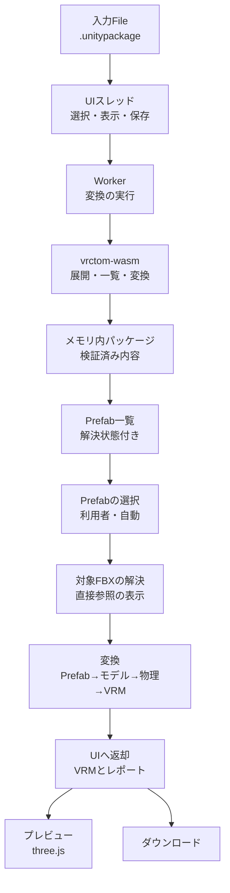
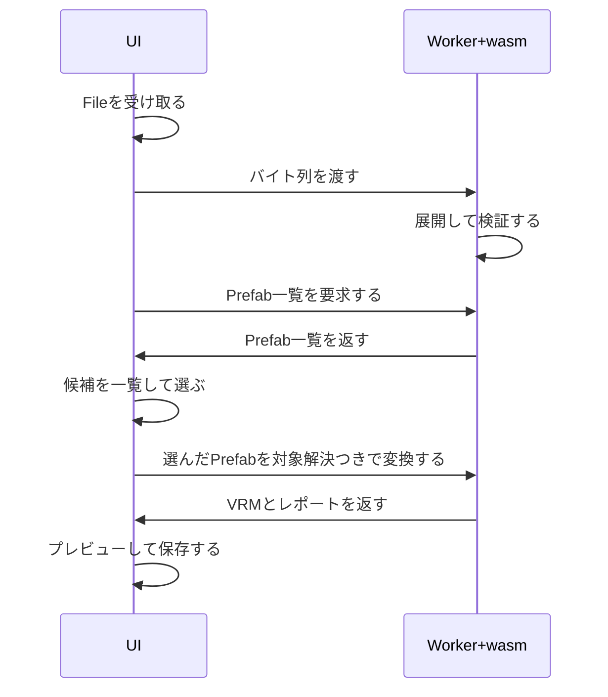

# Webアプリ

## 担当責務

この文書は、`.unitypackage` からVRMへの対話的変換をブラウザ内で完結させる
Webアプリの設計を担当する。入力の受付、変換の実行、three.jsによるプレビュー、
VRMのダウンロードまでを受け持ち、サーバへの送信や永続保存は行わない。
変換の正しさ自体は [`変換処理`](変換処理.md)、
展開は [`UnityPackage展開`](UnityPackage展開.md)、
材質は [`VRM材質`](VRM材質.md) に譲り、
ここでは責務の配置と境界だけを決める。

## 設計概要

入力は `.unitypackage` のみとし、ブラウザ内で完結する。
Fileとして受け取ったバイト列をWorker内のwasmへ渡し、
展開・Prefab一覧・選択・対象FBX解決・変換・プレビュー・ダウンロードの順に進める。

## 利用フロー

- 入力Fileを受け取り、ArrayBufferとしてWorkerへ渡す。
- Worker内のwasmがパッケージを検証し、Prefab一覧（`prefabTargets`）を返す。
- Prefabごとの解決状態は次のいずれかである。
  判定は型付き参照だけを使い、GUID文字列の部分一致検索はしない。

  | 状態 | 意味 |
  |---|---|
  | `resolved` | 直接FBXがちょうど1種あり、変換対象にできる |
  | `unsupportedMultipleFbx` | 直接FBXが2種以上あり、先勝ちにしない |
  | `requiresPrefabResolution` | 直接FBXが無く、ネストPrefabの解決が必要である（今回未対応） |
  | `unresolved` | 直接FBXが無く、参照先が索引に無いなどの未解決参照がある |
  | `noModel` | 直接FBXもネストPrefabも無い |
  | `unreadable` | Prefab自体を読めなかった記録であり、候補数に含めない |

  解決は `PrefabInstance.m_SourcePrefab` と `SkinnedMeshRenderer.m_Mesh` の
  GUIDを索引で解決する。`MonoBehaviour.m_Script` の外部GUID
  （VRCSDK・Unity内蔵）はFBX解決に使わず、未解決にも数えない。
- `resolved` が1件だけなら自動で選び、複数ならパス順の一覧から利用者が選ぶ。
  `resolved` が0件なら変換に進めず止まる。
- 選んだPrefabが直接参照するFBXを表示し、そのFBXを変換する。
  作品名（空なら解決したFBXのstem）・作者（空ならunknown）・
  descriptor表情（既定で作る）・基準姿勢（既定で焼く）・
  物理（既定で対象Prefabから導出）を設定して変換し、VRMとレポートをUIへ返す。
- プレビューで見た目を確かめ、利用者が保存する。

Prefabの選び方はこの文書の判断であり、推測による自動決定はしない。
複数FBXの合成・先勝ち・ネストPrefabの汎用解決はしない。
物理の導出・適用の中身は [`VRMスプリング`](VRMスプリング.md) に譲り、
ここでは選択と失敗時の扱いだけを決める。
詳しい境界は [`変換処理`](変換処理.md) に譲る。
旧FBX入口（`fbxCandidates`・`prefabCandidates`・`convert`）は互換のため残るが、
Web UIは使わない。

## メモリ内パッケージ方式

Web初版の変換経路はメモリ内パッケージ方式とし、
OPFSや `workspace` を使わない。
入力FileはどのみちArrayBufferでメモリに載り、
材質読取もバイトマップを必要とするため、
OPFSへの退避と再読込ではピークメモリ削減を保証できない。
退避を増やすだけでは安全にならず、経路が複雑になるためである。

展開のtar走査・種別検査・上限・対応付け・パスと衝突の検証・計画は
ターゲット非依存の共通核へ切り出す。
退避先だけをnative（tempfile）とweb（メモリ）で差し替える。
全件の検証が終わるまで成功したパッケージとして公開しない保証は、
どちらの退避先でも維持する。
詳しくは [`UnityPackage展開`](UnityPackage展開.md) を参照。

## Workerとwasmの境界

変換はWorkerで実行し、UIの応答を塞がない。
中断はWorkerの破棄で行い、変換側に専用の中断手順は作らない。
出力のバイト列は転送でUIへ渡し、複写を増やさない。
プレビューの読み込みは世代で識別し、古い読み込みが遅れて終わっても
現在の表示を変えず、読み込んだ場面は破棄する。
変換要求ごとに世代を進め、古い変換の結果・診断・プレビュー完了が
遅れて届いても新しい変換の表示を変えない。

wasm側は同期APIの小さな入口に絞る。
開く・Prefab一覧を挙げる・選んだPrefabを変換するの三つであり、
成功はVRMとレポート、失敗は段階・文面・対象パスで返す。
旧FBX入口（`fbxCandidates`・`prefabCandidates`・`convert`）は互換のため残るが、
Web UIは使わない。警告はレポートに含め、失敗と混同しない。
スレッド並列は使わない。

プレビューは表示・回転・ズームだけとする。
変換は共有関数 `vrctom::conversion::prefab::convert_prefab` を使い、
順序は対象解決→`.fbx.meta`（GUID・humanoid対応表・材質置換表）→
descriptor表情・基準姿勢→中間モデル→humanoid確定→物理導出・適用→
材質割当・有効状態→書き出しである。CLIの表示・終了コードはCLI側に残す。
材質割当・有効状態のうちPrefab由来の分は、Prefab入口の割当で反映する。
材質自体は [`VRM材質`](VRM材質.md) の共通経路をそのまま使い、
Web専用の簡易写像は作らない。

ネストPrefabのジオメトリは出力しない。対象のPrefabを選ぶときと、
レポート・警告にネスト先のパスを残す。物理の導出は既存処理に任せ、
ネスト参照も扱う。

物理の扱いは次のとおりである。対象Prefabから取得する（既定）か、
使わないかの二択であり、新入口では別のPrefab指定はしない。
旧FBX APIの `auto`・明示・`none` は互換のため残るが、Web UIは使わない。
新入口のレポートの `physics.selection` は `target` である。
物理の導出・適用の失敗は変換全体を失敗させる。失敗時はUIから
「物理を使わず再変換」でき、このとき他設定を保ったまま物理なしで変換し直し、
T-poseの適用と視線も省く。レポートには `physics`（使ったPrefab、選択理由、
spring・joint・collider・group件数、T-pose適用・スキップ、lookAt）を載せる。
読めなかったPrefabは診断に残し、0件扱いにしない。
読み取り上限はPrefab本文64MiB、導出の依存合計512MiBである。
詳しい導出・適用の判断は [`VRMスプリング`](VRMスプリング.md) に譲る。

## 配信

フロントは `web/` に置く Vite・TypeScript・three.js構成とし、
VRMの表示にはthree-vrmを使う。
wasm-packでweb向けのnpmパッケージを作り、Workerはモジュールとして読み込む。
同じ成果物を `@halby/vrctom-wasm` として公開できる形にし、
Webアプリはそのglueをそのまま使う。
生成物と配信物はコミットせず、CIでwasmの構築からフロントの型検査と
ビルドまでを通してPagesへ渡す。npm公開はタグを契機に別のworkflowで行う。
配信の土台の詳細はここでは決めず、構成の方針だけを保つ。

## 制限と公開判断

現行の展開上限はWeb向けの安全値ではないため、
圧縮入力・展開量・単一アセット（FBX）・画像の画素数と復号量・出力量を
別々に制限する。具体の上限値は実装パラメータとし、
代表パッケージでの時間・メモリ・配信サイズの計測に基づく初期値を置く。
公開後も計測で見直す。
OPFSの採用評価と公開条件を混同しない。
詳しくは [`ファイル扱い`](ファイル扱い.md) を参照。

## 保証しないこと

- サーバへの送信やブラウザへの永続保存はしない。
- 巨大な入力に対する時間の上限は設けない。資源上限は量だけを抑える。
- ネストPrefabのジオメトリ合成、Prefab Variantの汎用解決、複数FBXの合成はしない。
- 生成したVRMが第三者製のvalidatorをすべて通ることは保証しない。

## 外した選択肢

- OPFSへの退避方式は採らない。メモリ負荷の頂点を下げるとは限らず、
  経路と後始末が増えるだけで見合わない。
- 展開済みの配置を入力として受け付ける方式は採らない。
  Web初版の入力は `.unitypackage` のみに絞り、配置の持ち込みは扱わない。
- FBX単体入力は受け付けない。材質の置換表と `.mat` の解決に
  パッケージ全体の索引が要るためである。
- 複数FBXの合成・先勝ちはしない。対象は解決した1件に絞り、
  複数あるPrefabは選べず、利用者に別のPrefabを選び直してもらう。
- サーバ変換は行わない。ブラウザ内で完結させる要求であり、
  送信と保存の扱いを増やさない。
- Web専用の簡易材質写像は作らない。見た目の二重解釈を避けるため、
  既存の変換をそのまま使う。
