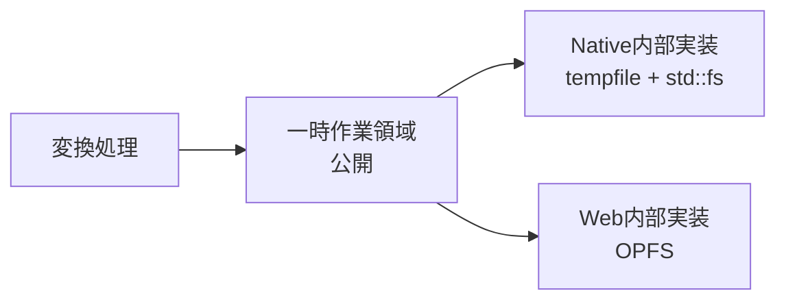

# ファイル扱い

## 担当責務

この文書は、大きい中間データの保持など一時ストレージを必要とする経路に使う
一時作業領域の設計を担当する。変換処理がNativeとWebのどちらで動く場合も、作業単位ごとに隔離された置き場を渡して、終わったら片付けることが役割になる。
UnityPackageの展開は [`UnityPackage展開`](UnityPackage展開.md) が担当し、
Web初版の変換経路はメモリ内パッケージを使うためこの作業領域を使わない。

## 設計概要

公開するのは変換用の一時作業領域という小さな具体型で、汎用ファイルシステム抽象にはしない。変換処理が必要とするのはストレージ一般の操作ではなく、作業単位ごとの隔離と後始末まで含めた一時置き場のライフサイクル管理だからだ。そのため保存先の種別や採用しているcrate、バックエンド依存のエラー型は公開契約に含めず、差し替えられる内側の話として扱う。

公開する操作はread / write / delete / listに絞り、ディレクトリ構造は扱えるようにする。パスは作業領域内の相対パスのみ受け付け、絶対パスや作業領域外への脱出がある場合はエラーを返す。システムグローバルパスやOPFSといった保存先種別は隠蔽し、変換処理側が意識しなくて済む形にする。なお、UnityPackageのNative展開は検証済み計画をユーザー指定先へ直接書き出すためworkspaceを使わず、workspaceは変換中の中間データ用という区別になる。Web初版の変換経路（[`Webアプリ`](Webアプリ.md)）はメモリ内パッケージで完結し、workspaceを使わない。一時ストレージを必要としない経路にworkspaceを持ち込まないための区別であり、公開APIの変更ではない。

作業単位ごとに領域を隔離し、正常終了だけでなく失敗やキャンセル時にも片付ける。OPFSは自動的に消える一時ストレージではないので、明示的な非同期cleanupを設計し、Dropやページ終了時の処理だけに頼らない形にする。

同期と非同期の扱いは、単一のasync操作として公開する方針で確定した。Nativeはpollしたスレッドで同期I/Oを行い、ライブラリにランタイムを持ち込まない。Webはawaitで使う。全操作は`&mut self`で直列化する。

後始末は明示的なasync `close`を必須経路とし、DropはNativeのbest effortのみに頼る。強制abort・プロセス終了・ページ破棄では削除完了を保証しない。

## バックエンド

ターゲット別に内部実装を持ち、自前の薄い作業領域層で束ねる。NativeとWebを単一crateで統一する案は採らない。

- Native（MVPはmacOS）は[`tempfile`](https://docs.rs/tempfile)の`TempDir`と`std::fs`を組み合わせる。ローカル一時領域には追加の抽象化や実行基盤がいらないため、身軽な構成にしておく。
- WebはOPFSを保存方式として採用する方針で、利用crateは[`opfs`](https://github.com/anchpop/opfs)のWeb実装を第一候補にする。ブラウザー実機での検証後に正式採用する。

Web の実装方式は配置とキャンセル保証の2点で確定した。OPFS ルート直下に共有名前空間 `vrctom-workspaces-v1` を置き、その下へ `ws-` と128bit暗号学的乱数hexの領域を作る。OPFS ルート自体は使わず、共有名前空間は空でも残す。操作全体を所有する Future を `Workspace` 内部に保持し、公開 Future の drop では実処理を失わず、次回操作または `close` で完了させてから進める。`close` は領域削除自体も保持し、削除後は有無確認で完了判定と再試行を行う。

## 外した選択肢

- OpenDALの`Operator`をそのまま抽象化層には採用しない。要求の中心は汎用ストレージ操作ではなく一時作業領域のライフサイクル管理で、`Operator`は領域の分離や一意名、後始末、失敗時の扱いを定めない。バックエンド差（capability）が変換処理側に漏れてしまう点も合わない。
- OpenDALの`fs`は今回は使わない。機能が足りないのではなく、ローカル一時領域には追加の抽象化や実行基盤（tokioなど）を持ち込む必要がないためだ。
- OpenDALでNativeとWebを統一する案も採用しない。WebのOPFS側にworkerまわりの既知問題（[apache/opendal#8318](https://github.com/apache/opendal/issues/8318)）があり、統一しても一時領域管理の仕組みは別に残る。
- `opfs` crateでNativeとWebを両方統一する案は採用しない。Nativeの一時領域要件に対して、追加依存と操作モデルを持ち込むだけの利益が見込めない。
- Webを最初から全面`web-sys`自作にするのは第一選択にしない。まず既存crateを検証して、足りないところだけを絞って作るほうが手戻りが小さい。
- Worker同期OPFS API（FileSystemSyncAccessHandle）は保留にする。大容量処理で非同期APIが不足すると実測されてから検討すれば足りる。

## 保証しないことと検証に委ねること

現時点では以下を保証しない。ブラウザー実機での検証に委ねる。

- `opfs` crateの正式採用、対応ブラウザーと最低バージョン、main threadとDedicated Workerでの動作、データサイズ上限、時間とメモリの許容範囲、チャンク処理やSyncAccessHandleの要否
- atomic置換、永続復旧、部分更新、seek

異常終了後に残った残骸の回収は、他ジョブを消さない方式を別途決める。

## Web採用の確定条件

`opfs` crateをWeb限定で正式採用するかどうかは、対象ブラウザーと実行コンテキスト（main thread / Dedicated Worker）で同じ操作列を動かして決める。個別のテスト内容はここには書かない。

- 正当性と性能のどちらも許容を満たす場合は正式採用する
- crate固有の局所的な問題に留まる場合は最小再現を作り、上流修正か限定的な`web-sys`実装で対応する。全面forkはしない
- 大容量時のみ許容を満たさない場合はチャンク処理を先に検証し、それでも足りなければWorker同期APIを再設計対象にする
- ブラウザー機能や保存容量制限（quota）自体が足りない場合はcrate交換では解決しないので、対応環境やサイズ上限、Web提供範囲を再判断する

この採用評価と [`Webアプリ`](Webアプリ.md) の公開条件は混同しない。
Web初版はメモリ内パッケージでworkspaceもOPFSも使わないため、
OPFSの可否はWeb初版の公開を塞がない。
