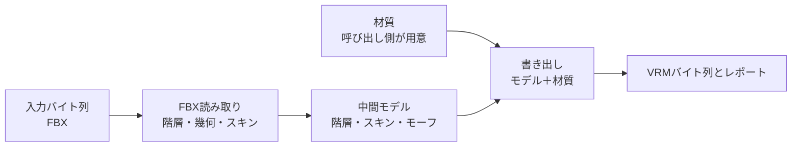

# 変換処理

## 担当責務

この文書は、CLIとWebが共有する基本変換の入口の設計を担当する。
FBX解析から中間モデルの生成を経てVRM書き出しに至る純粋な経路だけを受け持ち、
レポート付きで結果を返す。
CLI固有の配置・表示・終了コードや、Prefab由来の材質割当・レンダラsidecarを
使う特殊経路は含めない。物理の導出・適用はCLIとWebが同じ入口を使う。

## 設計概要

入口は入力バイト列（FBX）と、呼び出し側が用意した材質・書き出し設定を受け、
VRMバイト列とレポートを返すだけに絞る。
材質の読み取りは呼び出し側の責務であり、共有入口では行わない。
ファイル配置の解決、標準エラーへの表示、終了コードの決定は呼び出し側に残す。
材質の読み取り自体は [`VRM材質`](VRM材質.md) の `AssetSource` 越しの判断に従い、
nativeとwebで同じ読み取りを通す。
FBXの読み方は [`FBX読み取り`](FBX読み取り.md)、
中間の作り方は [`VRM中間モデル`](VRM中間モデル.md)、
書き方は [`VRM書き出し`](VRM書き出し.md) に譲る。

## 境界

- 共有するのは基本変換経路（FBX解析・モデル構築・VRM書き出し・レポート）と、
  物理sidecarの導出・適用（`derive_physics_sidecar_with`・`apply_physics_sidecar`、
  解決→T-pose→lookAt→スプリング生成の順序）である。CLIは `FsAssetSource`、
  Webはメモリ内パッケージを `AssetSource` 越しに渡し、中身はfsに触れない
  共通本体を使う。
- CLIの特殊経路のうち材質割当・レンダラsidecarの導出と適用は
  当面既存APIを使う形に残し、共有入口には入れない。
- 呼び出し側ごとの差（出力先の決定・表示・終了コード・FBX選択の対話）は
  共有入口の外に置く。WebのFBX選択は [`Webアプリ`](Webアプリ.md) に譲る。
- 汎用コールバックやプラグイン機構は作らない。
  現時点で差し込む相手が特殊経路しかなく、抽象の維持費が見合わない。
- 物理の有無は呼び出し側の指定が決める。Webの選択規則（`auto`・明示・`none`・
  0件警告・失敗時の扱い）は [`Webアプリ`](Webアプリ.md) に譲る。

## 保証しないこと

- Prefab由来の材質割当・有効状態の再現と、Prefab Variantの汎用解決は、
  この入口では保証しない。材質割当・レンダラsidecar経路は共有化していない。
- エラーの文言や `source` の具体型は契約にしない。
- 巨大な入力に対する時間の上限は設けない。資源上限は量だけを抑える。

## 外した選択肢

- CLI全体の移設はしない。配置・表示・終了コードまで移すと
  Web側に不要な責務を持ち込むため、純粋な経路だけを切り出す。
- Prefab・レンダラsidecar経路の共有化は今はしない。
  物理の導出・適用は共有済みであり、材質割当・レンダラsidecarは
  対応が要る時点で見直す。
- 汎用コールバック・プラグイン機構は作らない。
  差し込みの相手が定まらない抽象は、呼び出し側の分岐で足りる。
