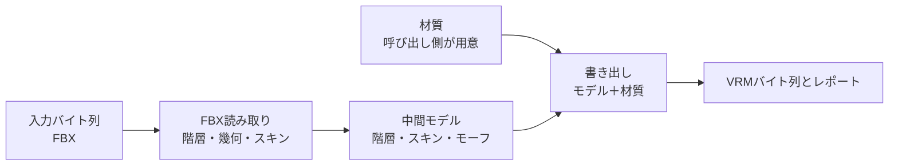
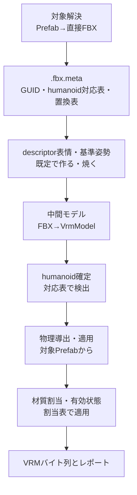

# 変換処理

## 担当責務

この文書は、CLIとWebが共有する基本変換の入口の設計を担当する。
FBX入口（FBX解析から中間モデルの生成を経てVRM書き出しに至る純粋な経路）と、
Prefab入口（`vrctom::conversion::prefab::convert_prefab`）だけを受け持ち、
レポート付きで結果を返す。
CLI固有の配置・表示・終了コードや、レンダラsidecarを
使う特殊経路は含めない。物理の導出・適用はCLIとWebが同じ入口を使う。
Prefab入口の共有本体はWebが使い、CLIの既存 `--prefab` 経路は
同じ順序の実装だがまだ共有関数を使っていない。

## 設計概要

入口は入力バイト列（FBX）と、呼び出し側が用意した材質・書き出し設定を受け、
VRMバイト列とレポートを返すだけに絞る。
材質の読み取りは呼び出し側の責務であり、共有入口では行わない。
ファイル配置の解決、標準エラーへの表示、終了コードの決定は呼び出し側に残す。
材質の読み取り自体は [`VRM材質`](VRM材質.md) の `AssetSource` 越しの判断に従い、
nativeとwebで同じ読み取りを通す。
FBXの読み方は [`FBX読み取り`](FBX読み取り.md)、
中間の作り方は [`VRM中間モデル`](VRM中間モデル.md)、
書き方は [`VRM書き出し`](VRM書き出し.md) に譲る。

## Prefab入口

Prefab入口は `convert_prefab` が担う。対象解決から書き出しまでを
固定順序で通し、呼び出し側は `AssetSource` と `AssetIndex` を渡すだけで
ファイルシステムに触れない。

- 順序は対象解決→`.fbx.meta`→descriptor表情・基準姿勢→中間モデル→
  humanoid確定→物理導出・適用→材質割当・有効状態→書き出しである。
  表情と基準姿勢の解決は中間モデル生成より前に済ませ、
  humanoid確定は物理の補助ノード追加より前に済ませる。
- 境界は `AssetSource` と `AssetIndex` 越しであり、中身はfsに触れない
  共通本体を使う。Prefab本文・FBX・`.mat`・テクスチャはすべてこの越しに読む。
- レポートは対象Prefab・対象FBX・ネストPrefab・件数（ノード・メッシュ・
  スキン・材質・画像・表情）・割当方式（改変内容・直接記述・なし）・
  有効メッシュと除外メッシュ・材質プール・基準姿勢・表情・
  物理（`selection` は `target`）を持つ。
  ネストPrefabはジオメトリを出さず、パスをレポートと警告に残す。
- 失敗は段階ごとに分け、対象パスとともに返す。
  `prefab`（対象解決・本文読み取り・表情・基準姿勢の解決）・
  `model`（FBX解析・中間モデル生成）・`physics`（導出・適用）・
  `material`（材質読み取り）・`assignment`（割当の解決・適用）・
  `export`（VRM書き出し）である。
- 実測として、実fixture `Milfy.unitypackage` の `Milfy.prefab`
  （`Milfy.fbx` を直接参照し、`KumaPhone.prefab` をネスト）は
  Webの新入口で変換でき、CLIと意味的に一致した
  （ノード287・メッシュ26・材質5・画像17・表情8・
  基準姿勢1メッシュ/2Shape・物理45/148/12/4）。

## 境界

- 共有するのは基本変換経路（FBX解析・モデル構築・VRM書き出し・レポート）と、
  物理sidecarの導出・適用（`derive_physics_sidecar_with`・`apply_physics_sidecar`、
  解決→T-pose→lookAt→スプリング生成の順序）と、
  Prefab入口の共有本体（`convert_prefab`、上記の固定順序）である。
  CLIは `FsAssetSource`、Webはメモリ内パッケージを `AssetSource` 越しに渡し、
  中身はfsに触れない共通本体を使う。
  ただしCLIの既存 `--prefab` 経路はまだ共有関数を使っておらず、
  同じ順序の別実装である。移設は今後の課題として残す。
- レンダラsidecarの導出と適用は当面既存APIを使う形に残し、共有入口には入れない。
  Prefab経路は共有済みであり、レンダラsidecarは引き続き共有外である。
- 呼び出し側ごとの差（出力先の決定・表示・終了コード・Prefab選択の対話）は
  共有入口の外に置く。WebのPrefab選択は [`Webアプリ`](Webアプリ.md) に譲る。
- 汎用コールバックやプラグイン機構は作らない。
  現時点で差し込む相手が特殊経路しかなく、抽象の維持費が見合わない。
- 物理の有無は呼び出し側の指定が決める。Webの新入口は対象Prefabから
  取得するかしないかの二択であり、旧FBX APIの選択規則（`auto`・明示・`none`・
  0件警告・失敗時の扱い）は [`Webアプリ`](Webアプリ.md) に譲る。

## 保証しないこと

- レンダラsidecar経路の共有化と、Prefab Variantの汎用解決は、
  この入口では保証しない。
- エラーの文言や `source` の具体型は契約にしない。
- 巨大な入力に対する時間の上限は設けない。資源上限は量だけを抑える。

## 外した選択肢

- CLI全体の移設はしない。配置・表示・終了コードまで移すと
  Web側に不要な責務を持ち込むため、純粋な経路だけを切り出す。
- CLIの既存 `--prefab` 経路の共有関数への移設は今回の範囲外とし、
  今後の課題に残す。
- レンダラsidecar経路の共有化は今はしない。
  Prefab経路は共有済みであり、レンダラsidecarは
  対応が要る時点で見直す。
- 汎用コールバック・プラグイン機構は作らない。
  差し込みの相手が定まらない抽象は、呼び出し側の分岐で足りる。
